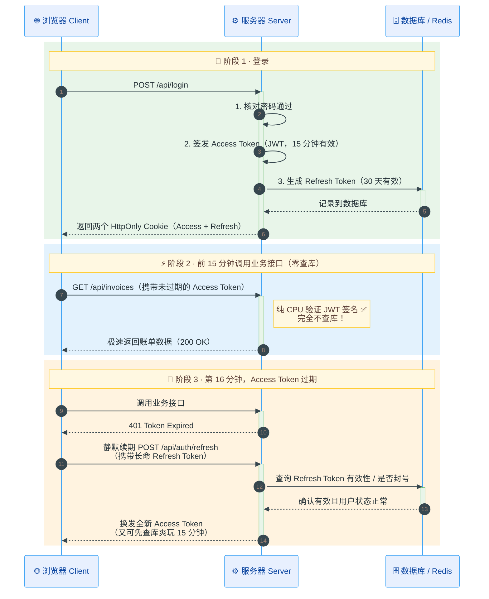

## API 相关概念详解

你列出的这 8 个词（认证、授权、校验、错误、状态码、CORS、CSRF、限流），表面上看是一堆零散的安全与工程概念，但在实际的服务器处理流程中，它们其实是一条**严格按先后顺序排列的“安检流水线（Request Pipeline）”**。

要想不死记硬背，最好的办法就是**按照一个 HTTP 请求进入服务器后的真实闯关顺序**来拆解。

### 1. 全局蓝图：生产级 API 的“五道安检门”

当一封来自不可信网络（浏览器或黑客脚本）的 HTTP 请求信到达你的 `route.ts` 时，在真正触碰数据库之前，它必须依次闯过以下五道关卡。**任何一关通不过，就会立刻触发对应的【错误响应】与【HTTP 状态码】并被直接拦截退回：**

```
[ 外部 HTTP 请求 ] (可能来自正常用户、恶意第三方网站、或自动化攻击脚本)
        │
        ▼
【第 1 关：来源与流量控制】 ── 拦截恶意跨域与洪水攻击
  ├── CORS (跨域资源共享)     → 检查：这个请求是从允许的前端域名发来的吗？
  ├── CSRF (跨站请求伪造防御) → 检查：是用户本人在我们的页面点的，还是被钓鱼网站冒充的？
  └── Rate Limiting (限流)    → 检查：这个 IP/用户一秒钟发了 1000 次请求吗？（不通过则返回 429）
        │
        ▼
【第 2 关：身份认证 (Authentication / AuthN)】 ── 解决“你是谁？”
  └── 检查 Cookie / Token     → 检查：这封信带合法的“身份证”了吗？（不通过则返回 401）
        │
        ▼
【第 3 关：权限授权 (Authorization / AuthZ)】 ── 解决“你能干什么？”
  └── 检查角色与资源归属      → 检查：你是张三，但你请求删除李四的账单，越权了吗？（不通过则返回 403）
        │
        ▼
【第 4 关：输入校验 (Validation)】 ── 解决“你给的数据干净、合规吗？”
  └── 检查 Body / 参数 (Zod)  → 检查：金额是负数吗？邮箱格式对吗？缺必填项吗？（不通过则返回 400 / 422）
        │
        ▼
【第 5 关：业务逻辑与数据库操作】 ── 真正执行核心业务
  └── 查库 / 写库             → 如果数据库断连或代码崩溃，捕获异常并脱敏（返回 500，绝不暴露堆栈细节）
        │
        ▼
[ 返回标准化 HTTP 响应 (状态码 200/201 + JSON) ]
```

### 2. 推荐的渐进式学习路径（分 3 个模块推进）

为了保证每一步都能在脑子里建立清晰的因果链，而不是被概念淹没，我建议我们按 **“从内到外、从高频必写到基础设施”** 的顺序分三步走：

| **阶段**                   | **主题模块**                             | **涵盖概念**                                                 | **为什么先学/后学它？**                                      |
| -------------------------- | ---------------------------------------- | ------------------------------------------------------------ | ------------------------------------------------------------ |
| **第一站（最推荐先开始）** | **契约与容错层：怎么好好说话？**         | **状态码 (Status Codes)** + **输入校验 (Validation)** + **错误处理 (Error Handling)** | 这是写任何一个生产级 `route.ts` 最基础的骨架。你得先知道“为什么 TypeScript 编译期类型防不住运行时的脏数据”，以及“出错了该返回什么状态码和 JSON 结构”。 |
| **第二站**                 | **身份与权限层：怎么认人看权？**         | **认证 (Authentication)** vs **授权 (Authorization)**        | 搞懂 `401` 和 `403` 的本质区别，理解无状态的 HTTP 是怎么靠 `Cookie/Session` 或 `JWT Token` 记住“你是谁”的，以及怎么防止“水平越权（IDOR）”。 |
| **第三站**                 | **浏览器安全与网关防御层：怎么防黑客？** | **CORS** + **CSRF** + **限流 (Rate Limiting)**               | 这三个概念强依赖对“浏览器同源策略”和“Cookie 自动携带机制”的理解。放在前两站之后学，你会瞬间明白为什么有了认证还会中 CSRF 招。 |

### 3. 你的选择：我们从哪一站出发？

按照上面的依赖关系，**我最建议我们从【第一站：状态码 + 输入校验 + 错误处理】开始**。我们可以直接拿刚才那个极简的 `app/api/invoices/route.ts` 开刀，看看如何把它从“玩具代码”一步步改造成包含参数校验、异常捕获和标准状态码的生产级接口。

你看我们是直接从**第一站**开始，还是你目前对第二站（认证 vs 授权）**或**第三站（CORS/CSRF）有更迫切的疑问想先拆解？告诉我你的选择，我们立刻展开。

---

## 3.3 服务器与客户端是如何通过 API 进行交互的？⭐⭐

当你看到 `fetch('/api/invoices')`、`GET()`、`NextResponse.json()`、`response.ok` 这些词时，如果脑子里没有一套“信件是怎么打包、怎么投递、怎么拆封”的物理画面，它们就只是一串需要死记硬背的魔法咒语。

今天我们就把 Next.js 先放一边，退后一步，用最直白的逻辑把 **API、HTTP 协议、以及那段代码里的每一步到底在干什么** 彻底拆解清楚。

---

### 3.3.1 核心逻辑骨架：为什么需要 HTTP 和 API ？

我们先解决最根本的问题：**浏览器和服务器明明是两台不同的电脑，用着不同的编程语言或环境，它们是怎么“说话”的？**

来看下面这一个过程：

1. **物理障碍 (Problem)**
   - 浏览器里的代码在用户的电脑内存中运行；数据库和后端代码在远端服务器的内存中运行。
   - 浏览器不能直接伸手去读服务器的内存变量（比如直接拿 const invoices 的值）。
2. **通信契约：HTTP 协议 (The Protocol)**
   - 两台电脑需要一套全世界通用的“信件格式标准”，规定信封怎么写、内容怎么装。这就是 HTTP。
   - 它本质上就是个“一问一答”的文本传输规矩：客户端发一封【请求信 (Request)】，服务器回一封【响应信 (Response)】。
3. **业务窗口：API 端点 (The Endpoint)**
   - 服务器很大，里面有很多功能（查账单、改密码、删用户）。
   - 服务器在门口开了不同的“**办事窗口（URL 路径）**”，每个窗口规定好“你给我什么参数，我办完事给你什么结果”——这个办事窗口就是 API。
4. **翻译语言：JSON 序列化 (Serialization)**
   - 网线里只能传纯文本（字符串）或二进制流，传不了 JavaScript 里的真实对象/数组。
   - 所以发送前必须把数据“压扁成纯文本字符串”（JSON），收到后再“还原成 JS 对象”。

---

### 3.3.2 拆解基础概念

在看代码之前，我们先认清这 4 个高频核心词到底是什么：

#### 1. 什么是 API（在这里特指 Web HTTP API）？

**字面意思**：应用程序编程接口（Application Programming Interface）。

**真实物理含义**：就是服务器对外公开的一个**网址（URL）+ 操作规矩**。

- 普通网址（如 `https://example.com/dashboard`）：是给**人**看的，服务器返回的是画好界面的 HTML 网页。
- API 网址（如 `https://example.com/api/invoices`）：**是给代码（程序）调用的，服务器不返回网页画面，只返回纯粹的业务数据（比如账单列表数据）**。

---

#### 2. 什么是 HTTP 请求（Request）与响应（Response）？

每次客户端找 API 拿数据，都严格遵循 **“一封去信（Request） + 一封回信（Response）”** 的结构。这两封信长这样：

| **信件类型**                                                | **信封表面（Headers / 元信息）**                             | **信件正文（Body / 数据主体）**                              |
| ----------------------------------------------------------- | ------------------------------------------------------------ | ------------------------------------------------------------ |
| **去信：HTTP Request**<br />（浏览器 $\rightarrow$ 服务器） | 1. **收件窗口 (URL)**：`/api/invoices` <br />2. **办事动作 (Method)**：`GET`（我要读取数据）或 `POST`（我要提交新数据） <br />3. **身份凭证 (Cookie/Token)**：证明我是哪个登录用户 | 如果是 `GET`（纯查询），正文通常是空的；如果是 `POST`（提交表单），正文里装着用户填的数据。 |
| **回信：HTTP Response**<br/>（服务器 $\rightarrow$ 浏览器） | 1. **处理结果状态码 (Status Code)**：用三位数字立刻告诉你成功还是失败（比如 `200` 成功，`404` 找不到，`500` 服务器崩了） <br />2. **内容格式说明 (Content-Type)**：`application/json`（告诉浏览器正文是 JSON 格式） | 服务器查完数据库后，打包好的纯文本数据（比如 `'[{"id": 1, "amount": 100}]'`）。 |

---

#### 3. 为什么需要 JSON（序列化与反序列化）？

这是新手最容易卡壳的地方：**为什么代码里要写 `NextResponse.json(invoices)` 和 `await response.json()`？直接传数组不行吗？**

**原因**：服务器内存里的 `invoices` 是一个真正的 JavaScript 数组对象（带有内存地址和原型链）。但**网线里只能传输字节流（字符串）**，不能把一台电脑的内存地址传给另一台电脑。

**过程**：

1. **服务端打包（序列化 Serialization）**：服务器把内存里的 JS 数组 `[ { id: 1 } ]` 转换成一段纯文本字符串 `'[{"id":1}]'`，塞进 HTTP 回信的正文里发出去。
2. **客户端拆包（反序列化 Deserialization）**：浏览器收到这串纯文本后，把它重新解析还原成浏览器内存里的 JS 数组，这样你的 React 代码才能用 `.map()` 去遍历它。

---

### 3.3.3 逐行解剖：那 7 步数据流在代码里到底干了什么？

现在我们把教程里的两段代码放在一起，像慢动作回放一样，看看一次请求从发出到显示在屏幕上，每一行代码分别对应什么物理动作：

#### 1. 客户端寄出“请求信”（对应步骤 1）

```ts
// 跑在用户的浏览器里
const response = await fetch('/api/invoices');
```

**`fetch('/api/invoices')` 干了什么？**`fetch` 是浏览器自带的“发信员”。当你调用它且不传第二个参数时，它默认帮你写了一封 **HTTP Request（去信）**：

- **动作（Method）**：默认是 `GET`（表示“我想获取数据”）。
- **地址（URL）**：自动拼上当前网站域名，发往 `http://你的网站/api/invoices`。

**为什么要写 `await`？** 因为信件通过光纤传到服务器、服务器查数据库、再传回浏览器，需要几十到几百毫秒。`await` 的意思是：“在这里暂停一下这个函数，等服务器的回信（Response）到了，再赋值给 `response` 变量往下走，同时别卡死浏览器的画面。”

---

#### 2. 服务器收信、查库、寄出“回信”（对应步骤 2 ~ 6）

当浏览器的 `GET /api/invoices` 请求到达 Next.js 服务器时：

```ts
// app/api/invoices/route.ts —— 跑在你的服务器上
import { NextResponse } from 'next/server';
import { fetchLatestInvoices } from '@/app/lib/data';

export async function GET() {
  // 步骤 4 & 5：服务器去查数据库，拿到真实的 JS 数组
  const invoices = await fetchLatestInvoices();

  // 步骤 6：打包成 HTTP 回信发给浏览器
  return NextResponse.json(invoices);
}
```

**为什么函数名叫 `export async function GET()`？** 这是 Next.js 的约定：

1. 文件路径 `app/api/invoices/route.ts` 决定了窗口地址是 `/api/invoices`。
2. 函数名 `GET` 决定了它专门接待动作是 `GET` 的请求信。（如果客户端发的是 `POST` 提交请求，Next.js 就会去找同文件里的 `export async function POST()`）。

**`NextResponse.json(invoices)` 干了什么？** 它一次性帮你干了三件脏活：

1. 把 JS 数组 `invoices` 转换成 JSON 格式的纯文本字符串（序列化）。
2. 拟好一封 **HTTP Response（回信，构造响应）**，在信封上贴上状态码 `200 OK`（代表成功），并注明内容类型是 `Content-Type: application/json`。
3. 把这封回信顺着网线发回给刚才等待的浏览器。即 `return` 后由框架发送。

---

#### 3. 客户端收信、验货、拆包、更新画面（对应步骤 7）

现在信回到了浏览器，刚才暂停的 `await fetch(...)` 拿到了信封，存进了 `response` 变量：

```ts
// 回到用户的浏览器里
if (!response.ok) {
  throw new Error('Failed to fetch invoices');
}

const data = await response.json();
setInvoices(data);
```

这里有两个极其关键的细节，很多人写了几年代码都没搞明白为什么要分两步：

1. **为什么拿到了 `response`，还要判断 `if (!response.ok)`？**
   - 当 `await fetch()` 结束时，浏览器其实**只先看了一眼“信封表面（HTTP 状态码）”**。
   - 如果服务器报错了（比如返回了 `404` 找不到接口，或者 `500` 数据库连不上），`fetch` 本身不会自动报错停止，而是把这封写着 `500` 的信交给你。
   - `response.ok` 是一个布尔值：只有当信封上的状态码是 `200 ~ 299`（代表成功）时，它才是 `true`；如果是 `400`、`404`、`500`，它就是 `false`。所以这一步是在“拆信封前先看状态码对不对”。
2. **为什么 `await response.json()` 还要再写一次 `await`？**
   - 因为拿到信封（Headers）的时候，信件里可能长达几兆的庞大正文（Body 数据流）还在顺着网线往浏览器里传输！
   - `await response.json()` 的意思是：“等信件正文全部流传输完毕，并且把里面的 JSON 纯文本解析还原成真正的 JavaScript 数组/对象后，交给我存进 `data`”。
3. **`setInvoices(data)`**：
   - 拿到真正的 JS 数组后，更新 React 的状态，React 自动把数据渲染成网页上的 DOM 元素。

---

#### 4. 一图流

把上面三段拼起来，整个传统 API 交互其实就是这样一个严丝合缝的闭环：

```
[浏览器 Client Component]                      [服务器 Route Handler]
        │                                               │
        ├─ 1. fetch('/api/invoices')                    │
        │     寄出 HTTP Request (Method: GET) ─────────>│
        │                                               ├─ 2. 匹配到 GET() 函数
        │                                               ├─ 3. await fetchLatestInvoices() 查数据库
        │                                               │     拿到 JS 数组: [{ id: 1, amount: 50 }]
        │                                               ├─ 4. NextResponse.json(invoices)
        │     收到 HTTP Response (Status: 200) <────────┤     转成字符串 '{"id":1...}' 装入回信
        ├─ 5. 检查 response.ok (状态码是否 200~299)       │
        ├─ 6. await response.json()                     │
        │     拆信封读正文，把字符串还原成 JS 数组           │
        └─ 7. setInvoices(data) 更新界面                 │
```

---

## 3.4 第一站：深入 API 生产边界：状态码 + 输入校验 + 错误处理⭐⭐

我们直接拿一个最典型的生产场景开刀：**创建一个新账单（`POST /api/invoices`）**。

之所以从 `GET`（读取）切换到 `POST`（写入），是因为只要客户端开始向服务器**提交数据**，“输入校验、错误处理、状态码”这三兄弟就会立刻在同一个接口里正面交锋。

---

### 3.4.1 核心逻辑骨架

从问题-约束-核心机制说起：

1. **问题 (Problem)**
   - 客户端发来的数据完全不可信（用户可能乱填、前端校验可能被绕过、黑客可能用脚本直接发畸形数据包）。
   - 同时，服务器查库时随时可能发生意料之外的崩溃（如断网、唯一键冲突）。
2. **约束 (Constraints)**
   - TypeScript 的类型只在“写代码和编译时”存在，代码一旦跑起来（Runtime），TS 类型就全部被擦除了。
   - 服务器绝不能把原始报错（如数据库表结构、代码行号）直接吐给客户端，否则会暴露系统弱点。
3. **核心机制 (Mechanism)**
   - 运行时校验（Schema Validation）：在代码真正执行业务前，用校验库（如 Zod）对拆包后的 JSON 做“安检”。
   - 异常分层捕获（try / catch）：区分“客户端犯的错（4xx）”与“服务器犯的错（5xx）”。 
   - 契约化响应（Status Code + Error Payload）：用 HTTP 状态码表达错误的“性质”，用 JSON Body 表达错误的“可读原因”。

---

### 3.4.2 拆解三大支柱

#### 1. 支柱一：输入校验（为什么 TypeScript 救不了你？）

很多刚学全栈的开发者会写这样的代码：

```ts
interface CreateInvoiceDTO {
  customerId: string;
  amount: number; // 我已经规定了它是 number！
}

export async function POST(request: Request) {
  // ❌ 致命错觉：以为加了 as CreateInvoiceDTO，body.amount 就真的是数字了
  const body = (await request.json()) as CreateInvoiceDTO;
  await saveToDatabase(body.customerId, body.amount);
}
```

**为什么这是错的？**

**原理**：TypeScript 在编译成 JavaScript 时，所有的 `interface` 和 `as CreateInvoiceDTO` 都会被**完全删掉**。到了服务器上真正运行的是：`const body = await request.json()`。

**后果**：如果恶意用户跳过你的网页表单，直接用命令行工具（如 `curl` 或 Postman）向你的接口发一段 `{"customerId": 12345, "amount": -999999}` 甚至 `{"amount": "drop table"}`，`await request.json()` 会照单全收！没有任何东西会拦截它，直到脏数据把你的数据库搞乱或直接引爆 SQL 报错。

> **结论**：凡是跨越 HTTP 网络边界进入服务器的数据，其类型在运行时本质上都是 `unknown`。**必须使用运行时校验工具（行业标准是 `Zod`）在内存里逐个字段验明正身。**

---

#### 2. 支柱二：HTTP 状态码（信封上的“分拣标签”）

状态码不是随便挑个数字，它决定了客户端（前端代码、浏览器缓存、监控网关）看到信封的第一眼会采取什么动作。在生产级 API 中，你只需要死死记住这 **3 个家族、6 个核心状态码**：

| **状态码家族**        | **核心代表**                    | **含义与责任归属**                                           | **客户端收到后该怎么办？**                                   |
| --------------------- | ------------------------------- | ------------------------------------------------------------ | ------------------------------------------------------------ |
| **2xx（成功）**       | **`200 OK`**                    | 请求成功（常用于 `GET` 查数据、`PUT/PATCH` 改数据）          | 直接解析 JSON 渲染画面                                       |
|                       | **`201 Created`**               | 成功在服务端**创建了新资源**（专用于 `POST` 新建数据）       | 提示“创建成功”，跳转页面或刷新列表                           |
| **4xx（客户端的锅）** | **`400 Bad Request`**           | 请求格式烂掉了（比如发来的根本不是合法 JSON，或者缺了必填字段、类型不对） | **不要原样重试**！在表单上标红提示用户修改输入               |
|                       | **`422 Unprocessable Entity`**  | JSON 格式合法，但**违反业务规则**（如：转账金额写了 `-100`，或者邮箱已被注册）*(注：很多团队也统一用 400 代替 422)* | 在具体输入框下方提示业务错误原因                             |
| **5xx（服务器的锅）** | **`500 Internal Server Error`** | 客户端没毛病，是服务器自己崩了（数据库断连、代码空指针异常） | 提示用户“系统繁忙，请稍后再试”，同时触发后端报警通知程序员修 Bug |

---

#### 3. 支柱三：错误处理与“错误脱敏”（为什么不能把 `error.message` 直接返回？）

当数据库查询报错时，原始的 `Error` 对象里往往包含这样的信息： `Error: connect ECONNREFUSED 10.0.14.88:5432 - Postgres user "admin_prod" failed at /app/src/lib/db.ts:42:15`

**如果你直接 `return NextResponse.json({ error: err.message }, { status: 500 })`**： 黑客立刻就知道了你用的是 Postgres 数据库、内网 IP 是多少、用户名叫什么、代码目录结构长什么样。

**生产级做法（内外有别）**：

- **对内（服务端日志 `console.error` / 监控系统）**：把完整的 `err`（包含堆栈、SQL 语句）原原本本打印出来，方便你自己排查。
- **对外（返回给浏览器的 HTTP 响应）**：只返回一句冷酷、礼貌、毫无细节的通用文案：`{"error": "Internal Server Error"}`，状态码标为 `500`。（错误不泄露堆栈）

---

### 3.4.3 代码对比：从“玩具代码”到“生产级 `route.ts`”

玩具级代码（一碰就碎）：

```ts
// app/api/invoices/route.ts
import { NextResponse } from 'next/server';
import { createInvoiceInDB } from '@/app/lib/data';

export async function POST(request: Request) {
  const body = await request.json(); // 隐患1：如果客户端发来的不是合法 JSON，这行直接崩溃！
  
  // 隐患2：完全没检查 body.amount 是不是正数、body.customerId 存不存在
  const newInvoice = await createInvoiceInDB(body); // 隐患3：如果数据库挂了，未捕获的异常会导致难看的崩溃

  return NextResponse.json(newInvoice); // 隐患4：默认返回 200，语义不够精准
}
```

生产级代码：

```ts
import { NextResponse } from "next/server";
import { z } from "zod";
import { createInvoiceInDB, fetchLatestInvoices } from "~/lib/data";

// 解决隐患 2：定义输入校验 Schema（校验 customerId、amount 是否合法）
const CreateInvoiceSchema = z.object({
  customerId: z.uuid({ message: "请提供合法的客户 UUID" }),
  // 支持数字或字符串转换，要求金额大于 0
  amount: z.coerce.number().positive({ message: "发票金额必须大于 0" }),
  status: z.enum(["pending", "paid"]).default("pending"),
});

export async function POST(request: Request) {
  // 解决隐患 1：捕获非法 JSON 解析异常，防止服务崩溃
  // ── 第一步：安全地拆开信封正文 (防范畸形 JSON) ──
  let rawBody: unknown;
  try {
    rawBody = await request.json();
  } catch {
    // 客户端发来的连合法的 JSON 字符串都不是 -> 400 Bad Request
    return NextResponse.json(
      { error: "请求体不是合法的 JSON 格式" },
      { status: 400 },
    );
  }

  // 解决隐患 2：Zod 结构与业务边界安全校验
  // ── 第二步：运行时数据校验 (使用 safeParse 而不是 parse，避免抛异常) ──
  const validationResult = CreateInvoiceSchema.safeParse(rawBody);

  if (!validationResult.success) {
    // 校验未通过：明确是客户端填错了数据 -> 返回 400 (或 422)，并附上具体哪个字段错了
    return NextResponse.json(
      {
        error: "参数校验失败",
        details: z.treeifyError(validationResult.error),
        // details 会生成类似: { amount: ['账单金额必须大于 0'] }，前端可以直接拿去标红表单！
      },
      { status: 400 },
    );
  }

  // 走到这里，validationResult.data 不仅在运行时 100% 安全，而且自动拥有完美的 TypeScript 类型！
  const validData = validationResult.data;

  // 解决隐患 3：捕获数据库底层执行异常（如外键不匹配、网络错误）
  try {
    // ── 第三步：执行核心业务与数据库操作 ──
    const newInvoice = await createInvoiceInDB(validData);

    // 解决隐患 4：符合 REST 规范的 201 Created 语义
    // ── 第四步：成功创建资源 -> 返回 201 Created ──
    return NextResponse.json({ data: newInvoice }, { status: 201 });
  } catch (error) {
    // ── 第五步：兜底捕获所有未预期的服务器内部异常 (如数据库连接断开) ──

    // 1. 对内：记录完整错误日志，供开发者排查
    console.error("[POST /api/invoices] 数据库或系统异常:", error);

    // 2. 对外：严格脱敏，绝不把 error.message 直接发给客户端 -> 返回 500
    return NextResponse.json(
      { error: "服务器开小差了，请稍后再试" },
      { status: 500 },
    );
  }
}

```

---

### 3.4.4 客户端如何优雅地配合这个生产级 API？

当后端把状态码和错误结构规整好之后，客户端（Client Component）里的 `fetch` 逻辑就会变得极其清晰——**看状态码行事**：

```ts
async function handleSubmit(formData: unknown) {
  const response = await fetch('/api/invoices', {
    method: 'POST',
    headers: { 'Content-Type': 'application/json' },
    body: JSON.stringify(formData), // 序列化成字符串寄出
  });

  const result = await response.json(); // 无论成功失败，后端都保证了返回的是合法 JSON

  if (!response.ok) {
    // 如果是 400：说明是用户表单填错了，把后端返回的字段错误直接显示在输入框下面
    if (response.status === 400 && result.details) {
      setFieldErrors(result.details);
      return;
    }
    // 如果是 500 或其他错误：弹一个全局提示框
    alert(result.error || '提交失败');
    return;
  }

  // response.ok 为 true (状态码 201)：大功告成！
  console.log('创建成功的新账单：', result.data);
}
```

---

### 3.4.5 最小数据返回原则（Data Minimization / DTO 裁剪）

DTO — Data Transfer Object，数据传输对象。一句话：**专门用来「跨边界传输」的对象，只装要传输的数据，不装数据库实体、不装业务逻辑**。

**DTO 就是落地最小数据返回这个规范的载体**。

> 边界 = 数据库 ↔ 服务、后端 ↔ 前端、微服务 A ↔ 微服务 B。 数据库里的叫 **Entity（实体）**；往外发出去的叫 **DTO**。

数据库 Entity（Prisma / ORM 拿到的原始对象，对应表）

```ts
// Entity：和数据库表一一对应，所有字段都在
type UserEntity = {
  id: number
  name: string
  avatar: string
  phone: string
  passwordHash: string
  idCard: string
  address: string
}
```

**UserCardDTO**：给用户列表卡片用，只传卡片需要的最小字段

```ts
// DTO：对外输出，裁剪后
type UserCardDTO = {
  id: number
  name: string
  avatar: string
}
```

流程：查数据库拿到 `UserEntity` → 手动 / 工具映射 → 转成 `UserCardDTO` → 序列化 JSON 返回给前端。

需要区分：

1. **Entity（实体）**：映射数据库表，忠实反映表结构；包含敏感字段、冗余字段；只在服务内部使用。
2. **DTO（数据传输对象）**：用于**跨进程 / 跨机器通信**；分两种方向
   - Response DTO：后端发给前端（输出，最小返回）
   - Request DTO：前端传给后端（入参，校验前端提交的数据）

---

#### 1. Request DTO

请求 DTO 的核心职责：

- 定义**客户端允许传入哪些字段**
- 作为接口契约：前端知道能发什么、TS 给后端做类型提示
- 是后端接收外部输入的第一层类型描述

比如前端发登录请求：

```ts
{ "email": "a@test.com", "password": "123456" }
```

对应的 Request DTO：

```ts
type LoginRequestDTO = {
  email: string
  password: string
}
```

作用：**约束后端接收哪些参数、做校验，拒绝多余垃圾参数**。

下面是项目里的一个完整示例：

```ts
const CreateInvoiceSchema = z.object({
  customerId: z.string().optional(),
  customer_id: z.string().optional(),
  amount: z.number(),
  status: z.enum(["pending", "paid"]).optional().default("pending"),
  date: z.string().optional(),
});

export type CreateInvoiceDTO = z.infer<typeof CreateInvoiceSchema>;

export async function createInvoiceInDB(data: CreateInvoiceDTO) {
  const dto = CreateInvoiceSchema.parse(data);

  const customerId = dto.customerId ?? dto.customer_id;
  if (!customerId) {
    throw new Error("Missing customerId");
  }

  const amountInCents = Math.round(dto.amount);
  const status = dto.status;
  const date = dto.date ?? new Date().toISOString().split("T")[0];

  try {
    const [newInvoice] = await sql<Invoice[]>`
      INSERT INTO invoices (customer_id, amount, status, date)
      VALUES (${customerId}, ${amountInCents}, ${status}, ${date})
      RETURNING id, customer_id, amount, status, date
    `;

    // 这里要再映射成 ResponseDTO，不要直接 return newInvoice
    return {
      id: newInvoice.id,
      customerId: newInvoice.customer_id,
      amount: newInvoice.amount,
      status: newInvoice.status,
      date: newInvoice.date,
    };
  } catch (error) {
    console.error("Database Error:", error);
    throw new Error("Failed to create invoice in database.");
  }
}
```

流程：HTTP Request JSON → 解析成 `CreateInvoiceDTO` → 业务清洗转换 → 入库实体（Invoice）

为什么使用 Zod 进行运行时校验？因为当 HTTP 请求过来，JSON 是普通字符串，**运行时 TS 类型直接消失**。

区分一句话：

- TypeScript type：**编译期契约**，给开发者看、IDE 提示
- Zod schema：**运行时校验契约**，真正拦截非法请求 工业界标准：先写 Zod Schema，再从 Schema 导出 TS 类型作为 Request DTO。

---

#### 2. Response DTO

在真实的数据库表（比如 `users` 或 `invoices`）中，一行记录往往包含大量**服务端内部字段**。

```ts
// 数据库里查出来的原始对象 (Database Entity)
const dbInvoice = {
  id: 'inv_123',
  amount: 5000,
  status: 'paid',
  // ❌ 下面是绝不该发给普通客户端的字段：
  internalAuditNotes: '该客户曾有欺诈嫌疑，人工审核通过', // 内部风控备注
  stripePaymentIntentSecret: 'pi_3MtwBwLkdIwHu7ix28a3tqPa_secret_...', // 支付密钥
  createdByAdminId: 'admin_99', // 内部管理员 ID
  deletedAt: null,
};
```

如果你在 `route.ts` 里直接写 `return NextResponse.json(dbInvoice)`，会发生两个灾难：

1. **安全泄密（Over-fetching / Excessive Data Exposure）**：这是 OWASP API Top 10 头号漏洞之一。前端界面虽然没展示 `internalAuditNotes`，但任何人打开浏览器开发者工具的 **Network（网络）面板**，点开这个 API 响应就能看的一清二楚。
2. **带宽浪费与耦合**：把数据库表结构直接暴露给前端，以后数据库改个字段名，前端就崩了。

**好做法**：查库时只选需要的列 + 返回前做 DTO 映射

```ts
// ✅ 第一道过滤：在数据库查询层只 SELECT 必需字段（以 Prisma / SQL 为例）
const invoice = await db.invoice.findUnique({
  where: { id },
  select: {
    id: true,
    amount: true,
    status: true,
    // 根本不从数据库里把 secret 和 internalAuditNotes 读出来
  },
});

// ✅ 第二道过滤（或使用 Zod / 显式函数做 DTO 转换）：明确构造返回给客户端的结构
return NextResponse.json({
  id: invoice.id,
  amount: invoice.amount,
  status: invoice.status,
});
```

更规范的项目会单独抽 DTO type，写映射函数。

Prisma 的 `select` 只是数据库层面裁剪；DTO 是**类型层 + 业务层的契约定义**。就算你 select 了，规范项目依然会定义 DTO，方便统一约束、文档生成。

---

### 3.4.6 状态码详解

不要把状态码当成死板的数字，它们回答的是同一个问题：**“请求处理得怎么样了？如果失败了，是谁的原因、具体卡在了哪一关？”**

#### 🟢 2xx 成功家族（注意“有正文”与“无正文”的区别）

| **状态码** | **英文名称**   | **精准语义与典型场景**                                       | **响应里有 Body（正文）吗？**                                |
| ---------- | -------------- | ------------------------------------------------------------ | ------------------------------------------------------------ |
| **`200`**  | **OK**         | 通用成功。比如 `GET` 拿到账单列表，`PATCH` 修改账单并返回更新后的对象。 | **有**（返回 JSON 数据）                                     |
| **`201`**  | **Created**    | **新建资源成功**。专用于 `POST` 创建了新的数据库记录（如新建账单、注册用户）。 | **有**（通常返回新建资源的 `id` 或完整对象）                 |
| **`204`**  | **No Content** | **执行成功，但故意不返回任何正文**。最常见于 `DELETE /api/invoices/123`（删都删了，没东西可返回）或仅保存设置无需回传数据的 `PUT`。 | **绝对没有！（0 字节）** *（如果客户端调 `.json()` 会直接炸裂，见下文）* |

#### 🟡 4xx 客户端错误家族

只要返回 4xx，意思就是：**“服务器没坏，是你客户端发来的请求有问题，别原样重试了，先改改再来！”**

| **状态码** | **英文名称**             | **对应安检关卡**   | **精准语义与易混辨析**                                       |
| ---------- | ------------------------ | ------------------ | ------------------------------------------------------------ |
| **`400`**  | **Bad Request**          | **语法/格式层**    | **信封或正文格式烂了**。比如发来的根本不是合法 JSON、URL 查询参数缺失、字段类型不对（要数字给了字符串）。 |
| **`401`**  | **Unauthorized**         | **认证关 (AuthN)** | **“我不知道你是谁（未登录/凭证无效）”**。（虽然英文叫 Unauthorized，但实际意思是 Unauthenticated）。比如没带 Token，或者 Token 过期了。客户端收到后应**跳转登录页或刷新 Token**。 |
| **`403`**  | **Forbidden**            | **授权关 (AuthZ)** | **“我知道你是张三，但你没权限干这事！”**。身份已经核实通过，但权限不足（比如普通员工调用了只有老板能用的“删除全公司账单”接口）。**跳转重新登录也没用**。 |
| **`404`**  | **Not Found**            | **资源定位层**     | **找不到目标**。两种情况：① URL 路径写错了（`/api/invvvvoices`）；② 路径对了，但查的 ID 在数据库里不存在（`/api/invoices/999999`）。*(有时为了保密，对无权访问的资源也会故意返回 404 而不是 403，防止黑客探测某 ID 是否存在)*。 |
| **`409`**  | **Conflict**             | **业务状态层**     | **请求本身合法，但与服务器当前数据状态冲突**。最典型场景：**唯一键冲突**（注册时邮箱已被占用、重复提交同一笔幂等订单号）、或者多人同时编辑同一文档导致的版本冲突。 |
| **`422`**  | **Unprocessable Entity** | **业务规则层**     | **JSON 语法完全合法，但业务语义不合法**。比如 `{"amount": -500}`（是合法的 JSON 数字，但业务规定金额不能为负）。*(注：工程中用 `400` 还是 `422` 均可，只要团队内部统一)*。 |
| **`429`**  | **Too Many Requests**    | **流量控制关**     | **触发限流（Rate Limit）**。“你点得太快了 / 请求太频繁了”。通常会配合响应头 `Retry-After: 60` 告诉客户端等 60 秒再试。 |

#### 🔴 5xx 服务端错误家族（服务器的锅）

| **状态码** | **英文名称**              | **精准语义与处理原则**                                       |
| ---------- | ------------------------- | ------------------------------------------------------------ |
| **`500`**  | **Internal Server Error** | **服务器内部崩溃**。客户端完全合规，但服务器在执行时遇到了未预期的异常（数据库挂了、第三方支付接口超时、代码写了 `null.xxx`）。客户端可以进行有限次数的延迟重试。 |
| **`501`**  | **Not Implemented**       | 服务器不支持请求所需的功能（如 PATCH 方法未实现）。**客户端不应重试**，属于服务端能力缺失，需等待服务方实现或改用其他接口。 |
| **`502`**  | **Bad Gateway**           | 网关或代理服务器从上游服务器收到了无效响应（上游返回了非法格式、连接被重置、上游直接断开）。网关本身没问题。可重试，但要区分是偶发抖动还是上游持续故障；持续 502 应熔断降级。 |
| **`503`**  | **Service Unavailable**   | 服务器**暂时**不可用：过载、限流、发布中、维护中，无法处理请求。客户端应**指数退避重试**，并优先遵循响应头 `Retry-After`（秒数或时间点）。设计上应配合健康检查和流量摘除。 |
| **`504`**  | **Gateway Timeout**       | 网关/代理等待上游**响应超时**（上游太慢，不是响应内容非法）。常见于下游服务慢查询。重试必须确认接口幂等；根治方向是优化下游耗时或调整网关超时阈值。 |

---

### 3.4.7 解剖 `fetch` 与 `response.json()` 的三大致命陷阱

我们来讲一下前端处理网络请求最核心的**底层机制（Invariants）**：

```
调用 fetch('/api/xxx')
  │
  ├── 【陷阱 1】断网 / DNS 失败 / 跨域被拦 / 请求超时
  │       └── Promise 直接 REJECT！跳进 catch (err) 块（根本拿不到 response 对象）
  │
  └── 只要服务器回了信（不管是 200、404 还是 500！）
          └── fetch 的 Promise 都会 RESOLVE（视为通信成功）！
                │
                ├── 【陷阱 2】如果状态码是 204 No Content（正文为空）
                │       └── 此时若调用 await response.json() → 解析空字符串报错 REJECT！
                │
                └── 【陷阱 3】如果状态码是 500/502（网关如 Nginx 直接返回了一段 HTML 报错网页）
                        └── 此时若无脑调用 await response.json() → 把 "<html>..." 当 JSON 解析报错 REJECT！
```

为什么 `fetch` 对 4xx / 5xx 不 reject（不抛异常）？

- **底层逻辑**：`fetch` 是一个**传输层搬运工（信使）**。在信使眼里，只要它成功把信送到服务器，并且服务器给它回了一封格式完整的 HTTP 响应信（哪怕信里写着 `404 找不到` 或 `500 我崩了`），**“送信-收信”这个网络传输动作本身就是 100% 成功的**！
- 只有当**网线断了、域名解析不出 IP、服务器彻底拒绝连接、或者触发浏览器 CORS 拦截**时，信使连回信都没拿到，`fetch` 才会 `reject` 抛出 `TypeError: Failed to fetch`。

为什么 `204` 或非 JSON 响应调 `response.json()` 会炸？

- `response.json()` 的内部实现，等价于先把响应正文当文本读出来（`const text = await response.text()`），然后调用 `JSON.parse(text)`。
- **遇到 `204 No Content` 时**：HTTP 规范强制规定 `204` 响应体必须是空的（`""`）。你在浏览器控制台跑一下 `JSON.parse("")`，会立刻抛出 `SyntaxError: Unexpected end of JSON input`！
- **遇到网关 `502 Bad Gateway` / `500` HTML 页时**：有时候你的 Next.js 进程直接崩了，挡在前面的 Nginx 或 Cloudflare 会返回一段默认的 HTML 报错网页（`<html><body>502 Bad Gateway</body></html>`）。如果你不看 `Content-Type` 就直接调 `response.json()`，`JSON.parse("<html>...")` 会立刻抛出 `SyntaxError: Unexpected token '<'`，反而把真正的 HTTP 502 状态码给掩盖掉了！

---

#### 1. 对于 `fetch` 的封装

理解了上面所有的坑，你就明白为什么在生产级项目中，我们**绝不会在每个组件里裸写 `fetch` + `response.json()`**，而是会封装一个统一处理所有边界的请求函数（AI 生成）：

```ts
// lib/api-client.ts

// 自定义一个携带状态码和详情的 API 错误类
export class ApiError extends Error {
  status: number;
  details?: unknown;

  constructor(message: string, status: number, details?: unknown) {
    super(message);
    this.name = "ApiError";
    this.status = status;
    this.details = details;
  }
}

export async function apiRequest<T>(
  url: string,
  options?: RequestInit,
): Promise<T> {
  let response: Response;

  // ── 防线 1：捕获真正的网络层错误 (断网、DNS 失败、CORS 拦截) ──
  try {
    const isFormData =
      typeof FormData !== "undefined" && options?.body instanceof FormData;

    const isPlainObject =
      options?.body && typeof options.body === "object" && !isFormData;

    response = await fetch(url, {
      ...options,
      headers: {
        ...(isPlainObject ? { "Content-Type": "application/json" } : {}),
        ...options?.headers,
      },
    });
  } catch (networkError) {
    // 只有连服务器都没连上，才会进这个 catch
    throw new ApiError("网络连接失败，请检查您的网络设置", 0, networkError);
  }

  // ── 防线 2：处理 204 No Content（无正文响应，绝不能调 .json()） ──
  if (response.status === 204) {
    return undefined as T;
  }

  // ── 防线 3：安全地解析响应体（防止 502 HTML 页面或空响应把 response.json() 搞崩） ──
  let data: unknown;
  const contentType = response.headers.get("content-type") || "";

  if (contentType.includes("application/json")) {
    try {
      data = await response.json();
    } catch {
      // 声明了是 JSON，但实际正文损坏无法解析
      if (response.ok) {
        throw new ApiError("服务器返回的数据格式异常", response.status);
      }
    }
  } else {
    // 如果不是 JSON（比如 Nginx 返回的 502 HTML 文本），安全地读成普通字符串
    const text = await response.text();
    data = { error: text || `HTTP Error ${response.status}` };
  }

  // ── 防线 4：主动拦截 4xx / 5xx 状态码，转化为统一的 ApiError 抛出 ──
  if (!response.ok) {
    // 解决这个问题只需要在读取错误字段前做一次轻量级的类型断言即可。
    const errPayload = data as
      | { error?: string; message?: string; details?: unknown }
      | undefined;
    const errorMessage =
      errPayload?.error ||
      errPayload?.message ||
      `请求失败 (${response.status})`;
    throw new ApiError(errorMessage, response.status, errPayload?.details);
  }

  // ── 走到这里：状态码是 200/201，且 JSON 解析成功 ──
  return data as T;
}

```

虽然这个客户端封装本身接近满分，但需要明确**在什么场景用它，在什么场景不要滥用**：

| 场景                               | 是否需要 `apiRequest`？ | 推荐的做法                                                   |
| ---------------------------------- | ----------------------- | ------------------------------------------------------------ |
| **Server Component 加载数据**      | ❌ **不需要**            | 直接调用 DAL 查询（如 `await fetchLatestInvoices()`），不要多绕一层 HTTP 发起自己调自己的请求。 |
| **Server Action 表单提交**         | ❌ **不需要**            | 直接用 Server Action 在服务端写库，无需暴露 REST API 再通过 fetch 调用。 |
| **Client Component 异步轮询/搜索** | ✅ **非常需要**          | 客户端组件（如配合 SWR 或 TanStack Query）调用 `/api/invoices?q=xxx` 搜索时，必须使用它。 |
| **Next.js 服务端调用外部微服务**   | ✅ **非常需要**          | 你的 Next.js 服务端去调用微信支付、Stripe、第三方 Java/Go 后端 API 时，极力推荐用它作为基础 Client。 |

有了上面的 `apiRequest`，你在任何 Client Component 里调用接口时，所有的网络断连、`204` 空响应、`400/401/403/409/429/500` 状态码都被统一收拢到了一个干净的 `try / catch` 中：

```ts
try {
  // 如果是 DELETE 返回 204，这里也会安全通过，不会报错！
  await apiRequest(`/api/invoices/${id}`, { method: 'DELETE' });
  alert('删除成功');
} catch (err) {
  if (err instanceof ApiError) {
    switch (err.status) {
      case 0:
        alert('您似乎断网了，请检查网络连接');
        break;
      case 400:
      case 422:
        setFieldErrors(err.details); // 表单校验错误，标红字段
        break;
      case 401:
        window.location.href = '/login'; // 未登录，跳登录页
        break;
      case 403:
        alert('您没有权限删除该账单');
        break;
      case 409:
        alert('该账单状态已变更或存在冲突，请刷新页面后重试');
        break;
      case 429:
        alert('操作太频繁啦，请喝口水稍后再试');
        break;
      default:
        alert('服务器开小差了，请稍后重试'); // 500 等服务端错误
    }
  }
}
```

---

## 3.5 第二站：API 的身份与权限层⭐⭐

现在我们正式进入安检流水线的【第二站：身份与权限层】。

在第一站里，我们解决了“数据格式对不对”的问题；但就算黑客发来的 JSON 格式 100% 符合 Zod 校验，服务器还面临两个更致命的灵魂拷问：

1. **“发信的人到底是谁？”**（认证 Authentication，简称 **AuthN**）
2. **“他有资格动这笔账单吗？”**（授权 Authorization，简称 **AuthZ**）

要彻底搞懂这一站，我们必须先从 HTTP 协议天生的一个“缺陷”讲起。

---

### 3.5.1 从 HTTP 的缺陷出发

本节的叙述逻辑：

1. **根本矛盾 (Problem)**
   - HTTP 协议天生是“无状态 (Stateless)”的——服务器像一个患了脸盲症的办事员
   - 你前一秒刚发请求登录成功，下一秒再发请求查账单，服务器完全不记得你是同一个人。
2. **解决思路：发通行证 (Core Idea)**
   - 既然每次请求都重新输账号密码太蠢，那就在第一次登录成功时，服务器给浏览器发一张“通行证”。
   - 以后**浏览器每次发请求，都在信封表面（HTTP Header）把这张通行证带上**。
3. **两大流派：通行证里装什么？ (Mechanism)**
   - Stateful Session（有状态会话）：通行证上只印一串随机编号（Session ID），真正的用户信息锁在服务器的数据库/Redis 柜子里。
   - Stateless JWT（无状态令牌）：直接把用户信息印在通行证表面，并用服务器的“传国玉玺（密钥）”盖章防伪，服务器不用查柜子，看一眼印章真假就能认人。
4. **装在哪个口袋：Cookie vs Header (Transport)**
   - 通行证造好后，通常装进浏览器的 HttpOnly Cookie 里，让浏览器每次发请求时自动夹带。
5. 通行证造好后，通常装进浏览器的 HttpOnly Cookie 里，让浏览器每次发请求时自动夹带。
   - 凭通行证认出“你是张三”（通过 401 关卡）后，还必须核对“这张账单的 ownerId 是不是张三”（防 403 越权）。

---

### 3.5.2 第一层机制：HTTP 是怎么靠“通行证”记住你是谁的？

当你在登录页输入账号密码点击“登录”时，背后发生了两步接力：

1. **核验密码（只发生一次）**：服务器去数据库比对密码哈希值，确认你是“用户张三（`userId: u_123`）”。
2. **签发通行证（Session vs JWT）**：此时服务器要给你发证了。业界有两种截然不同的造证方式：

---

#### 1. 流派 A：传统 Session ID（有状态 / 查户口本模式）

**怎么造证？** 服务器生成一个毫无规律的随机长字符串（比如 `sid_98a7f6d5...`），然后在服务器自己的数据库或 Redis 内存里记下一笔： `{ "sid_98a7f6d5...": { userId: "u_123", role: "editor", expiresAt: "明天" } }` 接着把这个随机字符串 `sid_98a7f6d5...` 发给浏览器。

**怎么验明正身？** 下次浏览器带着 `sid_98a7f6d5...` 来请求 `/api/invoices` 时，服务器拿着这串编号，**去自己的 Redis/数据库里查表**，查到了就知道你是 `u_123`。

**核心优缺点**：

- **优点（随时可撤回）**：如果发现张三账号被盗，或者管理员把张三封号了，服务器直接在 Redis 里把这行记录删掉，张三手里的证**下一秒立刻作废**。
- **缺点（服务端有开销）**：每次 API 请求，服务器都得去查一次 Redis 或数据库。

---

#### 2. 流派 B：JWT — JSON Web Token（无状态 / 防伪钢印模式）

为了省去每次查 Redis 的开销，现代 Web（包括 Next.js 常见的 Auth.js / NextAuth 默认模式）广泛采用 **JWT**。

**怎么造证？** 

服务器不在自己家里存任何记录，而是直接把你的身份信息写成一段 JSON（称为 **Payload**）： `{"userId": "u_123", "role": "editor", "exp": 1735689600}` 。

为了防止你在浏览器里偷偷把 `"role": "editor"` 改成 `"role": "admin"`，服务器用自己严格保密的环境变量密钥（`JWT_SECRET`），通过密码学算法（如 HMAC-SHA256）对这段 JSON 算出一个**数字签名（Signature）**，拼在后面发给你： `Header.Payload.Signature`（长这样：`eyJhbGci... . eyJ1c2VySWQi... . SflKxwRJSMeKKF2QT...`）

**怎么验明正身？**

1. **注意：JWT 的中间那段 Payload 只是做了 Base64 编码，没有加密！** 任何人拿去解码都能看清里面写了 `userId: u_123`（所以**绝对不能在 JWT 里放密码或敏感隐私**）。
2. 但黑客**改不了**它！因为一旦黑客把里面的 `u_123` 改成了 `u_999`，服务器收到后用自己的 `JWT_SECRET` 重新算一遍签名，发现跟后面的 `Signature` 对不上，就会立刻识破篡改，直接返回 **`401 Unauthorized`**！

**核心优缺点**：

- **优点（极速、免查库）**：服务器只需要花零点几毫秒做一次 CPU 签名验算，就能直接从 Token 里读出 `userId` 和 `role`，不用查数据库。
- **缺点（覆水难收）**：因为服务器没存状态，一旦一张有效期 7 天的 JWT 发出去，在它自然过期前，除非你改掉全局密钥（会导致所有人掉线）或者引入黑名单查表，否则**很难单独让某一张已经发出去的 JWT 立即作废**。

---

### 3.5.3 传输载体：通行证到了浏览器，该存在哪？（Cookie vs localStorage）

服务器造好了通行证（不管是 Session ID 还是 JWT），发回给浏览器后，浏览器该把它放在哪，才能在后续请求时带给服务器？

#### 1. 方案 1：存 `localStorage` + 手动塞进 `Authorization` Header

运作机制：前端拿到 Token 后写 `localStorage.setItem('token', xxx)`；每次 `fetch` 时手动写 `headers: { Authorization: 'Bearer ' + token }`。

安全风险与 Next.js 适配度：❌ **不推荐用于同域 Web 应用**

1. **怕 XSS 攻击**：一旦页面存在任何 JS 注入漏洞或引入了有毒的第三方 npm 包，恶意 JS 一行 `localStorage.getItem('token')` 就能把用户的通行证偷走。 
2. **Next.js Server Component 拿不到**：服务端渲染页面时，服务器根本读不到浏览器里的 `localStorage`！ 

---

#### 2. 方案 2：存 `HttpOnly Cookie`（行业黄金标准）

登录成功时，服务器在回信的信封上贴一条指令：  `Set-Cookie: session=xxx; HttpOnly; Secure; SameSite=Lax`  以后只要浏览器向这个域名发请求（无论是页面跳转还是 `fetch('/api/...')`），**浏览器底层会自动把这个 Cookie 贴在信封上带过去**，前端 JS 完全不用操心！ 

安全风险与 Next.js 适配度：✅ **Next.js 全栈首选**： 

1. **防 XSS 偷窃**：因为标了 **`HttpOnly`**，浏览器严禁任何前端 JavaScript（`document.cookie`）读取它！黑客就算注入了 JS 也偷不走这张证。  
2. **打通 RSC**：无论是 `route.ts` 还是 Server Component，都能在服务端直接通过 `cookies().get('session')` 拿到身份！  *(注：用 Cookie 会引出 CSRF 问题，我们将在第三站拆解)*。

---

### 3.5.4 第二层机制：认证（AuthN / 401） vs 授权（AuthZ / 403）与水平越权

很多人写 API 时认为：“我已经在接口最开头校验了登录状态（拿到了 `userId`），这接口就安全了！” **这是生产环境中最致命的安全漏洞来源——忽略了资源级授权（BOLA / IDOR 水平越权漏洞）。**

我们用一张表看清两者的边界：

| **维度**       | **认证 (Authentication / AuthN)**                            | **授权 (Authorization / AuthZ)**                             |
| -------------- | ------------------------------------------------------------ | ------------------------------------------------------------ |
| **核心问题**   | **“你是谁？”**（核实身份真伪）                               | **“允许你干这件事吗？”**（核实权限边界）                     |
| **失败状态码** | **`401 Unauthorized`**（未登录、没带 Cookie、Token 过期或被篡改） | **`403 Forbidden`**（已登录且认识你，但你的角色不够，或这笔数据不属于你） |
| **细分类型**   | 校验 Session ID 或验证 JWT 签名                              | 1. **垂直授权（RBAC 角色控制）**：你是普通员工（`user`），不能调用管理员（`admin`）的删库接口。  2. **水平授权（Ownership 归属控制）**：你是普通用户张三（`u_123`），你只能修改属于 `u_123` 的账单，绝不能修改同为普通用户李四（`u_456`）的账单！ |

---

### 3.5.5 代码实战：把 AuthN 与 AuthZ 装进生产级 `route.ts`

假设我们要写一个**修改指定账单金额**的接口：`PATCH /api/invoices/[id]`。 我们把第一站的 **Zod 校验** 和第二站的 **认证 + 授权** 完整组装起来，看看生产级代码是怎么一层层设防的：

```TypeScript
// app/api/invoices/[id]/route.ts
import { NextResponse } from 'next/server';
import { cookies } from 'next/headers';
import { z } from 'zod';
import { verifySessionToken } from '@/app/lib/auth'; // 验证 JWT 或查 Session 的工具函数
import { db } from '@/app/lib/db';

const UpdateInvoiceSchema = z.object({
  amount: z.number().positive(),
});

export async function PATCH(
  request: Request,
  { params }: { params: Promise<{ id: string }> }
) {
  try {
    // =========================================================================
    // 【第 1 关：身份认证 (Authentication / AuthN)】 -> 解决“你是谁？”
    // =========================================================================
    const cookieStore = await cookies();
    const token = cookieStore.get('session_token')?.value;

    if (!token) {
      // 没带通行证 -> 401
      return NextResponse.json({ error: '请先登录' }, { status: 401 });
    }

    // 验证签名是否合法、是否过期（如果是 Session 模式则是去查 Redis）
    const currentUser = await verifySessionToken(token);
    if (!currentUser) {
      // 通行证是伪造的或已过期 -> 401
      return NextResponse.json({ error: '登录状态已失效，请重新登录' }, { status: 401 });
    }
    // ✅ 走到这里，我们已经 100% 确定当前操作者是：currentUser.id，角色是：currentUser.role

    // =========================================================================
    // 【第 2 关：权限授权 (Authorization / AuthZ)】 -> 解决“你能改这张账单吗？”
    // =========================================================================
    const { id: invoiceId } = await params;

    // 先从数据库查出这张账单是谁的
    const existingInvoice = await db.invoice.findUnique({
      where: { id: invoiceId },
      select: { id: true, ownerUserId: true },
    });

    if (!existingInvoice) {
      return NextResponse.json({ error: '账单不存在' }, { status: 404 });
    }

    // 核心防御：既不是管理员（垂直权限），账单也不属于他本人（水平权限） -> 坚决拦截！
    const isAdmin = currentUser.role === 'admin';
    const isOwner = existingInvoice.ownerUserId === currentUser.id;

    if (!isAdmin && !isOwner) {
      // 认识你是谁，但你越权了 -> 403 Forbidden
      return NextResponse.json({ error: '您没有权限修改他人的账单' }, { status: 403 });
    }

    // =========================================================================
    // 【第 3 关：输入校验 (Validation)】 -> 复用我们第一站学的知识
    // =========================================================================
    const rawBody = await request.json().catch(() => null);
    const parsed = UpdateInvoiceSchema.safeParse(rawBody);

    if (!parsed.success) {
      return NextResponse.json(
        { error: '参数不合法', details: parsed.error.flatten().fieldErrors },
        { status: 400 }
      );
    }

    // =========================================================================
    // 【第 4 关：执行更新并做最小数据返回 (DTO 裁剪)】
    // =========================================================================
    const updatedInvoice = await db.invoice.update({
      where: { id: invoiceId },
      data: { amount: parsed.data.amount },
      select: { id: true, amount: true, status: true }, // 最小数据返回！
    });

    return NextResponse.json({ data: updatedInvoice }, { status: 200 });

  } catch (error) {
    console.error('[PATCH /api/invoices/[id]] 内部错误:', error);
    return NextResponse.json({ error: '服务器内部错误' }, { status: 500 });
  }
}
```

> **进阶工程技巧（合并查询与水平授权）**：
>
> 在实际写数据库更新时，很多老手甚至会把“查账单存不存在 + 校验是不是本人”直接合并到数据库的 `WHERE` 条件里：
>
> ```
> await db.invoice.updateMany({ where: { id: invoiceId, ownerUserId: currentUser.id }, data: ... })
> ```
>
> 这样从数据库底层就锁死了“只能改自己名下的数据”，哪怕代码前面漏写了 `if (!isOwner)` 也不会酿成大祸。

---

### 3.5.6 思考题

现在你手里已经握住了“通行证签发（Session vs JWT）”、“安全存放（HttpOnly Cookie）”以及“认人看权（AuthN vs AuthZ）”的完整钥匙。用下面三个小场景测试一下你的直觉：

（1）**找出漏洞**：某新手程序员写了一个获取个人工资单的接口 `GET /api/payslip?userId=u_123`。

他在代码里是这样写的：

```ts
export async function GET(request: Request) {
  const currentUser = await verifySessionToken(cookies().get('token'));
  if (!currentUser) return NextResponse.json({ error: '未登录' }, { status: 401 });

  // 直接用 URL 里传过来的 userId 去查工资单并返回
  const targetUserId = new URL(request.url).searchParams.get('userId');
  const payslip = await db.payslip.findUnique({ where: { userId: targetUserId } });
  return NextResponse.json(payslip);
}
```

请问：这段代码做过“认证（AuthN）”了吗？如果员工张三（`u_123`）正常登录后，手动把浏览器地址栏或请求里的 `userId=u_123` 改成老板的 `userId=u_001`，会发生什么？怎么改最安全？


（2）**JWT 的特性**：假设你用无状态的 JWT 做登录，Payload 里存了 `{"userId": "u_123", "role": "admin"}`，有效期设为 30 天。

今天下午，这位管理员突然离职了，你在数据库里把他的 `role` 改成了 `"disabled"`。请问：如果你的 `route.ts` 只验证 JWT 签名并直接相信 JWT 里的 `role` 字段，不去查数据库，这位离职员工在接下来的 30 天里还能继续调用管理员接口吗？为什么？

---

## 3.6 双 token 机制

既然长有效期的 JWT 无法立即作废，实际生产项目中是怎么通过 Access Token（短命）+ Refresh Token（长命）或者混合模式来解决这个问题的？

这个问题直接戳中了现代身份认证架构的**核心折中艺术（Trade-off）**。

既然 **Session（有状态）** 的优势是“随时可撤回、绝对受控”，缺点是“每次 API 请求都要查库”；而 **JWT（无状态）** 的优势是“纯 CPU 验签、极速免查库”，缺点是“一旦签发出去，在过期前就像泼出去的水，无法撤回”。

那我们能不能**把两者的优点结合起来，既让 99% 的日常请求不用查数据库，又能随时把离职员工或被盗账号踢下线**？

这就是生产环境中最经典的 **双 Token 机制（Access Token + Refresh Token）** 和 **混合架构** 诞生的原因。

---

### 3.6.1 核心思路解析

从问题出发，我们来看看解决方案。

**两难困境 (Dilemma)**。如果只发一张 JWT：

  - 有效期设太长（如 30 天）→ 账号被盗或员工离职时，30 天内无法吊销权限（不安全）。
  - 有效期设太短（如 15 分钟）→ 用户每隔 15 分钟就要重新输入一次账号密码（体验极差）。

**破局设计：职责拆分 (Design Choice)**。发两张证，把“高频验明正身”和“低频续期管控”拆开：

    1. Access Token（短命的“日票/门禁卡”，如 15 分钟过期）：纯无状态 JWT，用来高频刷日常 API。
    2. Refresh Token（长命的“换票凭证”，如 30 天过期）：有状态（存数据库/Redis），只用来在日票过期时换领新日票。

**结果与权衡 (Consequence & Trade-off)**：

- 平时调 100 次业务 API：全靠 Access Token 纯内存验签，0 次数据库查询（保住了 JWT 的极速性能）。
- 每隔 15 分钟 Access Token 过期时：客户端拿着 Refresh Token 找服务器换新票，此时服务器查 1 次数据库核实该用户是否被封禁（拿回了 Session 的吊销控制权）。

---

### 3.6.2 机制拆解：双 Token 是如何协同运转的？

我们用 **“游乐园的年卡与当日手环”** 来对应这两个 Token 的真实运转流程：

- **Refresh Token（年卡）**：有效期 30 天，保存在数据库里登记造册。你不需要每玩一个游乐项目都去服务中心查年卡档案，你只在**入园或手环过期时**去服务中心出示一次。
- **Access Token（当日纸质手环）**：有效期只有 15 分钟，上面盖了防伪钢印（JWT 签名）。你在园内玩过山车、旋转木马（调各种业务 API）时，工作人员只看一眼手环上的钢印和印着的时间，1 秒放行，根本不用联网查总部数据库。

完整生命周期的 4 个阶段：



---

### 3.6.3 当“管理员突然离职/账号被盗”时，系统怎么踢人？

回到上一节最后那个思考题：**如果管理员下午 2:00 离职，我们在后台点下了“禁用该账号”，双 Token 机制下会发生什么？**

1. **后台执行封禁动作（下午 2:00）**： 服务器在数据库里把该用户的状态改为 `disabled`，同时**直接删掉（或标记作废）该用户在数据库/Redis 里的所有 `Refresh Token` 记录**。
2. **短暂的窗口期（下午 2:00 ~ 最晚 2:15）**： 如果他的 `Access Token` 是下午 1:55 刚换发的（有效期 15 分钟），那么在 2:10 之前，他的 `Access Token` 还没过期。
3. **彻底拦截（下午 2:10）**： 一旦到了 2:10，他手里的 `Access Token` 满 15 分钟自然失效。此时他的浏览器自动拿着 `Refresh Token` 去请求 `/api/auth/refresh` 想要换领新的 `Access Token`。 服务器去数据库一查：**“你的 Refresh Token 已经被吊销了（或者你的账号已禁用）！”**，直接拒绝换发并清空他的 Cookie，他被彻底踢回登录页。

---

### 3.6.4 进阶安全：如果连 15 分钟的延迟都不能忍，怎么办？（混合模式）

你可能会问：*“普通业务等 5~15 分钟自动失效没问题，但如果是修改银行卡密码、大额转账、或者离职高管删库，哪怕给他留 5 分钟的窗口期也是致命的，这怎么破？”*

在实际生产项目中，我们会采用 **“读写分离 / 敏感度分级”的混合模式（Hybrid Pattern）**：

| **接口风险等级**                | **典型接口示例**                                             | **服务端校验策略**                                           | **性能与安全权衡**                                           |
| ------------------------------- | ------------------------------------------------------------ | ------------------------------------------------------------ | ------------------------------------------------------------ |
| **普通高频读取 (90% 流量)**     | `GET /api/invoices`（看列表）、看个人资料、刷动态            | **纯信 Access Token (JWT)**：只做内存 CPU 验签，不查库。     | 极致性能，最坏情况有 5~15 分钟的状态延迟。                   |
| **高危敏感写操作 (10% 流量)**   | `DELETE /api/company`、`POST /api/transfer`（转账）、修改权限或密码 | **强制回源查库（Stateful Check）**：虽然带了合法的 Access Token，但在这几个特定的 `route.ts` 里，强制多加一行 `await db.user.findUnique({ where: { id }, select: { status: true, role: true } })`。 | 牺牲这 10% 低频接口的几毫秒查库时间，换取**高危操作 0 秒延迟的绝对实时风控**。 |
| **Redis 黑名单模式 (Denylist)** | 全局实时踢人                                                 | 平时不存 Token；只有当某个用户被封号时，把他的 `userId` 塞进 Redis 的“近期封禁黑名单（TTL 设为 15 分钟）”。每次验完 JWT 顺手在内存/Redis 集合里做一次极速的 `SISMEMBER` 排查。 | 黑名单体积极小（只存最近 15 分钟内被封的人），兼顾了速度与秒级实时封禁。 |

---

### 3.6.5 防盗刷终极武器：Refresh Token 轮换（Rotation）

如果黑客极其狡猾，连用户的 `Refresh Token` 都偷走了怎么办？ 现代认证框架（如 Auth0、Supabase Auth、NextAuth 高级配置）还会开启一项叫做 **Refresh Token Rotation（刷新令牌轮换 / 一次性作废）** 的机制：

1. **用一次就撕掉**：每次客户端拿着 `Refresh Token A` 来换新 `Access Token` 时，服务器不仅给你新的 `Access Token`，还会**把旧的 `Refresh Token A` 标记为“已使用过”，并同时发给你一张全新的 `Refresh Token B`**。
2. **抓内鬼机制（Reuse Detection）**：
   - 假设黑客偷走了 `Refresh Token A`，并抢先用它换走了 `Refresh Token B`。
   - 几分钟后，真正的用户浏览器也拿着手里那张旧的 `Refresh Token A` 来请求换票。
   - 服务器一查数据库：**“警报！这张 `Refresh Token A` 刚才明明已经被用过一次了，怎么又有人拿它来刷？说明这张卡肯定被复制盗窃了！”**
   - 服务器立刻触发熔断：**将这名用户名下衍生出的整条 Token 家族链（包括黑客刚换走的 `Token B`）全部作废**，把黑客和真用户同时强制登出，要求重新验证手机验证码登录！

---

### 3.6.6 在 Next.js 中的实战代码长什么样？

在 Next.js App Router 中，你甚至不需要让前端手写复杂的“遇到 401 自动调 refresh 接口再重发请求”的拦截器，因为可以在服务端（Middleware 或 Route Handler 辅助函数）直接优雅地处理这两个 Cookie：

```ts
// app/lib/auth-helper.ts (服务端验证与续期逻辑示意)
import { cookies } from 'next/headers';
import { verifyJWT, signJWT } from './jwt';
import { db } from './db';

export async function getAuthenticatedUser() {
  const cookieStore = await cookies();
  const accessToken = cookieStore.get('access_token')?.value;

  // 1. 快路径 (Fast Path)：如果 Access Token 存在且未过期，直接纯内存验签返回，0 数据库查询！
  if (accessToken) {
    const payload = await verifyJWT(accessToken);
    if (payload) {
      return { id: payload.userId, role: payload.role };
    }
  }

  // 2. 慢路径 (Slow Path)：Access Token 过期了或不存在，检查是否有 Refresh Token
  const refreshToken = cookieStore.get('refresh_token')?.value;
  if (!refreshToken) return null; // 彻底未登录 -> 返回 401

  // 去数据库查这张 Refresh Token 是否有效、用户是否被封禁
  const sessionRecord = await db.session.findUnique({
    where: { token: refreshToken },
    include: { user: { select: { id: true, role: true, isDisabled: true } } },
  });

  // 如果已被吊销、已过期、或用户已被封禁 -> 拒绝续期！
  if (!sessionRecord || sessionRecord.expiresAt < new Date() || sessionRecord.user.isDisabled) {
    return null;
  }

  // 3. 核实无误：在服务端签发一张新的 15 分钟 Access Token（在 Route Handler / Middleware 中写回 Cookie）
  // ... 签发新 Token 逻辑 ...
  return { id: sessionRecord.user.id, role: sessionRecord.user.role };
}
```

---

### 3.6.7 检验一下当前的心智模型

**双 Token 加上混合校验，基本就是大厂生产环境身份认证的终极形态了**。我们可以用一个具体的时间线推演来验证你是否彻底吃透了它：

**思考题：** 假设我们的系统配置了：

- `Access Token`（纯 JWT，不查库）：有效期 **10 分钟**。
- `Refresh Token`（存数据库）：有效期 **7 天**。
- 查看文章接口 `GET /api/posts`：只做纯 `Access Token` 内存验签。
- 删除账号接口 `DELETE /api/account`：在验过 `Access Token` 后，额外加了一步数据库用户状态实时检查。

**场景推演**： 用户李四在 **10:00** 登录成功。在 **10:03** 时，管理员发现了李四违规，在后台封禁了李四（将数据库中李四的 `isDisabled` 设为 `true`，并删除了他的 `Refresh Token`）。 请问：

1. 在 **10:05** 时，李四请求查看文章 `GET /api/posts`，会成功还是失败？为什么？
2. 在 **10:05** 时，李四请求删除账号 `DELETE /api/account`，会成功还是失败？为什么？
3. 到了 **10:11** 时，李四再次请求查看文章 `GET /api/posts`，此时会发生什么？

---

## 3.7 第三站：浏览器安全与网关防御层（CORS、CSRF 与限流）

很多开发者之所以觉得 **CORS** 和 **CSRF** 像绕口令一样难懂，是因为没搞清楚一个大前提：**这两个机制存在的唯一原因，都是因为“浏览器太热心了”**。

如果把这两者放在一起对比，你会发现它们完美互补，分别解决浏览器的两个核心行为矛盾。

---

### 3.7.1 核心思路解析

根本起因：浏览器的“热心肠” (Root Cause)

- 在第二站中，我们把通行证存在了 HttpOnly Cookie 里。  
- 浏览器有一条死规矩：只要向 mybank.com 发请求，不管是用户在 mybank.com 自己点的，  还是在钓鱼网站 evil.com 里被诱导触发的，浏览器都会【自动把 mybank.com 的 Cookie 塞进信封带过去】！

从而引发的两大安全危机 (The Two Threats)

1. 偷读危机 (Read Threat)  → 钓鱼网站 evil.com 想偷偷用 fetch('https://mybank.com/api/balance') 读走你的银行余额。
2. 盲写危机 (Write Threat) → 钓鱼网站不读数据，而是直接发一个 POST 请求到 'https://mybank.com/api/transfer' 把你的钱转走（它不需要看响应结果，只要服务器执行了就行）

对应的三道防线 (Mechanisms)

1. **同源策略 + CORS（防跨站偷读）**：浏览器默认禁止 evil.com 读取 mybank.com 的响应；除非 mybank.com 在回信上明确贴了“允许该域名读取”的标签（CORS Header）。
2. **CSRF 防御（防跨站盲写）**：通过 SameSite Cookie 属性、检查 Origin Header 或 CSRF Token，阻止跨站发来的写请求携带 Cookie 或直接拒绝执行。
3. **Rate Limiting 限流（防暴力洪峰）**：用滑动窗口或令牌桶算法（基于 Redis），统计每个 IP 或 userId 的请求频率，超标直接返回 429。

---

### 3.7.2 第一道防线：同源策略与 CORS（跨域资源共享）

#### 1. 什么是“同源（Same-Origin）”？

浏览器把 **`协议 (Protocol) + 域名 (Domain) + 端口 (Port)`** 三者完全一致称为“同源”。

你的网站是 `https://app.com:443`：

- 请求 `https://app.com/api/invoices` $\rightarrow$ **同源**（这是 Next.js 全栈项目最常见的情况，前后端在同一个域名下，**默认根本不会触发跨域问题**）。
- 请求 `http://app.com`（协议不同）、`https://api.app.com`（子域名不同）、`https://evil.com`（域名不同） $\rightarrow$ 统统属于**跨源（Cross-Origin，俗称跨域）**。

---

#### 2. 为什么要有 CORS？（先上锁，再配钥匙）

**（1）浏览器的默认大锁（同源策略 SOP）**

为了防止钓鱼网站 `evil.com` 用一段 JS 脚本去请求你的银行接口并**读取**你的账单，浏览器规定：**允许跨域发请求，但默认死死锁住返回来的响应结果，不准前端 JS 读取！**

**（2）合法的跨站需求（配钥匙 —— CORS）**

 假设你们公司前端部署在 `https://web.company.com`，后端 API 独立部署在 `https://api.company.com`。

这时候自己人也被浏览器的同源策略拦住了，怎么办？

 这就是 **CORS（跨源资源共享，Cross-Origin Resource Sharing）**：让后端服务器**在回信的信封表面（Response Headers）贴一张“放行条”**，告诉浏览器：“`web.company.com` 是我自家人，把数据交给它读吧！”

> 还是在 Http Headers 上面放标识信息

---

#### 3. 简单请求 vs 预检请求（Preflight OPTIONS）

当你跨域发送一个带有 JSON（`Content-Type: application/json`）的 `POST`、`PATCH` 或 `DELETE` 请求时，浏览器非常谨慎——**它害怕万一你的服务器不支持跨域**，直接发过去岂不是已经把数据库改掉了？

于是浏览器会自动拆成两步走：

1. **先派侦察兵（`OPTIONS` 预检请求）**：浏览器先自动向服务器发一个动作叫 `OPTIONS` 的空请求，问服务器：“嗨，来自 `https://web.company.com` 的网页想给你发一个 `POST` 请求，还带了 `Content-Type` 头，你允许吗？”
2. **服务器许可后才发真请求**：只有当服务器的 `OPTIONS` 函数返回了下面这几个 CORS 响应头，浏览器才会把真正的 `POST` 请求发出去：

```ts
// app/api/invoices/route.ts (当你需要允许外部特定域名调用你的 API 时)
import { NextResponse } from 'next/server';

const corsHeaders = {
  'Access-Control-Allow-Origin': 'https://web.company.com', // 只允许这个前端域名读取响应（千万别在对带 Cookie 的接口写 '*'）
  'Access-Control-Allow-Methods': 'GET, POST, PATCH, DELETE, OPTIONS',
  'Access-Control-Allow-Headers': 'Content-Type, Authorization',
};

// 专门接待浏览器的跨域“侦察兵”
export async function OPTIONS() {
  return new NextResponse(null, { status: 204, headers: corsHeaders });
}

export async function GET() {
  const data = { amount: 100 };
  return NextResponse.json(data, { headers: corsHeaders });
}
```

> **打破一个高频误区**： **CORS 只防“浏览器读数据”，不防 Postman/服务器脚本，也不一定能防“盲写”！** 
>
> 很多新手以为配了 CORS 就能代替身份认证。错！**CORS 只是浏览器遵守的君子协定**。如果黑客不用浏览器，直接写个 Python 脚本或用 `curl` 调你的接口，根本不会理会什么同源策略和 CORS。

---

### 3.7.3 第二道防线：CSRF（跨站请求伪造 —— 为什么用 Cookie 会躺枪？）

理解了上面的铺垫，**CSRF（Cross-Site Request Forgery）** 的原理会让你瞬间后背发凉。

#### 1. 犯罪现场还原：黑客是怎么不动声色转走你的钱的？

1. 你在浏览器里登录了 `https://mybank.com`，拿到了 `HttpOnly Cookie`（里面装着你的通行证）。

2. 你没关浏览器，顺手点开了一个黑客伪装的搞笑网站 `https://evil.com`。

3. `evil.com` 的网页代码里藏着一个自动提交的隐藏原生 HTML 表单：

   ```HTML
   <!-- 注意：原生 HTML form 表单提交属于古老规范，浏览器不会发 OPTIONS 预检，会直接把请求发出去！ -->
   <form action="https://mybank.com/api/transfer" method="POST">
     <input name="toUser" value="hacker" />
     <input name="amount" value="10000" />
   </form>
   <script>document.forms[0].submit();</script>
   ```

4. **致命一击**：当这个表单向 `mybank.com` 发起 `POST` 请求时，浏览器一看：“哟，目标是 `mybank.com`！我兜里刚好有 `mybank.com` 的 Cookie，我帮你自动带上！”

5. **结果**：虽然浏览器因为同源策略（CORS）不让 `evil.com` 看到转账成功的返回结果，**但请求已经带着你合法的 Cookie 到了银行服务器，钱已经在数据库里转走了！** 这就是“借刀杀人（跨站请求伪造）”。

> 我想起了用 wireshark 类似的工具爬取本地微信登录的 cookies，然后通过 python 脚本登录爬取公众号文章。

---

#### 2. 生产级防御：三层铠甲彻底掐死 CSRF

在现代 Next.js 应用中，我们用以下三招组合拳彻底免疫 CSRF：

| **防御层级**                                                 | **具体手段**                                                 | **为什么能防住 CSRF？**                                      |
| ------------------------------------------------------------ | ------------------------------------------------------------ | ------------------------------------------------------------ |
| **第 1 层：给 Cookie 上锁<br />（`SameSite` 属性）**         | 在设置登录 Cookie 时加上 `SameSite=Lax`（现代浏览器默认值）或 `SameSite=Strict`： `Set-Cookie: token=xxx; HttpOnly; Secure; SameSite=Lax` | 告诉浏览器：**只要是从别的网站（如 `evil.com`）发起的跨站 `POST` 请求，严禁自动携带我家的 Cookie！** 没了 Cookie，请求到了服务器直接被 `401` 拦下。 |
| **第 2 层：要求 JSON 格式<br />（拒绝原生 Form）**           | 我们的 `route.ts` 只接收 `Content-Type: application/json`，不接收表单格式。 | 原生 HTML `<form>` 只能发送 `urlencoded` 或 `multipart` 格式，发不出 `application/json`；而如果黑客想用 `fetch` 强行发 JSON，就会触发我们上面讲的 **CORS `OPTIONS` 预检请求**，当场被预检拦截，连请求都发不出来！ |
| **第 3 层：服务端核验信封来源<br />（Checking `Origin` Header）** | 在 `route.ts` 或 `middleware.ts` 里，对所有写操作（`POST/PATCH/DELETE`）检查浏览器自动附带的 `Origin` 头是否等于自己的域名。*(注：Next.js 的 Server Actions 底层默认自动开启了这项检查！)* | 浏览器在发跨站写请求时，会在信封上诚实地印上 `Origin:https://evil.com`（且前端 JS 无法篡改这个头）。服务器一看 `Origin !== 'https://mybank.com'`，直接返回 `403 Forbidden`！ |

```TypeScript
// 在 route.ts 中一行代码实现 CSRF Origin 校验
export async function POST(request: Request) {
  const origin = request.headers.get('origin');
  if (origin !== process.env.NEXT_PUBLIC_APP_URL) {
    return NextResponse.json({ error: '非法跨站请求 (CSRF Blocked)' }, { status: 403 });
  }
  // ... 后续逻辑
}
```

---

### 3.7.4 第三道防线：Rate Limiting

就算黑客不搞跨域、也不用浏览器，他直接写一个循环脚本，一秒钟向你的登录接口 `/api/login` 发 10,000 次请求撞库猜密码，或者一秒钟调 1,000 次你的 AI 生成接口（直接刷爆你的 OpenAI 账单），怎么防？

这就需要在安检流水线的最门口加上 **限流（Rate Limiting）**。

#### 1. 核心机制：按“谁”限流？怎么计数？

限流器的逻辑很简单：**“在时间窗口 $T$ 内，主体 $K$ 最多只能请求 $N$ 次。”**

- **未登录接口（如登录、注册、发短信）**：以 **客户端 IP 地址** 作为统计 Key（例如：同一个 IP 每分钟最多尝试登录 5 次）。
- **已登录接口（如创建账单、调用 AI）**：以 **`userId`** 作为统计 Key（例如：每个用户每分钟最多创建 20 笔账单）。

#### 2. 为什么生产环境的限流不能用 JavaScript 的普通变量（`new Map()`）？

如果你在 `route.ts` 顶部写一个 `const ipCountMap = new Map()` 来记数：

- 在现代 Serverless 部署环境（如 Vercel、AWS Lambda）或多台服务器集群中，100 个并发请求可能会启动 10 个独立的 Node.js 实例，每个实例内存各自独立，计数完全不准；而且实例一旦休眠重启，内存瞬间清零。
- **正确做法**：必须把计数器放在**一个所有服务器实例共享、且读写速度极快的外部内存数据库**（Redis，如 Upstash Redis）**中，使用**滑动窗口（Sliding Window）**或**令牌桶（Token Bucket）算法。

#### 3. 代码实战：在 Next.js `route.ts` 中实现限流并返回 `429`

```TypeScript
// app/api/invoices/route.ts
import { NextResponse } from 'next/server';
import { checkRateLimit } from '@/app/lib/rate-limit'; // 底层通常基于 Redis (如 @upstash/ratelimit)

export async function POST(request: Request) {
  // 1. 获取客户端标识（优先用已登录的 userId，未登录则提取真实 IP）
  const forwardedFor = request.headers.get('x-forwarded-for');
  const clientIp = forwardedFor ? forwardedFor.split(',')[0].trim() : '127.0.0.1';

  // 2. 检查限流：限制每个 IP 每 60 秒最多请求 10 次
  const { success, limit, remaining, resetInSeconds } = await checkRateLimit(
    `invoice_create:${clientIp}`,
    10, // 最大次数
    60  // 时间窗口(秒)
  );

  if (!success) {
    // 3. 触发限流：返回 429 Too Many Requests，并附上标准限流响应头
    return NextResponse.json(
      { error: '您的请求过于频繁，请稍后再试' },
      {
        status: 429,
        headers: {
          'X-RateLimit-Limit': limit.toString(),
          'X-RateLimit-Remaining': '0',
          'Retry-After': resetInSeconds.toString(), // 明确告诉客户端还要等多少秒
        },
      }
    );
  }

  // ... 通过限流，继续执行后续的 AuthN -> AuthZ -> Zod 校验 -> 查库 ...
}
```

---

### 3.7.5 最后的总结

恭喜你！到这里为止，我们已经把**生产级 HTTP API 的全部 8 个核心边界**完整走通了。

现在，当你再在 Next.js 里写任何一个 `app/api/.../route.ts` 时，你脑子里看到的不再是一段孤立的函数，而是下面这张严丝合缝的**五层防御装甲表**：

| **闯关顺序** | **关卡名称**                | **防御目标**                                                 | **核心技术手段**                                             | **拦截返回状态码**                                      |
| ------------ | --------------------------- | ------------------------------------------------------------ | ------------------------------------------------------------ | ------------------------------------------------------- |
| **第 1 关**  | **来源与流控层**            | 防跨站伪造 (CSRF)、防跨域滥用 (CORS)、防暴力刷接口 (Rate Limit) | `SameSite` Cookie + 校验 `Origin` 头 + Redis 滑动窗口限流    | `403` (CSRF) `429` (限流)                               |
| **第 2 关**  | **身份认证层 (AuthN)**      | 确认“你是谁？”（防未登录访问与伪造身份）                     | `HttpOnly Cookie` + 双 Token（短命 JWT `Access` + 长命入库 `Refresh`） | **`401`** Unauthorized                                  |
| **第 3 关**  | **权限授权层 (AuthZ)**      | 确认“你能动这笔数据吗？”（防垂直越权与水平越权 IDOR）        | 校验 `user.role` + 数据库核对 `resource.ownerId === currentUser.id` | **`403`** Forbidden *(或 `404`)*                        |
| **第 4 关**  | **输入校验层 (Validation)** | 确认“数据干净合规吗？”（弥补 TS 运行时擦除，防脏数据入库）   | `try { req.json() }` + `Zod.safeParse()` 运行时校验          | **`400`** Bad Request **`422`** Unprocessable           |
| **第 5 关**  | **业务执行与响应层**        | 处理业务冲突、隔离内部报错、防止敏感字段泄露                 | 唯一键冲突转 `409` + 数据库 `select` 最小数据返回 + `catch` 日志脱敏 | 成功：`200` / `201` / `204` 冲突：`409` 崩溃：**`500`** |

---


