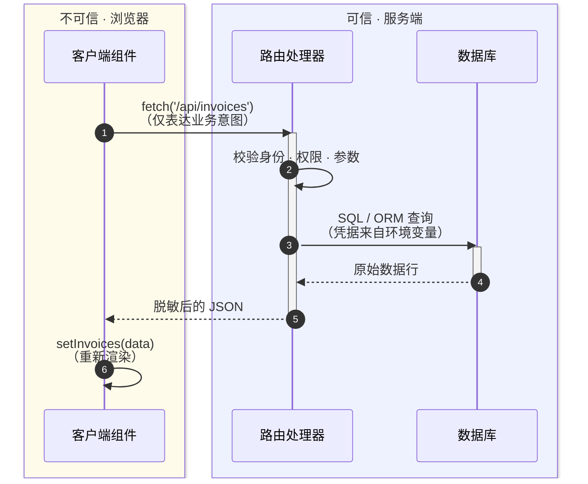

# Chapter 7 — Fetching Data

# 1. 本章学习目标

本章要解决的核心问题是：在 Next.js 应用中，如何安全、高效地从数据库获取数据，并将其交给页面组件使用？

完成本章后，你应该建立以下认识：

1. 数据获取不仅是调用 API，还涉及应用架构、服务端执行环境和数据库访问边界。
2. Server Components 让 React 组件能够直接参与服务端数据获取。
3. SQL 不只是查询语言，还能将筛选、排序和聚合工作交给数据库执行。
4. `async/await` 会形成明确的异步等待关系，需要识别其中不必要的串行依赖。
5. `Promise.all()` 能组织独立任务并发执行，但不能解决所有性能问题。
6. 数据获取、缓存、渲染和 Streaming 是相关但不同的概念。

---

# 2. 模块一：数据获取的架构边界

## 2.1 为什么需要考虑数据获取位置？

假设我们正在开发一个 Dashboard：

```
Dashboard
├── RevenueChart
├── LatestInvoices
└── Cards
    ├── Collected
    ├── Pending
    ├── Total Invoices
    └── Total Customers
```

这些组件都需要从 PostgreSQL 数据库获取数据。**最直接的思路**是让每个组件自己连接数据库、执行 SQL、取得结果。

但这会带来一个根本问题：**浏览器端的 JavaScript 与服务器端的 JavaScript，并不具有相同的执行权限**。

浏览器中的代码可以访问：

- DOM
- `window`
- `localStorage`
- 浏览器网络接口

但它不应该直接持有：

- PostgreSQL 数据库连接凭证
- 数据库内部连接地址
- 服务端私密 API Key
- 其他只应留在服务器上的敏感信息

问题并不是 JavaScript 不能发送网络请求，而是**数据库连接、凭证和数据库访问逻辑属于服务端资源**。

> 我们应该做的是：想好哪些部分是浏览器应该做的，哪些部分是后端应该做的。设立好边界，分析好模块，这才是软件工程应当考虑的。

---

## 2.2 API Layer：应用与数据库之间的中间层

传统的客户端数据获取通常采用这种结构：


API 是应用代码与数据库之间的中间层。以下几种常见场景通常会用到 API：

- 使用提供 API 的第三方外部服务。
- 从客户端获取数据时：必须通过运行在服务端的 API 层，以避免将数据库连接密钥暴露给客户端浏览器。

数据流：

1. Client Component 发起 HTTP 请求。
2. 请求到达服务端 API。
3. Route Handler 执行参数校验、身份认证和业务逻辑。
4. 服务端访问数据库。
5. 数据库返回结果。
6. API 将结果返回给浏览器。
7. Client Component 更新界面。

Next.js App Router **使用路由处理器（Route Handlers）**创建这类 HTTP 接口（ API 端点）。例如：

```ts
// app/api/invoices/route.ts

import { NextResponse } from 'next/server';
import { fetchLatestInvoices } from '@/app/lib/data';

export async function GET() {
  const invoices = await fetchLatestInvoices();

  return NextResponse.json(invoices);
}
```

客户端组件如何使用：

```ts
'use client';

import { useEffect, useState } from 'react';

export default function InvoiceList() {
  const [invoices, setInvoices] = useState([]);

  useEffect(() => {
    async function loadInvoices() {
      const response = await fetch('/api/invoices');

      if (!response.ok) {
        throw new Error('Failed to fetch invoices');
      }

      const data = await response.json();
      setInvoices(data);
    }

    loadInvoices();
  }, []);

  return <div>{/* Render invoices */}</div>;
}
```

这里展示的是一个简化示例，实际项目还需要考虑加载状态、错误状态以及数据类型定义。

**API Layer 的价值**：

- 隔离客户端与数据库。
- 保管数据库凭证。
- 在服务器端集中处理业务逻辑。
- 为浏览器和其他外部消费者提供统一接口。
- 在服务端执行请求校验与权限控制。

但要注意：API Layer 并非数据库访问的唯一入口。

---

## 2.3 数据库查询

构建全栈应用时，你需要编写与数据库交互的业务逻辑。对于 Postgres 这类[关系型数据库](https://aws.amazon.com/relational-database/)，可以使用原生 SQL 或 ORM（对象关系映射器）来实现。

编写数据库查询的典型场景：

- 创建自己的 API 端点时，需要编写与数据库交互的底层查询逻辑。
- **使用 React 服务端组件（在服务端获取数据）时，可以跳过 API 中间层，直接在组件内部查询数据库**，且完全不用担心数据库密钥泄露给客户端。

---

## 2.4 使用 Server Component 获取数据

Next.js 应用**默认使用 React 服务端组件（React Server Components）**。使用服务端组件获取数据是一种相对较新的模式，具备以下核心优势：

- **原生支持 Promise**：天然支持异步任务，你可以直接在组件内使用 `async/await` 语法，无需依赖 `useEffect`、`useState` 或第三方数据获取库。
- **执行在服务端**：将耗时的密集型数据获取与处理逻辑留在服务端执行，最终仅将计算结果发送给客户端，显著减少前端代码体积。
- **直连数据库**：因为直接在服务端运行，你可以跳过额外的 API 层直接查询数据库，省去了编写与维护多余 API 接口的代码成本。

示例：

```tsx
// app/dashboard/page.tsx

import { fetchLatestInvoices } from '@/app/lib/data';

export default async function Page() {
  const invoices = await fetchLatestInvoices();

  return (
    <main>
      <h1>Dashboard</h1>
      <pre>{JSON.stringify(invoices, null, 2)}</pre>
    </main>
  );
}
```

这里不需要再请求：`fetch('/api/invoices');` ，而是直接调用服务器端的数据访问函数。

为什么？因为：

- `Page` 是 Server Component。
- `fetchLatestInvoices()` 也在服务器端执行。
- 两者处于同一个服务端执行环境。
- 没有必要为了访问自己的数据库，再额外发起一次 HTTP 请求。

这不仅减少了代码，还避免了不必要的网络往返。

Next.js 当前文档明确推荐 Server Components 直接从数据源获取数据，而不是通过自己的 Route Handler 再绕一圈。

> 参考：[Backend for Frontend](https://nextjs.org/docs/app/guides/backend-for-frontend)

---

## 2.5 `data.ts`：为什么将数据库查询集中管理？

原文将所有查询放在：

```
app/
└── lib/
    └── data.ts
```

例如：

```ts
// app/lib/data.ts

import postgres from 'postgres';

const sql = postgres(process.env.POSTGRES_URL!, {
  ssl: 'require',
});

// 数据查询函数
export async function fetchRevenue() {
  // ...
}

export async function fetchLatestInvoices() {
  // ...
}

export async function fetchCardData() {
  // ...
}
```

这体现了一种代码组织思想：**UI 组件应该依赖数据访问函数，而不需要了解数据库连接和 SQL 查询细节**。

职责分离：

```
page.tsx
    │
    ├── 负责页面结构
    ├── 负责调用数据函数
    └── 负责将数据传递给组件
             │
             ▼
           data.ts
             │
             ├── 负责数据库查询
             ├── 负责数据处理
             └── 负责返回应用需要的数据
                      │
                      ▼
                   PostgreSQL
```

这里还需要区分两个概念：

- `data.ts`：一个集中存放数据库查询函数的模块。
- DAL（Data Access Layer）：**数据访问层**，负责封装数据读取以及相关安全、授权规则。

二者存在联系，但不完全等价。

现代 Next.js 项目中，**DAL 通常还会负责**：

1. 验证用户会话。
2. 检查用户是否有权访问数据。
3. 限制返回字段。
4. 将数据库结果转换为 DTO（Data Transfer Object）。

尤其要注意：Server Component 不会自动保护所有数据。服务端直接访问数据库只是保护了数据库凭证，不代表用户自动获得了正确的数据权限。

> 参考：[How to implement authentication in Next.js](https://nextjs.org/docs/app/guides/authentication)

在实际项目中，可以通过 `import 'server-only'` 标记数据访问模块，避免它被意外引入 Client Component。

```ts
// app/lib/data.ts

import 'server-only';
import postgres from 'postgres';

// ...
```

> 注意：`import 'server-only'` 是 Next.js 提供的环境边界保护方式，不代替身份认证、权限检查和数据过滤。

---

## 2.6 如何选择数据获取路径？

| 业务场景                             | 推荐方式                                      |
| ------------------------------------ | --------------------------------------------- |
| Server Component 获取 Dashboard 数据 | 直接调用 DAL / 数据访问函数                   |
| Client Component 首次展示的数据      | 优先由 Server Component 获取并通过 Props 传递 |
| Client Component 需要主动请求数据    | Route Handler 或适合的服务端接口              |
| 第三方服务提供 HTTP API              | 服务端调用第三方 API                          |
| 浏览器需要访问自己的后端资源         | Route Handler                                 |
| 多个服务共同使用的数据接口           | 根据接口消费者设计独立 API                    |

**核心判断原则**：不要为了使用 API 而使用 API，也不要因为可以在 Server Component 直接访问数据库，就把所有业务逻辑堆在页面组件中。应该根据执行环境、接口消费者、安全边界和代码职责选择合适的访问路径。

---

## 2.7 为什么不需要用 `useEffect` 和 `useState` 获取这类服务器数据

在传统的客户端数据获取模式中，常见流程是：

1. 组件先在客户端渲染。
2. `useEffect` 在组件提交后运行，发起数据请求。
3. 请求完成后，通过 `useState` 保存结果。
4. 状态更新触发组件再次渲染，以显示数据。

Server Component 的数据获取流程不同：数据请求发生在服务器端，组件可以直接 `await` 异步函数，得到结果后再返回页面结构。因此，对这种**服务器端初始数据获取**而言，不需要用 `useEffect` 和 `useState` 人工管理请求完成后的状态更新。

这不意味着 `useEffect` 和 `useState` 不再有用。它们仍然属于客户端交互和状态管理中常用的工具；这里只是在说明，服务器组件获取服务器端数据时有原生的异步写法。

---

# 3. 再来探讨一下两种数据获取的方式

## 3.1 小节核心思路

我们结合前两节学到的 **Client Graph（客户端打包图）** 和 **RSC（服务端组件）** 原理，探讨本节内容。

核心问题 (Problem)：浏览器里的 UI 组件需要展示或修改存放在服务端数据库里的数据。

物理与安全约束 (Constraints)：

1. **秘密泄露（编译期）**：根据上一节原理，Client Component 导入的所有模块都会打进客户端 JS Bundle。如果直接导入数据库驱动，数据库密码会明文发给全世界。  
2. **环境隔离（运行期）**：浏览器沙箱不支持底层的数据库 TCP Socket 连接协议（浏览器本质是一个沙箱）。 
3. **信任边界（安全）**：运行在用户浏览器里的代码随时可被篡改，绝不能让客户端直接拼装 SQL 或跳过权限检查。

解决机制：API Layer / Route Handlers (Mechanism)

- 在服务器上设立一个通过 HTTP 协议通信的“安检站”（如 /api/invoices/route.ts）
- 客户端发 HTTP 请求 → 服务端安检（鉴权/校验） → 服务端用内部密钥查库 → 只把脱敏后的 JSON 返回给浏览器。

适用边界 (Boundary / The Twist)

- 只有“跨越信任边界（从浏览器或外部第三方发起）”的请求才必须走 HTTP API Layer；
- 如果是 RSC（Server Component），它本身就跑在服务端信任边界内部，可以直接查数据库，无需绕道 HTTP API！

---

## 3.2 为什么 Client Component 必须走这 7 步数据流？

> 可能有些重复了，这里探讨的东西我们在 API 详解部分已经涉及过了

如果把这段教程里的 7 步数据流拆开，你会发现它本质上是在完成一次**跨越“不可信区（浏览器）”与“可信区（服务器）”的接力**。



假设你在 `InvoiceList.tsx`（顶部标了 `'use client'`）里不写 `fetch('/api/invoices')`，而是直接写：

```ts
'use client';
import { fetchLatestInvoices } from '@/app/lib/data'; // 里面用了数据库驱动和 process.env.DB_PASSWORD
```

**依赖传染**：根据我们第一节讲的规则，因为 `InvoiceList.tsx` 有 `'use client'`，它静态 `import` 的 `@/app/lib/data` 会被强制拉入 **Client Graph（客户端依赖图）**。

**灾难后果**：

- 打包器会试图把 Node.js 专用的数据库驱动（包含 `fs`、`net`、`tls` 等底层模块）塞进浏览器的 JS Chunk 里，导致构建直接报错崩溃。
- 退一步讲，就算能打包成功，如果你把密钥硬编码在代码里，任何人打开浏览器开发者工具查看下载的 JS Chunk，就能直接拿走你的数据库最高权限密码。

因此，**`app/api/invoices/route.ts`（Route Handler）在架构上的真正角色，是一道物理防火墙**：它永远留在服务端，只通过标准的 HTTP 接口（GET/POST）向外暴露受控的数据。

---

## 3.3 两种方式的对比

在传统的纯前端 React 项目（如 Vite / Create React App）中，**所有组件都在浏览器里跑**，所以 100% 的数据获取都必须走 `useEffect + fetch('/api/xxx')`。

但在 Next.js App Router 中，你有两种组件，对应**两条截然不同的数据库访问路径**：

| **对比维度**           | **路径 A：通过 API Layer (route.ts)**                        | **路径 B：Server Component 直接访问数据库**                  |
| ---------------------- | ------------------------------------------------------------ | ------------------------------------------------------------ |
| **调用方是谁？**       | **Client Component**（浏览器内触发）或 **外部消费者**（移动端 App、Webhook） | **Server Component**（服务端直接执行）                       |
| **是否跨越网络边界？** | **是**。浏览器挂载组件后，再发起一次额外的客户端到服务端的 HTTP 请求（存在网络瀑布流延迟）。 | **否**。代码本来就在服务器上跑，直接调用 `await fetchLatestInvoices()` 查库，拿到数据直接渲染成 HTML/RSC Payload 下发。 |
| **安全性（密钥保护）** | 安全。密钥留在 `route.ts` 服务端环境。                       | **同样安全**。如第一节所述，Server Component 的代码和依赖不会进入客户端 JS Bundle，密钥绝不会泄露给浏览器。 |
| **代码复杂度**         | 高。需要写 `route.ts` + 客户端 `useState` + `useEffect` + 处理 Loading/Error 状态。 | 极简。直接在 `async function Page()` 里一行 `const data = await fetchLatestInvoices()` 搞定。 |

---

## 3.4 什么时候才真正需要 API Layer (`route.ts`)？

理解了上面的对比，你就能精准判断教程开头列出的“常见场景”了。在 Next.js App Router 中，你**只有在以下 3 种情况**才需要创建 `app/api/.../route.ts`：

1. **需要在客户端由用户交互动态拉取数据（Client-side Fetching）**： 比如页面已经加载完了，用户在搜索框里一边打字一边触发实时搜索提示，或者点击“加载更多”按钮，由 Client Component 在浏览器端按需发起 `fetch('/api/search?q=xxx')`。
2. **给非 Next.js 网页的外部客户端提供接口**： 比如你的公司同时在做 iOS/Android 原生 App，或者对外提供开放 API，它们需要通过标准 HTTP 接口读写同一个后端的业务数据。
3. **接收第三方服务的 Webhook 回调**： 比如 Stripe 支付成功通知、GitHub 代码推送回调、第三方 OAuth 登录回调，外部服务器需要一个固定的公网 HTTP URL 来推送消息。

---

# 4. 模块二：数据库查询与数据整形

在当前仪表盘应用中，你将使用 `postgres.js` 库与原生 SQL 编写数据库查询。选择原生 SQL 的主要原因包括：

- SQL 是关系型数据库查询的行业通用标准（大多数 ORM 底层也是将其转化为 SQL 执行）。
- 理解基础 SQL 有助于掌握关系型数据库的核心原理，这些经验可以无缝迁移到其他工具库。
- SQL 表达灵活，支持精确提取与操作所需数据。
- `postgres.js` 库提供了自动参数化查询，防止 SQL 注入风险。

无需担心没有深入学过 SQL，教程已经预先准备好了所有查询代码。

打开 `/app/lib/data.ts` 文件，可以看到此处引入了 `postgres`。导出的 `sql` 函数即可用于执行数据库查询：

```TypeScript
// /app/lib/data.ts
import postgres from 'postgres';
 
const sql = postgres(process.env.POSTGRES_URL!, { ssl: 'require' });
 
// ...
```

你可以在服务端的任何地方调用 `sql`（例如直接写在服务端组件中）。但为了让组件代码结构更清晰、便于维护，我们将所有数据库查询集中存放在 `data.ts` 文件中，组件只需按需导入即可。

---

## 4.1 SQL 与 ORM：为什么本章使用 SQL？

对于 PostgreSQL 这样的关系型数据库，我们可以使用两种常见方式访问数据：

SQL（Structured Query Language），直接描述希望数据库执行的操作：

```sql
SELECT name, email
FROM customers
WHERE id = 1;
```

ORM（Object-Relational Mapping），使用编程语言中的对象和方法表达数据库操作：

```ts
const customer = await db.query.customers.findFirst({
  where: (customers, { eq }) =>
    eq(customers.id, 1),
});
```

ORM 通常会在底层生成 SQL（程序员不用再手动编写SQL，这会大大增加我们的效率）。两者并不是互相排斥的技术：

| 对比     | SQL                          | ORM                    |
| -------- | ---------------------------- | ---------------------- |
| 表达方式 | SQL 语句                     | 编程语言 API           |
| 控制能力 | 直接控制查询                 | 受 ORM API 抽象约束    |
| 复杂查询 | 通常表达更直接               | 可能需要更复杂的 API   |
| 类型体验 | 依赖查询结果类型定义等       | 通常提供较好的类型集成 |
| 学习价值 | 理解关系数据库的底层查询模型 | 提高日常开发效率       |

本章使用 `postgres.js`，直接编写 SQL。原因不只是 SQL 更灵活，更重要的是：**理解 SQL 可以帮助你理解 ORM 最终在做什么**。

---

## 4.2 PostgreSQL 与 postgres.js

先看原文中的连接代码：

```ts
import postgres from 'postgres';

const sql = postgres(
  process.env.POSTGRES_URL!,
  { ssl: 'require' }
);
```

理解这几个部分：

| 内容                       | 作用                                   |
| -------------------------- | -------------------------------------- |
| `postgres`                 | postgres.js 提供的数据库客户端工厂函数 |
| `process.env.POSTGRES_URL` | 数据库连接字符串                       |
| `!`                        | TypeScript Non-null Assertion          |
| `ssl: 'require'`           | 要求使用 SSL 连接                      |

---


## 4.3 查询最近 5 条发票：JOIN、排序与 LIMIT

假设我们需要显示最新的发票：

```sql
SELECT
  invoices.amount,
  customers.name,
  customers.image_url,
  customers.email
FROM invoices
JOIN customers
  ON invoices.customer_id = customers.id
ORDER BY invoices.date DESC
LIMIT 5;
```

首先看数据来源：

```
invoices 表                 customers 表
┌──────────────┐            ┌──────────────┐
│ id           │            │ id           │
│ customer_id  │────────────│ name         │
│ amount       │            │ email        │
│ date         │            │ image_url    │
│ status       │            └──────────────┘
└──────────────┘
```

这条查询的目标：

从发票表获取金额，再根据 `customer_id` 找到对应客户的信息，最终返回最新的五条发票记录。

**第一步：SELECT**

```
SELECT
  invoices.amount,
  customers.name,
  customers.image_url,
  customers.email
```

指定需要返回哪些字段。Dashboard 不一定需要数据库中的全部字段。

只取所需字段能够减少：

- 数据库向应用返回的数据量。
- 网络传输量。
- 应用层处理的数据量。
- 不必要的数据暴露。

这就是原文强调的：只获取应用需要的数据。

**第二步：FROM**

```
FROM invoices
```

以 `invoices` 表作为查询基础。

**第三步：JOIN**

```
JOIN customers
  ON invoices.customer_id = customers.id
```

`JOIN` 将两张表关联起来。

其中：`invoices.customer_id = customers.id` 是关联条件。这里省略了 `INNER`，因此默认是 `INNER JOIN`。它只保留能够匹配到客户记录的发票。

如果使用：`LEFT JOIN customers ON invoices.customer_id = customers.id` 则会保留左表 `invoices` 中的记录，即使某条发票没有匹配到客户，也会保留发票记录，只是客户字段可能为 `NULL`。

这两种 JOIN 在业务上有不同含义，不能随意替换。

**第四步：ORDER BY**

`ORDER BY invoices.date DESC` 按照发票日期降序排列。

- `ASC`：Ascending，升序。
- `DESC`：Descending，降序。

**第五步：LIMIT**

`LIMIT 5` 只返回排序后的前五条记录。

#### 为什么不先把所有发票取回来，再用 JavaScript 排序和截取？

如果先获取全部发票，再在 JavaScript 中排序并取前五条，应用就需要接收本来并不需要的记录，并在应用侧执行排序。

把筛选、排序和数量限制写进 SQL，数据库只需返回页面需要的结果。这通常意味着：

- 传输的数据量更少；
- 应用侧不必对全部记录再次排序；
- 查询意图更明确，数据库可以执行相应的数据操作。

这里的核心并不是“JavaScript 不能排序”，而是**应该尽可能在最接近数据的位置完成适合由数据库执行的筛选和排序，只把应用真正需要的数据取回来。**

---

## 4.4 COUNT：数据库中的统计

`COUNT(*)` 的含义：

统计查询结果中的行数。

这里并不需要获取每条发票，只需要返回一个统计结果。

因此，数据库可以直接完成聚合计算，应用只需要接收统计值。

---

## 4.5 SUM + CASE WHEN：按照条件统计金额

Dashboard 还需要显示：Collected：已经收取的金额；Pending：待收取的金额。

```SQL
SELECT
  SUM(
    CASE
      WHEN status = 'paid'
      THEN amount
      ELSE 0
    END
  ) AS paid,

  SUM(
    CASE
      WHEN status = 'pending'
      THEN amount
      ELSE 0
    END
  ) AS pending

FROM invoices;
```

理解这个查询需要掌握两个概念。CASE WHEN：条件表达式

```sql
CASE
  WHEN status = 'paid'
  THEN amount
  ELSE 0
END
```

它可以理解为：

```ts
status === 'paid'
  ? amount
  : 0;
```

对每条发票分别判断：

| status  | amount | CASE 结果 |
| ------- | ------ | --------- |
| paid    | 100    | 100       |
| pending | 200    | 0         |
| paid    | 300    | 300       |
| pending | 400    | 0         |

SUM：求和聚合，`SUM(...)`。对每条记录产生的结果进行求和。最终：

```ts
paid    = 100 + 300 = 400
pending = 0 + 0 + 200 + 400 = 600
```

需要注意，上述结果中的金额字段经过 `CASE` 计算后分别为两组。更严格地说，如果整个表没有任何记录，`SUM()` 会返回 `NULL`，而不是自动返回 0。实际应用中可以使用：

```sql
COALESCE(
  SUM(
    CASE WHEN status = 'paid'
    THEN amount ELSE 0 END
  ),
  0
) AS paid
```

`COALESCE` 返回第一个非 `NULL` 的表达式。这样即使表为空，聚合结果也可以得到 0。

---

# 5. Dashboard 实战：在页面中获取数据

## 5.1 为仪表盘总览页面获取数据

理解了不同的数据获取方式后，让我们开始为仪表盘总览页拉取数据。打开 `/app/dashboard/page.tsx`，粘贴以下代码并查看其结构：

```tsx
// /app/dashboard/page.tsx
import { Card } from '@/app/ui/dashboard/cards';
import RevenueChart from '@/app/ui/dashboard/revenue-chart';
import LatestInvoices from '@/app/ui/dashboard/latest-invoices';
import { lusitana } from '@/app/ui/fonts';
 
export default async function Page() {
  return (
    <main>
      <h1 className={`${lusitana.className} mb-4 text-xl md:text-2xl`}>
        Dashboard
      </h1>
      <div className="grid gap-6 sm:grid-cols-2 lg:grid-cols-4">
        {/* <Card title="Collected" value={totalPaidInvoices} type="collected" /> */}
        {/* <Card title="Pending" value={totalPendingInvoices} type="pending" /> */}
        {/* <Card title="Total Invoices" value={numberOfInvoices} type="invoices" /> */}
        {/* <Card
          title="Total Customers"
          value={numberOfCustomers}
          type="customers"
        /> */}
      </div>
      <div className="mt-6 grid grid-cols-1 gap-6 md:grid-cols-4 lg:grid-cols-8">
        {/* <RevenueChart revenue={revenue}  /> */}
        {/* <LatestInvoices latestInvoices={latestInvoices} /> */}
      </div>
    </main>
  );
}
```

上面的部分组件被故意注释掉了。解析如下：

- 页面组件是一个**异步服务端组件（Async Server Component）**，这允许你直接在组件顶层使用 `await` 获取数据。
- 页面中包含 3 个接收数据的子组件：`<Card>`、`<RevenueChart>` 和 `<LatestInvoices>`。

---

## 5.2 获取 `<RevenueChart/>` 的数据

从 `data.ts` 中导入 `fetchRevenue` 函数，并在组件内调用：

```ts
// /app/dashboard/page.tsx
import { Card } from '@/app/ui/dashboard/cards';
import RevenueChart from '@/app/ui/dashboard/revenue-chart';
import LatestInvoices from '@/app/ui/dashboard/latest-invoices';
import { lusitana } from '@/app/ui/fonts';
import { fetchRevenue } from '@/app/lib/data';
 
export default async function Page() {
  const revenue = await fetchRevenue();
  // ...
}
```

随后执行以下操作：

1. 取消 `<RevenueChart revenue="{revenue}"/>` 组件的注释。
2. 打开该组件文件 `/app/ui/dashboard/revenue-chart.tsx`，取消内部相关代码的注释。
3. 访问 `localhost:3000/dashboard`，即可看到渲染出基于收入数据的柱状图。


Let's continue importing more data and displaying it on the dashboard.

---

## 5.3 获取 `<LatestInvoices/>` 的数据

对于 `<LatestInvoices/>` 组件，我们需要获取按日期排序的最近 5 笔发票记录。

你可以把全部发票拉取到前端再用 JavaScript 排序截取。在数据量小时这样没问题，但随着业务规模扩大，每次请求传输的数据量以及客户端排序所需的 JavaScript 运算量都会急剧膨胀。

更高效的做法是直接在数据库层通过 SQL 仅返回最新的 5 条记录。在 `data.ts` 中编写的查询如下：

```ts
// /app/lib/data.ts
// 获取按日期倒序排列的最新 5 笔发票
const data = await sql<LatestInvoiceRaw[]>`
  SELECT invoices.amount, customers.name, customers.image_url, customers.email
  FROM invoices
  JOIN customers ON invoices.customer_id = customers.id
  ORDER BY invoices.date DESC
  LIMIT 5`;
```

在页面中导入 `fetchLatestInvoices` 函数：

```ts
// /app/dashboard/page.tsx
import { Card } from '@/app/ui/dashboard/cards';
import RevenueChart from '@/app/ui/dashboard/revenue-chart';
import LatestInvoices from '@/app/ui/dashboard/latest-invoices';
import { lusitana } from '@/app/ui/fonts';
import { fetchRevenue, fetchLatestInvoices } from '@/app/lib/data';
 
export default async function Page() {
  const revenue = await fetchRevenue();
  const latestInvoices = await fetchLatestInvoices();
  // ...
}
```

取消页面中 `<LatestInvoices/>` 的注释，同时打开 `/app/ui/dashboard/latest-invoices.tsx` 取消其内部的注释代码。刷新浏览器，可以看到只拉取并展示了最新的 5 笔交易。


---

## 5.4 练习：为 `<Card>` 组件获取数据

现在轮到你来为 `<Card>` 组件获取数据了。卡片需要展示以下指标：

- 已收取的发票总金额（Collected）。
- 待处理的发票总金额（Pending）。
- 发票总数（Total Invoices）。
- 客户总数（Total Customers）。

同样，你可能会想获取所有发票和客户，并使用 JavaScript 来操作数据。例如，你可以使用 `Array.length` 来获取发票总数和客户总数：

```ts
const totalInvoices = allInvoices.length;
const totalCustomers = allCustomers.length;
```

如果把所有客户和发票都查出来并用 `allInvoices.length` 计算总数，会造成极大的网络传输浪费。

利用 SQL 的聚合函数，可以直接在数据库层面计算并只返回统计结果（只获取所需的数据）。代码比 `Array.length` 稍微长一点，但意味着请求期间需要传输的数据更少。下面是 SQL 替代方案：

```ts
// /app/lib/data.ts
const invoiceCountPromise = sql`SELECT COUNT(*) FROM invoices`;
const customerCountPromise = sql`SELECT COUNT(*) FROM customers`;
```

在 `data.ts` 中已经准备好了 `fetchCardData` 函数。你需要导入它并解构其返回值。

> 提示：
>
> - 查看卡片组件，了解它们需要什么数据。
> - 查看 `data.ts` 文件，了解该函数返回什么。

解答：

```tsx
// app/dashboard/customers/page.tsx

import { fetchCardData, fetchLatestInvoices, fetchRevenue } from "~/lib/data";
import { Card } from "~/ui/dashboard/cards";
import LatestInvoices from "~/ui/dashboard/latest-invoices";
import RevenueChart from "~/ui/dashboard/revenue-chart";
import { lusitana } from "~/ui/fonts";

export default async function Page() {
  const revenue = await fetchRevenue();
  const latestInvoices = await fetchLatestInvoices();
  const {
    numberOfCustomers,
    numberOfInvoices,
    totalPaidInvoices,
    totalPendingInvoices,
  } = await fetchCardData();

  return (
    <main>
      <h1 className={`${lusitana.className} mb-4 text-xl md:text-2xl`}>
        Dashboard
      </h1>
      <div className="grid gap-6 sm:grid-cols-2 lg:grid-cols-4">
        <Card title="Collected" value={totalPaidInvoices} type="collected" />
        <Card title="Pending" value={totalPendingInvoices} type="pending" />
        <Card title="Total Invoices" value={numberOfInvoices} type="invoices" />
        <Card
          title="Total Customers"
          value={numberOfCustomers}
          type="customers"
        />
      </div>
      <div className="mt-6 grid grid-cols-1 gap-6 md:grid-cols-4 lg:grid-cols-8">
        <RevenueChart revenue={revenue} />
        <LatestInvoices latestInvoices={latestInvoices} />
      </div>
    </main>
  );
}
```

太好了！你现在已经为仪表盘概览页面获取了所有数据。你的页面应该看起来像这样：


虽然数据已经成功呈现，但当前代码存在两个必须关注的架构问题：

1. **数据请求相互阻塞，形成了“请求瀑布（Request Waterfall）”**。
2. 默认情况下，Next.js 会**预渲染路由**以提升性能，这称为静态渲染（Static Rendering）。因此，如果你的数据发生变化，它不会反映在你的仪表盘中。

我们将在本章讨论第 1 点，然后在下一章详细探讨第 2 点。

---

# 6. 理解请求瀑布

当 Dashboard 的数据都接入后，课程指出了一个问题：数据请求可能在不必要的情况下互相等待，形成 Request Waterfall。

## 6.1 什么是 Request Waterfall ？

“瀑布”指一组存在依赖关系的连续网络请求——后一个请求必须等待前一个请求彻底完成后才能开始发起。


例如，在 `fetchRevenue()` 执行完毕之前，`fetchLatestInvoices()` 会一直等待，以此类推：

```ts
const revenue = await fetchRevenue();
const latestInvoices = await fetchLatestInvoices(); // wait for fetchRevenue() to finish
const {
  numberOfInvoices,
  numberOfCustomers,
  totalPaidInvoices,
  totalPendingInvoices,
} = await fetchCardData(); // wait for fetchLatestInvoices() to finish
```

为什么会这样？因为每一行都先 `await` 当前函数返回的 Promise。只有当前 `await` 得到结果，程序才继续执行下一行并调用下一个获取函数。

假设三个请求彼此独立：

- 获取收入数据不需要先知道最近发票；
- 获取最近发票不需要先知道 Card 统计结果；
- 获取 Card 统计结果也不需要前两个请求的结果。

那么让它们顺序启动就引入了没有必要的等待。后两个请求本来可以更早开始，却必须等前面的请求结束。

用一个简化的时间模型理解：假设三个独立请求分别耗时 `t1`、`t2`、`t3`，并暂时忽略启动开销与资源竞争：

- 顺序等待的总时间大致是 `t1 + t2 + t3`。
- 同时启动后再统一等待，总时间大致受最慢请求影响，即 `max(t1, t2, t3)`。

这是帮助理解的简化模型，并不保证真实系统一定达到这个时间。实际耗时还会受到数据库、网络、连接池和服务器资源等因素影响。

**瀑布模式并不一定全是有害的**。在某些业务场景下必须使用瀑布，例如：

```
先获取用户 ID
      │
      ▼
再根据用户 ID 获取用户资料或关联数据
      │
      ▼
根据已获得的信息继续请求好友列表
```

如果**后一个请求必须使用前一个请求返回的值，那么就不能在缺少该值时提前完成后续请求**。这时顺序执行是由数据依赖决定的，是**合理**的。

但在各个查询彼此互不依赖的场景下，无意的瀑布会导致总加载时长累加，显著拖慢整体响应速度。

**如何判断一个 Waterfall 是否可以消除**？

分析请求时，可以问三个问题：

1. 后一个请求是否需要前一个请求的返回值？
2. 如果不需要，是否可以在前一个请求完成之前就启动它？
3. 如果需要，依赖的究竟是哪一部分数据，是否能把不相关的请求提前？

判断标准不是“尽可能让所有请求同时执行”，而是**只在存在真实依赖时等待；没有依赖的请求不要仅仅因为代码排列顺序而互相阻塞。**

---

# 7. 并行数据获取（Parallel Data Fetching）

规避无意瀑布的标准方案是**并行发起所有数据请求**。

在 JavaScript 中，可以使用 [`Promise.all()`](https://developer.mozilla.org/en-US/docs/Web/JavaScript/Reference/Global_Objects/Promise/all) 或 [`Promise.allSettled()`](https://developer.mozilla.org/en-US/docs/Web/JavaScript/Reference/Global_Objects/Promise/allSettled) 同时触发多个 Promise 执行。

---

## 7.1 先理解：调用异步函数与等待结果是两件事

异步数据获取函数通常返回 Promise。

调用函数会启动相应的异步操作，并得到一个代表未来结果的 Promise；`await` 则暂停当前异步函数后续代码的执行，直到这个 Promise 有结果。

下面这种写法把“调用”和“等待”放在同一行：

```ts
const revenue = await fetchRevenue();
```

执行到这一行时，调用 `fetchRevenue()`，然后等待它完成。当前函数在结果返回前不会执行下一行。

如果希望多个独立请求不要互相等待，可以先调用所有函数，保存它们返回的 Promise：

```ts
const revenuePromise = fetchRevenue();
const latestInvoicesPromise = fetchLatestInvoices();
const cardDataPromise = fetchCardData();
```

此时三个异步操作已经分别启动（具体底层工作如何调度由相应函数和运行环境决定），**但代码还没有逐个等待它们的结果**。

---

## 7.2 使用 `Promise.all()` 统一等待

接下来使用 `Promise.all()`：

```ts
const [revenue, latestInvoices, cardData] = await Promise.all([
  revenuePromise,
  latestInvoicesPromise,
  cardDataPromise,
]);
```

它接收一组 Promise，并返回一个新的 Promise。这个新 Promise 在所有输入都成功完成后兑现，结果是一个数组；数组元素的顺序与传入的 Promise 顺序一致。

因此可以直接解构：

```ts
const [firstResult, secondResult, thirdResult] = await Promise.all([
  firstPromise,
  secondPromise,
  thirdPromise,
]);
```

即使第二个请求比第一个请求先完成，`secondResult` 仍对应第二个输入 Promise，而不是按照完成先后顺序排列。

---

## 7.3 顺序写法与并行写法对比

**顺序等待：**

```ts
const revenue = await fetchRevenue();
const latestInvoices = await fetchLatestInvoices();
const cardData = await fetchCardData();
```

```
调用并等待 A → 完成 A
                  │
                  ▼
             调用并等待 B → 完成 B
                                │
                                ▼
                           调用并等待 C → 完成 C
```

**先启动，再统一等待：**

```ts
const revenuePromise = fetchRevenue();
const latestInvoicesPromise = fetchLatestInvoices();
const cardDataPromise = fetchCardData();

const [revenue, latestInvoices, cardData] = await Promise.all([
  revenuePromise,
  latestInvoicesPromise,
  cardDataPromise,
]);
```

```
调用 A ───────────────────┐
调用 B ───────────────────┼── Promise.all() 等待全部结果
调用 C ───────────────────┘
```

**差异在于启动时机**：顺序版本要等 A 结束后才调用 B；并行版本先调用 A、B、C，再统一等待它们的结果。

---

## 7.4 课程中的 `Promise.all()`：`fetchCardData()`

课程在 `/app/lib/data.ts` 中使用 `Promise.all()` 并行执行三条统计查询。下面是聚焦于并行查询部分的结构示意，省略了函数后续的数据解构、格式化和完整错误处理代码：

```ts
export async function fetchCardData() {
    const invoiceCountPromise = sql`
      SELECT COUNT(*) FROM invoices
    `;

    const customerCountPromise = sql`
      SELECT COUNT(*) FROM customers
    `;

    const invoiceStatusPromise = sql`
      SELECT
        SUM(CASE WHEN status = 'paid' THEN amount ELSE 0 END) AS "paid",
        SUM(CASE WHEN status = 'pending' THEN amount ELSE 0 END) AS "pending"
      FROM invoices
    `;

    const data = await Promise.all([
      invoiceCountPromise,
      customerCountPromise,
      invoiceStatusPromise,
    ]);

  // 后续代码处理 data，并组织函数返回值。
}
```

这段代码分别发起：

1. `invoiceCountPromise`：统计发票总数。
2. `customerCountPromise`：统计客户总数。
3. `invoiceStatusPromise`：汇总已支付和待处理发票的金额。

三条查询之间没有数据上的先后依赖：统计客户数量不需要先知道发票数量，统计发票状态金额也不需要等待客户数量。因此可以先发起这三条查询，再由 `Promise.all()` 统一等待。

这体现了 `Promise.all()` 的作用：**它不负责定义每条 SQL 如何执行，而是把多个已经发起的异步操作组合起来，让调用方统一等待它们成功完成。**

---

## 7.5 并行数据获取的优点与缺点

使用 `Promise.all()` 时，至少要理解两点：

1. **仍然要等待最慢的那个成功请求。**`Promise.all()` 只有在所有输入 Promise 都成功完成后，整体结果才会成功。因此一个请求很快完成，并不意味着整体结果可以提前返回；其他请求仍然需要完成。
2. **任意一个输入 Promise 拒绝，整体 Promise 就会拒绝。**例如，三条查询中有一条失败，`await Promise.all(...)` 就会抛出对应的拒绝原因，调用方可以使用 `try/catch` 处理。

这种模式的优点在于：   

- 同时发起多个独立的数据库查询，总耗时取决于最慢的一个查询，而非所有查询耗时的简单叠加。
- 属于 JavaScript 原生语法，适用于任何技术栈与框架。

**但单纯依靠 `Promise.all()` 仍有一个潜在隐患**：如果其中某一个查询耗时极长（例如慢查询），整个页面就必须一直处于等待状态，连已经准备好的轻量组件也无法提前渲染展示。

> 需要注意：`Promise.all()` 的整体 Promise 拒绝，并不意味着它会自动取消其他已经启动的请求。其他操作是否能够取消，取决于各自 API 是否提供取消机制，以及调用代码是否使用了该机制。

课程同时提到 `Promise.all()` 和 `Promise.allSettled()`：两者都可以用来组合多个 Promise，但它们对失败的处理方式不同。

- `Promise.all()`：所有输入都成功时才成功；任意一个输入拒绝，整体就拒绝。
- `Promise.allSettled()`：等待所有输入都结束，并分别报告每个输入是成功还是失败。

本章实际示例使用的是 `Promise.all()`。掌握它的行为即可，不需要在本章进一步展开所有 Promise 组合 API。

---

## 7.6 并行不等于无限制地同时执行

并行获取适合彼此独立的请求，但不代表请求越多越好，也不意味着底层数据库一定会以相同方式同时执行所有工作。

实际执行还会受到数据库连接数、连接池、服务器资源和数据库自身调度等因素影响。`Promise.all()` **解决的是 JavaScript 层面如何组织多个异步结果、避免代码不必要地逐个等待的问题**；它本身不是数据库并行执行计划，也不会自动消除资源竞争。

**本节要点：** 对相互独立的异步操作，先启动，再用 `Promise.all()` 统一等待；对确实存在数据依赖的操作，仍然应该按依赖顺序执行。

---

# 8. 本章总结

把本章压缩成四个判断：

**数据应该在哪里获取？**

先看代码运行位置。客户端代码不能直接持有数据库凭证；服务器端的 Server Component 可以直接调用数据库查询逻辑。API Layer 是解决客户端与服务器端访问边界的一种方式，不是所有数据获取都必须经过的固定环节。

**应该把哪些数据取回来？**

只查询当前功能真正需要的数据。让 SQL 完成适合在数据库端进行的列选择、表关联、排序、数量限制和统计，避免把大量不需要的数据传回应用再处理。

**请求之间是否真的有依赖？**

如果后一个请求必须使用前一个请求的结果，就需要等待；如果多个请求互不依赖，就不应该仅仅因为代码按顺序书写而让它们逐个启动。

**如何组织独立的异步请求？**

先调用多个异步函数，取得各自的 Promise，再用 Promise.all() 统一等待。它组合结果，不负责取消失败请求，也不保证底层资源无限并行。


