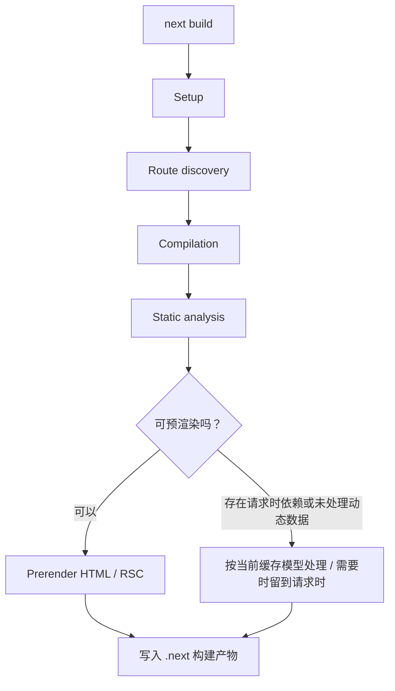
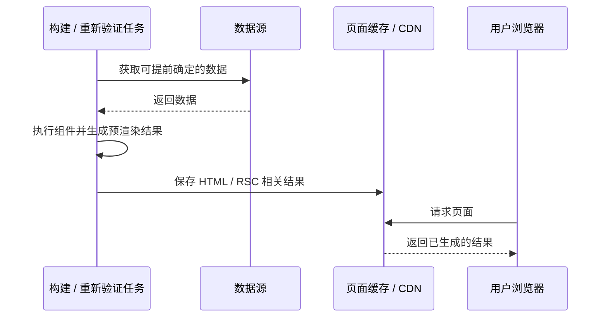
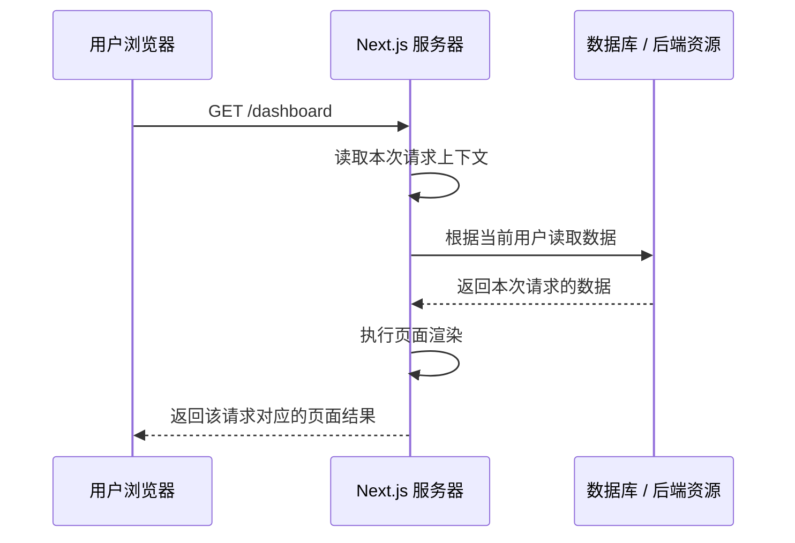
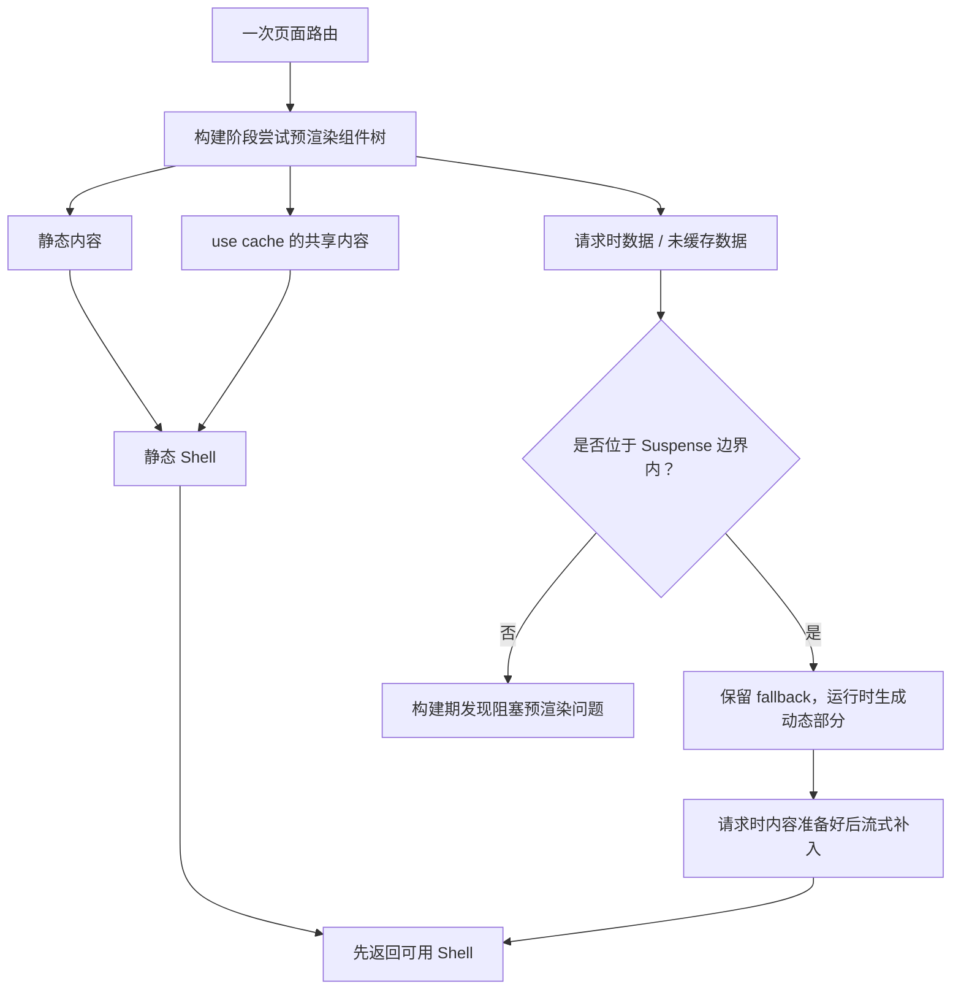
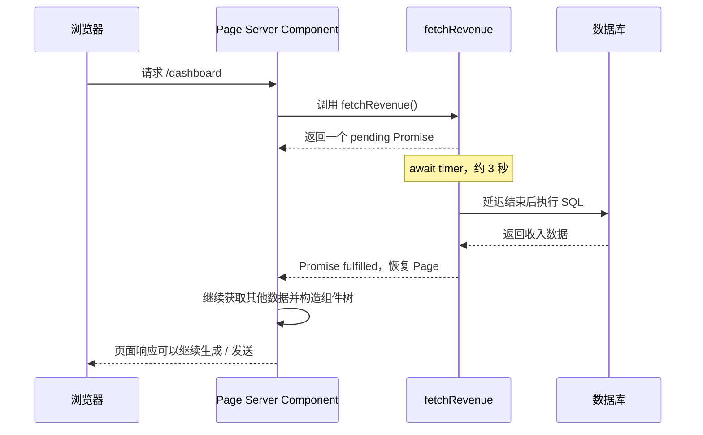

# 第 8 章：静态与动态渲染 (Static and Dynamic Rendering)

在上一章中，你完成了仪表盘总览页面的数据拉取。然而，我们也简要探讨了当前实现的两个局限性：

1. 各项数据请求无意间构成了相互阻塞的“请求瀑布（Waterfall）”。
2. 当前仪表盘采用的是静态渲染，因此后续数据库中的任何数据更新都不会实时反映在页面上。

**本章内容概览：**

- 什么是静态渲染（Static Rendering），以及它如何提升应用性能。
- 什么是动态渲染（Dynamic Rendering），以及何时应该使用它。
- 让仪表盘动态化的不同途径。
- 模拟慢速数据请求，观察其对页面渲染造成的具体影响。

**本章主线：** 页面是在构建时生成，还是在用户请求时生成？当请求时数据只在访问发生后才能确定时，Next.js 如何组织渲染？如果某个数据请求很慢，页面为什么会等待？

---

# 1. Rendering Fundamentals：渲染发生在什么时候？

## 1.1 先把三个容易混淆的概念分开

讨论 Static Rendering 和 Dynamic Rendering 前，需要区分：

1. **React Component Rendering：** React 执行组件，计算出组件树对应的 UI。
2. **Server Components Rendering：** 在服务器环境执行 Server Components，读取服务器资源并产生可序列化的组件结果。
3. **Next.js Route Rendering：** Next.js 把路由、组件树、请求上下文、缓存和响应输出组织起来，最终形成页面响应。

它们有关联，但不是同一个概念。

尤其不能把 Server Components 直接等同于 SSR：

- Server Components 说明组件在哪种环境执行；
- **SSR 说明服务器为一次页面请求生成 HTML 的过程**。

一个 Server Component 可以在构建阶段执行，也可以在服务器收到请求时执行。

React 官方明确说明，Server Components 可以在 CI 构建阶段运行，也可以由 Web Server 针对每次请求运行。[React — Server Components](https://react.dev/reference/rsc/server-components)

---

## 1.2 Build Time 与 Request Time

理解本章最关键的是：**同一份服务器组件代码，可以在不同时间执行。**

### Build Time

Build Time 是应用构建阶段。运行 `next build` 时，Next.js 会编译应用、分析路由，并对符合预渲染条件的页面执行 prerendering。

如果一个页面所需的数据在构建阶段可以确定，而且没有阻止预渲染的请求时依赖，那么框架就可以提前执行组件并生成结果。

### Request Time

Request Time 是用户请求到达服务器之后。此时框架才能确定当前请求携带的 Cookie、Header、URL 参数等信息，也可以执行必须针对当前访问者运行的数据读取。

例如：

- 用户 A 和用户 B 的登录 Cookie 不同；
- `/search?q=next` 与 `/search?q=react` 的查询参数不同；
- 请求的 `Accept-Language` 或其他 Header 可能不同。

这些值不能在一次通用构建过程中提前为所有用户算出同一个结果。

---

## 1.3 Prerendering、HTML 与 RSC Payload

“预渲染”（Prerendering）不是简单地把 TSX 代码编译成静态 HTML 字符串。在 Next.js App Router 架构中，服务端会并行协同生成两种核心产物：
- **HTML：** 浏览器首次访问时能够直接解析并渲染的静态标签，保证首屏内容以最快速度呈现（FCP），同时对搜索引擎友好。
- **RSC Payload（React Server Component Payload）：** React 服务端组件执行后的序列化紧凑数据流（Flight 协议）。它记录了服务端组件的渲染树、客户端组件的占位引用与对应 JS 代码路径，以及服务端传递给客户端组件的 Props 数据。

初学者常误以为服务端是“分别独立生成 HTML 和 RSC Payload”，实际上二者存在严格的先后因果链：

```
[Server Components (TSX)] 
        │
        ▼ 
[RSC Payload (Flight 虚拟 DOM 树)] 
        │
        ├──> 作为输入驱动 SSR 渲染器 ──> [首屏静态 HTML 标签]
        │
        └──> 作为数据流内嵌下发 ──────> [HTML 底部的 <script> 标签]
```

1. **第一步：** Next.js 首先在服务端执行 Server Components，生成描述整棵组件树的 **RSC Payload**。
2. **第二步：** 服务端 SSR 渲染器**以该 RSC Payload 为输入**，将其转换为可在浏览器直接展示的 **静态 HTML**。
3. **关键结论：** 没有 RSC Payload，服务端根本无法独立渲染出包含 Client Components 占位符的完整 HTML 骨架。

在用户首次打开页面时，浏览器与服务器**只发生一次文档级 HTTP 请求**：

- **单次往返与数据内嵌：** 服务端将渲染出的 HTML 发送给浏览器，同时将 **RSC Payload 直接内联（Inline）在 HTML 底部的 `<script>` 标签中**（在网页源代码中可见形如 `self.__next_f.push(...)` 的代码）。
- **极速可见（FCP）：** 浏览器解析 HTML，用户瞬时看到页面骨架与文字，无需等待任何 JavaScript 下载或执行。
- **免二次网络请求：** 当后续客户端 React 脚本下载完成后，直接就地读取内嵌在 HTML 里的 RSC 数据，无需再向服务器额外发起第二次请求索取状态。

浏览器光有 HTML 是无法直接让页面产生交互能力的。客户端 React 在接管页面（Hydration）时，**核心依据是 RSC Payload，而非仅仅读取 HTML DOM**：

- **HTML 的局限：** HTML 只是纯静态的标签字符串，它丢失了组件的层级边界、事件绑定线索，以及服务端向客户端传递的复杂 JS 状态（如非字符串 Props、Symbol、嵌套对象等）。
- **注水真实过程：** 客户端 React 解析内嵌的 RSC Payload，在浏览器内存中重构虚拟 DOM（Fiber 树），再与页面中已存在的 HTML DOM 节点进行对比与事件对齐（Reconciliation）。

一个常见的误区是：“*Server Component 在服务端执行，Client Component 仅在浏览器端执行*”。

实际上，Client Component 具有“两栖性”：

- **在生成的 HTML 中：** Client Component **同样会在服务端被执行一次并预渲染为静态 HTML 标签**，确保用户在 JS 下载完成前就能看到组件的初始外观，避免布局跳跃。
- **在 RSC Payload 中：** Client Component 不会序列化内部的业务逻辑代码，而是输出为一个**客户端引用占位符（Client Reference）**，指明加载该组件所需的 JS Chunk 路径及 Props。

Next.js App Router 的核心优势在于将“首次加载”与“后续导航”拆分为了两条完全不同的高效通道：

| 交互场景         | 触发方式             | 服务端传输的内容                         | 客户端处理行为                                               |
| ---------------- | -------------------- | ---------------------------------------- | ------------------------------------------------------------ |
| **首次整页访问** | 输入 URL 回车 / 刷新 | **HTML 文档 + 内嵌的 RSC Payload**       | 浏览器秒级渲染 HTML，随后利用内嵌 Payload 完成客户端注水     |
| **后续页面跳转** | 点击 `<Link>` 组件   | **纯 RSC Payload 数据流（0 字节 HTML）** | React 接收增量 Payload，局部 Patch 变动的 Page，**外层 Layout 状态与 DOM 永不销毁** |

---

## 1.4 `next build` 做了什么？

Next.js 官方的构建说明把 `next build` 概括为多个阶段：

1. 初始化配置和构建环境；
2. 扫描目录并发现路由；
3. 编译客户端与服务器代码；
4. 静态分析路由，判断哪些内容可以预渲染；
5. 预渲染静态页面或静态 Shell，并生成客户端导航所需的 RSC 数据；
6. 写出构建产物并展示路由结果。

其中与本章直接相关的是第 4、5 步：**静态生成不是浏览器访问时临时决定要不要缓存，而是构建阶段就会对路由进行分析和预渲染。**

官方参考：[Building Your Application — What `next build` does](https://nextjs.org/docs/app/guides/building)。



注意：在启用 Cache Components 的当前模型中，静态分析的目标更接近于检查路由能否生成一个有效的静态 Shell，而不只是简单地把整条路由分成“纯静态”与“纯动态”。后文会展开。

---

## 1.5 一个核心判断

Static / Dynamic Rendering 回答的是**渲染工作的时间安排**，不是组件是不是 Server Component。

| 概念                            | 回答的问题                                     |
| ------------------------------- | ---------------------------------------------- |
| Server Component                | 组件在哪个环境执行？                           |
| Client Component                | 哪些组件逻辑需要进入客户端以支持交互？         |
| Static Rendering / Prerendering | 可复用的页面结果能否提前生成？                 |
| Dynamic Rendering               | 哪些内容必须等请求到达后才能确定并生成？       |
| Streaming                       | 结果能否分阶段发送，而不是等所有内容都准备好？ |

---

# 2. 静态预渲染（Static Rendering）的工作机制

## 2.1 定义

课程对 Static Rendering 的定义是：数据获取和页面渲染在服务器上提前发生，**通常是在构建阶段（Build time，即部署执行时）或数据重新验证（Revalidating data）阶段完成**。

用户访问时，服务器或部署平台可以提供已经生成并缓存的结果。



这里的关键不是“页面里没有数据”，而是：**生成结果所依赖的数据在生成时已经能够确定，并且可以在一定范围内被多个请求复用。**

---

## 2.2 为什么静态预渲染更快？（优点）

如果每个访问都需要重新执行组件、查询数据库、组装页面，用户请求就必须承担这些工作。

静态预渲染把其中一部分工作提前到构建或重新验证阶段：

```text
动态请求路径：
用户请求 → 读取数据 → 执行组件 → 生成响应 → 返回

静态预渲染路径：
构建 / 重新验证时：读取数据 → 执行组件 → 生成并缓存
用户请求时：请求 → 读取已生成结果 → 返回
```

每当用户访问你的应用时，服务端直接返回预先生成好的缓存结果。静态渲染具有以下核心优势：

- **更快的访问速度（Faster Websites）**：预渲染的静态内容可以缓存在全球内容分发网络（CDN，如 Vercel Edge Network）上，确保世界各地的访问者都能以极低的延迟快速加载页面。
- **降低服务器计算负载（Reduced Server Load）**：因为内容已被静态缓存，服务器无需针对每一个访问请求实时重新执行代码，能显著降低算力开销与服务器成本。
- **优良的搜索引擎优化（SEO）**：页面首次加载时所有内容与 HTML 结构均已就绪，极大方便了搜索引擎爬虫的抓取与索引，有助于提升 SEO 排名。

SEO 需要谨慎理解：预渲染能改善爬虫获得内容的条件，但不会自动保证搜索排名提升。搜索排名仍由内容质量、链接、技术和搜索引擎规则等多因素决定。

---

## 2.3 哪些页面适合静态预渲染？

静态渲染**非常适用于无个性化数据或所有用户共享通用内容的场景**（如静态技术博客、营销落地页、通用商品展示页）。但对于包含用户专属数据、且需要频繁实时更新的仪表盘应用而言，纯静态渲染并不合适。

适合的典型场景是内容对不同访问者基本相同，并且不要求每次请求都重新计算：

- 博客文章；
- 文档页面；
- 面向所有人的产品介绍页面；
- 不需要用户身份就能展示的公共内容。

不适合直接将同一份结果共享给所有用户的场景：

- 当前登录用户的个人资料；
- 只允许当前用户查看的订单；
- 根据用户权限展示的管理面板；
- 需要根据当前请求参数产生不同结果的页面。

“数据变化频繁”并不意味着一定不能使用静态策略。它意味着必须认真考虑缓存有效期和重新验证策略，而不是无限期提供旧结果。

---

## 2.4 Revalidation：静态结果如何更新？

静态结果可以被重新生成。课程用一句话概括为：页面可以在构建时生成，也可以在数据重新验证时再次生成。

需要区分两个时间点：

- **数据变化的时间：** 数据库中的记录发生变化。
- **缓存重新验证的时间：** Next.js 判断缓存需要重新获取或被显式失效。

两者不一定同时发生。比如数据库刚刚更新，但缓存仍处于有效期内，用户可能暂时看到旧内容；等到重新验证完成，后续访问才得到新结果。

### 时间型重新验证

旧缓存模型中可以通过 `revalidate` 等配置指定重新验证周期。例如：

```ts
// 旧缓存模型的示意写法
export const revalidate = 3600; // 1 小时
```

它表达的是缓存有一个重新验证周期，并不等于数据库每小时主动推送变化。

启用 Cache Components 的 Next.js 16 模型中，使用 `use cache` 配合 `cacheLife()` 指定缓存生命周期：

```ts
import { cacheLife } from 'next/cache';

export async function getPublicProducts() {
  'use cache';
  cacheLife('hours');

  return db.query.products.findMany();
}
```

这里 `use cache` 让函数结果进入缓存；`cacheLife('hours')` 选择缓存生命周期配置。缓存值可以在一段时间内被复用，达到重新验证条件后再按策略刷新。

### 按事件重新验证

当前文档提供了几种按需更新缓存的 API：

- `cacheTag()`：给缓存结果打标签；
- `revalidateTag()`：按标签使相关缓存过期或变为陈旧；
- `updateTag()`：适合 Server Action 中需要立即看到自己写入结果的场景；
- `revalidatePath()`：按路由路径使相关缓存失效。

需要特别注意：当前 `revalidateTag(tag, 'max')` 推荐使用 stale-while-revalidate 行为。即可以先提供陈旧结果，同时在后台获取新内容。它不是“这次调用结束时，所有调用者已经拿到最新数据库值”的承诺。

官方参考：[Revalidating](https://nextjs.org/docs/app/getting-started/revalidating)。

---

## 2.5 静态渲染不等于 Static Export

两个概念经常混淆：

- **Static Rendering / Prerendering：** Next.js 在构建或重新验证阶段提前生成页面结果。应用仍然可以运行在 Next.js 服务器上，也可以使用服务器能力。
- **Static Export：** 把应用导出为纯静态文件，部署时不依赖 Next.js 服务器处理请求。

所以，不要因为某个 App Router 页面是静态预渲染的，就推断整个项目一定是静态托管、没有服务器。

---

## 2.6 本节 mental model

静态预渲染的本质是把可复用的计算提前做完，并在后续请求中复用结果。真正需要设计的是“哪些结果可以安全复用、复用多久、何时更新”。

---

# 3. 请求时动态渲染的工作机制

## 3.1 定义

课程中的 Dynamic Rendering 是指：在动态渲染模式下，内容是在请求阶段（Request time，即用户实际发起访问的时刻）在服务端为每位访问者实时渲染生成的。

它适合两类典型数据：

1. **实时或频繁变化的数据：** 例如订单状态、仪表盘指标。
2. **请求专属的数据：** 例如当前用户身份、Cookie、URL 查询参数。



和 Static Rendering 相比，核心差别不是“有没有缓存”这么简单，而是页面结果是否依赖构建时未知、必须在访问发生时才能确定的信息。

动态渲染具有以下核心优势：

- **实时数据（Real-Time Data）**：允许应用展示最新的或高频变动的数据，是数据变动频繁业务的理想选择。
- **个性化定制内容（User-Specific Content）**：便于针对不同登录用户提供个性化视图（如专属财务报表、个人资料页），并能依据用户的实时交互做出响应。
- **支持读取请求时上下文（Request Time Information）**：允许组件直接读取只有在用户发起请求瞬间才能确定的信息，例如 Cookies、请求头信息以及 URL 查询参数（Search Params）。

---

## 3.2 请求时上下文（Request-time Information）

### Cookies

**Cookie 是浏览器在请求中发送给服务器的数据**。服务器只有**收到这次 HTTP 请求后，才能知道请求携带了什么 Cookie**。

Next.js App Router 中：

```ts
import { cookies } from 'next/headers';

export default async function Page() {
  const cookieStore = await cookies();
  const theme = cookieStore.get('theme')?.value;

  return <main>Theme: {theme}</main>;
}
```

`cookies()` 读取的是当前 HTTP 请求携带的 Cookie。它的返回值依赖本次请求，因此不能在构建时为所有用户预先得出同一个值。

注意：在 Server Component 中读取 Cookie 与修改 Cookie 是两件事。读取可以发生在 Server Component；设置或删除 Cookie 要在能够修改响应头的 Server Function / Route Handler 等位置完成，不能把“组件渲染时读取 Cookie”理解成“组件渲染时可以随意写回 Cookie”。

官方参考：[cookies()](https://nextjs.org/docs/app/api-reference/functions/cookies)。

### Headers

HTTP Header 也属于请求上下文：

```ts
import { headers } from 'next/headers';

export default async function Page() {
  const requestHeaders = await headers();
  const userAgent = requestHeaders.get('user-agent');

  return <p>{userAgent}</p>;
}
```

`headers()` 返回只读的 Web `Headers` 对象。它的**内容取决于本次请**求，因此是请求时数据。

官方参考：[headers()](https://nextjs.org/docs/app/api-reference/functions/headers)。

### URL Search Params

页面的 `searchParams` 反映当前 URL 查询参数：

```ts
// app/search/page.tsx
export default async function Page({
  searchParams,
}: {
  searchParams: Promise<{ q?: string }>;
}) {
  const { q } = await searchParams;
  return <h1>Search: {q ?? ''}</h1>;
}
```

`/search?q=next` 和 `/search?q=react` 是不同的请求上下文。**页面输出依赖当前 URL 的查询参数**，因此不能只根据构建时一个固定值生成所有请求都通用的结果。

这里的 `searchParams` 是 Page 收到的 Promise，解析后得到普通 JavaScript 对象，不是 `URLSearchParams` 实例。

官方参考：[page.js — searchParams](https://nextjs.org/docs/app/api-reference/file-conventions/page)。

---

## 3.3 Next.js 16 的 Async Request APIs

Next.js 15 开始将一些 Request APIs 改为异步，并保留过渡期兼容。Next.js 16 已移除同步访问方式，必须异步读取：

- `cookies()`；
- `headers()`；
- `draftMode()`；
- Page / Layout / Route 等接收到的 `params`；
- Page 接收到的 `searchParams`。

例如：

```ts
// Next.js 16：正确的异步读取方式
const cookieStore = await cookies();
const requestHeaders = await headers();
const { slug } = await params;
const { query } = await searchParams;
```

这不只是语法形式变化。它明确表达这些值来自请求上下文，必须在运行时异步取得。

官方依据：[Upgrading to Next.js 16 — Async Request APIs](https://nextjs.org/docs/app/guides/upgrading/version-16)。

---

## 3.4 Dynamic Route Segment 不等于 Dynamic Rendering

这是非常重要的术语辨析。

例如：

```text
app/
  blog/
    [slug]/
      page.tsx
```

`[slug]` 表示路由路径中有一个动态段。它说明 URL 的一部分是变量，并不自动说明页面一定要对每次请求都动态渲染。

如果已知要生成哪些 `slug`，可以通过 `generateStaticParams()` 在构建时提供参数，让部分或全部路径参与预渲染：

```ts
// app/blog/[slug]/page.tsx
export async function generateStaticParams() {
  return [
    { slug: 'intro' },
    { slug: 'next-rendering' },
  ];
}

export default async function Page({
  params,
}: PageProps<'/blog/[slug]'>) {
  const { slug } = await params;
  return <article>Post: {slug}</article>;
}
```

因此：

- Dynamic Route Segment：路由路径中有变量；
- Dynamic Rendering：页面内容依赖请求时数据，必须在请求时处理。

它们是两个不同维度。

官方参考：[Dynamic Route Segments](https://nextjs.org/docs/app/api-reference/file-conventions/dynamic-routes)。

---

## 3.5 旧模型：动态数据访问可能使整条路由动态化

在不启用 Cache Components 的传统 App Router 缓存模型中，使用 `cookies()`、`headers()`、Page 的 `searchParams` 等请求时 API，通常会使对应路由转为请求时渲染。未缓存的数据获取（例如明确要求每次请求重新获取）也可能让路由进入动态渲染路径。

旧模型提供过 Route Segment Config，例如：

```ts
// 旧缓存模型示意：强制请求时渲染
export const dynamic = 'force-dynamic';
```

它的意思不是“只让一小块组件动态”，而是把该路由段按全动态方式处理。

不要把这段代码直接复制到启用了 Cache Components 的 Next.js 16 项目里。新模型不再使用这一组 Route Segment Config 来表达相同策略，下一节会说明。

---

# 4. 渲染策略（Rendering Strategy）、缓存与 Dashboard

前面三个模块建立了基本模型。现在需要回答更实际的问题：一个页面是否只能在 Static 和 Dynamic 之间二选一？缓存和渲染模式是不是一回事？

## 4.1 Static / Dynamic 比较

| 比较维度     | Static Rendering               | Dynamic Rendering                  |
| ------------ | ------------------------------ | ---------------------------------- |
| 主要执行时机 | 构建时或重新验证时             | 用户请求时                         |
| 结果依赖     | 构建阶段可确定、适合复用的数据 | 当前请求才能确定的数据             |
| 请求期间工作 | 主要读取预先生成结果           | 执行请求相关的数据读取和渲染       |
| 常见收益     | 快速响应、降低重复计算         | 个性化、请求相关数据、较新数据     |
| 主要风险     | 缓存过期、数据不够新           | 请求路径较长、服务器负载更高       |
| 典型页面     | 公共文章、文档、公共产品介绍   | 用户仪表盘、个人资料、权限相关页面 |

不应该把表格简化成“静态永远快、动态永远慢”。实际性能还取决于数据源延迟、缓存策略、流式输出、基础设施、内容体积等。

> 页面不是只能 Static 或 Dynamic 二选一

---

## 4.2 Rendering Mode 与 Data Cache 不是同一件事

这两个问题要分开问：

1. **Rendering Mode：** 页面或组件的结果在什么时候生成？
2. **Data Cache：** 某次数据查询的结果能否在后续计算中复用？

例如：

- 一个页面可能在请求时读取用户 Cookie，但同时使用缓存的公共产品目录。
- 一个页面也可能每次都请求时生成，但其中某个与用户无关的昂贵数据查询仍然适合缓存。
- 静态页面则可能在重新验证时更新数据并重新生成。

所以“动态渲染”不等于“所有数据一律不缓存”；“静态渲染”也不等于“数据库里的数据永远不能变化”。

---

## 4.3 两种 Next.js 缓存模型：必须先说明项目配置

当前 Next.js 文档将 Cache Components 模型与 Previous Model 分开说明。你必须先知道项目是否启用 `cacheComponents`，再决定使用哪套配置。

> Next.js 要先区分是否启用 `cacheComponents`，因为两套模型不同。

### A. 不启用 Cache Components：Previous Model

在旧模型中，路由级别的配置会影响整个路由段的缓存与渲染方式。常见配置包括：

- `dynamic`；
- `revalidate`；
- `fetchCache`。

例如 `dynamic = 'force-dynamic'` 用于强制请求时渲染。它属于旧模型的 Route Segment Config。

官方迁移指南明确说明：启用 Cache Components 后，这些路由配置由新的 `use cache`、`cacheLife` 等机制取代。[Migrating to Cache Components](https://nextjs.org/docs/app/guides/migrating-to-cache-components)

### B. 启用 Cache Components：组件 / 函数级组合

在 Next.js 16 中，可以在 `next.config.ts` 启用：

```ts
import type { NextConfig } from 'next';

const nextConfig: NextConfig = {
  cacheComponents: true,
};

export default nextConfig;
```

当前官方文档说明，使用推荐 `create-next-app` 默认配置创建的新 App Router 项目已经启用 Cache Components；对于已有项目，可以根据需要显式配置。请以项目生成的 `next.config.ts` 为准。

启用 Cache Components 后，框架不再只把整条路由当作一块静态或动态内容。它可以组合：

1. **静态内容：** 构建阶段可以确定的内容；
2. **缓存内容：** 用 `use cache` 缓存的数据或组件；
3. **请求时内容：** 依赖 Cookie、Header、URL 或未缓存数据的部分，在请求时生成。

这就是当前 Cache Components / Partial Prerendering 的重要设计方向。

---

## 4.4 Cache Components 与 Partial Prerendering

在新模型中，Next.js 会尽可能提前生成静态 Shell。

对于无法在构建时确定的内容，**开发者需要明确将它放在合适的 Suspense 边界内**，或者对可以复用的部分使用 `use cache`。



例子：一篇公共博客列表对所有人相同，但右上角的用户偏好取决于当前 Cookie。

```tsx
import { Suspense } from 'react';
import { cookies } from 'next/headers';
import { cacheLife } from 'next/cache';

export default function BlogPage() {
  return (
    <>
      <header>
        <h1>Our Blog</h1>
      </header>

      {/* 公共内容：可缓存并加入静态 Shell */}
      <BlogPosts />

      {/* 用户专属内容：在请求时读取 Cookie */}
      <Suspense fallback={<p>Loading preferences...</p>}>
        <UserPreferences />
      </Suspense>
    </>
  );
}

async function BlogPosts() {
  'use cache';
  cacheLife('hours');

  const response = await fetch('https://api.example.com/posts');
  return <PostList posts={await response.json()} />;
}

async function UserPreferences() {
  const cookieStore = await cookies();
  const theme = cookieStore.get('theme')?.value ?? 'light';

  return <p>Current theme: {theme}</p>;
}
```

这段代码展示的是设计模式，不是完整生产实现。`PostList` 需要自行定义；公共请求也应处理错误、超时和数据校验。

这里的关键是：

- `BlogPosts` 是共享内容并使用缓存
- `UserPreferences` 读取请求时 Cookie，并位于 Suspense 边界中。

**新模型怎么组合**：静态 Shell + `use cache` 缓存内容 + Suspense 内的请求时内容。这样可以让静态 Shell 包含博客结构和 fallback，而请求时再补上用户偏好。

> 参考：[Caching — Static, cached, and streaming](https://nextjs.org/docs/app/getting-started/caching)

---

### 4.4.1 `use cache`、`cacheLife` 与 `cacheTag`

- `'use cache'`：把函数或组件纳入缓存范围。
- `cacheLife()`：指定结果的缓存生命周期。
- `cacheTag()`：给缓存结果关联标签，便于后续按标签失效。

例如：

```ts
import { cacheLife, cacheTag } from 'next/cache';

export async function getPublicCatalog() {
  'use cache';
  cacheLife('hours');
  cacheTag('catalog');

  return db.query.products.findMany();
}
```

`use cache` 的参数和返回值必须满足可序列化要求；被缓存的函数也必须有明确的缓存语义。

不要把“读取当前用户身份的逻辑”随意塞进一个跨请求共享的缓存函数中。用户专属数据需要严格处理身份校验、缓存键隔离与数据访问边界。

> 官方参考：[use cache](https://nextjs.org/docs/app/api-reference/directives/use-cache)。

---

## 4.5 缓存个人数据时要特别谨慎

假设 Dashboard 根据当前用户 ID 查询订单：

```ts
const userId = (await cookies()).get('userId')?.value;
const orders = await db.query.orders.findMany({
  where: (orders, { eq }) => eq(orders.userId, userId),
});
```

这里订单数据具有用户隔离要求。不能因为希望提速，就把所有用户的订单缓存到一个没有区分用户身份的共享键里。

设计时至少要问：

1. 这个结果是否对所有用户相同？
2. 如果不是，缓存键是否包含能正确区分数据所有者的标识？
3. 身份和授权是否在正确的服务器端边界校验？
4. 用户权限变化或数据变更时，缓存如何失效？

**缓存不是权限系统。** 即使缓存键能区分用户，也不能省略授权检查。

---

## 4.6 Dashboard 应该怎么理解？

课程里的 Dashboard 具有两个特征：

- 内容可能随发票、客户和收入数据变化；
- 数据与当前用户或权限范围有关。

因此，直接把一份固定的、所有人共享的页面结果作为 Dashboard 的最终答案并不合适。

但这不意味着 Dashboard 页面里的每个部分都必须每次重新查询：

- 用户身份、权限和个性化指标通常需要请求时确定；
- 公共帮助文本、静态导航等可以提前生成；
- 与用户无关且允许短时间陈旧的数据可以缓存；
- 有严格实时性要求的数据可以在请求时获取，或者采用其他实时更新方案。

正确的设计不是简单选择“全静态”或“全动态”，而是按数据的共享性、时效要求和安全边界作选择。

---

# 5. 模拟慢速数据获取

## 5.1 课程实验

我们正在开发的仪表盘应用本质上需要是动态的。

但这也带来了上一章提到的严峻挑战：**如果某个数据请求的速度比其他所有请求都慢很多，会发生什么？**

让我们动手模拟一次耗时较长的数据请求。打开 `app/lib/data.ts`，取消 `fetchRevenue()` 函数内部 `console.log` 和 `setTimeout` 相关的注释代码：

```ts
export async function fetchRevenue() {
  try {
    // Artificial delay for demonstration only.
    console.log('Fetching revenue data...');

    await new Promise((resolve) => setTimeout(resolve, 3000));

    const data = await sql<Revenue[]>`
      SELECT * FROM revenue
    `;

    console.log('Data fetch completed after 3 seconds.');
    return data;
  } catch (error) {
    console.error('Database Error:', error);
    throw new Error('Failed to fetch revenue data.');
  }
}
```

保存代码，在浏览器新标签页中打开 `http://localhost:3000/dashboard/`，你会发现整个页面的加载耗时明显拉长。查看运行终端，应该能看到输出的日志信息：

```
Fetching revenue data...
Data fetch completed after 3 seconds.
```

这里我们通过注入 3 秒的人为延迟来模拟慢查询。引发的结果是：**在数据拉取完成之前，整个页面的 UI 渲染都被彻底阻塞，访问者面对的是长时间的白屏等待。**

这就引出了全栈开发者在采用动态渲染时必须面对的核心痛点：

> **在传统的全页面动态渲染机制下，整个应用的响应速度完全受制于最慢的那一个数据请求。**

课程原文：[Chapter 8 — Simulating a Slow Data Fetch](https://nextjs.org/learn/dashboard-app/static-and-dynamic-rendering)。

---

## 5.2 `setTimeout` 没有阻塞 Node.js 线程

这点需要特别澄清：

```ts
await new Promise((resolve) => setTimeout(resolve, 3000));
```

不是让 JavaScript 主线程连续忙等三秒。它大致完成以下事情：

1. 创建一个 Promise；
2. 执行 `new Promise(...)`，内部调用 `setTimeout`，向 Node.js 定时器阶段注册一个 3 秒后的回调；
3. Promise 处于 pending 状态；
4. `await` 让当前 `async` 函数**暂停执行**，把控制权交还给事件循环；
5. 这 3 秒内，Node.js 可以继续处理其他请求、定时器、I/O 回调等；
6. 3 秒后，`setTimeout` 回调执行 `resolve()`，当前 `async` 函数从 `await` 后面继续执行。

所以准确说法是：

- **会“挂起”当前 async 函数的后续代码**；
- **不会阻塞 Node.js 主线程/事件循环**；
- **不会让其他请求或回调无法执行**。

因此，延迟影响的是**当前异步操作何时能继续完成**，而不是让整个 Node.js 进程在三秒内无法处理其他请求。

> 因为用了 `await`，所以当前 `async` 函数会在 `await` 处暂停，等右侧的 Promise settle（resolve 或 reject）后，再继续执行该函数中 `await` 后面的代码。

---

## 5.3 从数据函数到页面响应的等待链

假设页面写成：

```tsx
export default async function Page() {
  const revenue = await fetchRevenue();
  const invoices = await fetchLatestInvoices();

  return (
    <main>
      <RevenueChart revenue={revenue} />
      <LatestInvoices invoices={invoices} />
    </main>
  );
}
```

在 `Page` 取得 `revenue` 之前，它还不能执行到 `return`。因此，依赖这份数据的组件树无法完整确定。



这解释了课程中的观察：如果页面本身在顶层 `await` 必需数据，而且没有合适的 Suspense / Streaming 边界让其他部分先发送，那么用户会等待这份数据。

---

## 5.4 请求耗时与渲染耗时不是一回事

一个请求最终需要经历多个阶段：

```text
请求到达
  → 读取请求上下文
  → 查询数据库 / 调用后端
  → 等待异步结果
  → 执行剩余组件逻辑
  → 产生 HTML / RSC 输出
  → 发送响应
  → 浏览器解析并展示
```

某个数据请求慢，会把它后面的依赖工作推迟。**但页面是否必须等它完成才能发送任何 UI，取决于组件结构和是否设置了 Suspense / Streaming 边界**。

---

## 5.5 Waterfall 与 Slow Data Fetch 的区别

Chapter 7 和 Chapter 8 连续讲了两个不同的问题：

| 问题              | 成因                                                 | 改进方向                                       |
| ----------------- | ---------------------------------------------------- | ---------------------------------------------- |
| Network Waterfall | 独立请求被代码顺序安排，后一个请求等前一个完成才开始 | 提前启动独立请求、`Promise.all()`              |
| Slow Data Fetch   | 某个请求本身就很慢                                   | 优化数据源、缓存、超时控制，或不要让整页依赖它 |
| 首屏被慢数据拖住  | 首屏必须等待慢数据，但没有更小的渲染边界             | Streaming / Suspense / 静态 Shell              |

并行请求只能解决不必要的请求排队，不能让一份本身需要三秒的数据库查询瞬间结束。

例如三个独立请求耗时为 0.3s、0.5s、3s：

- 串行：大约等待 `0.3 + 0.5 + 3 = 3.8s`；
- 并行：大约等待 `max(0.3, 0.5, 3) = 3s`；
- 将三秒内容放进独立 Suspense 边界：页面静态部分可能先显示，三秒后的区域再补上。

这是理想化时间模型，真实时间还包括调度、数据库连接、网络传输、序列化和渲染开销。

---

# 6. 下一章节

Chapter 8 的慢请求实验揭示一个体验问题：如果用户必须等待关键数据完成才能看到页面，页面就会显得迟缓。

Chapter 9 Streaming 将进一步回答：

- 能否先发送已经准备好的页面内容？
- 能否先显示 fallback，再把慢数据对应的 UI 补上？
- 如何用 Suspense 将页面拆成不同的加载边界？

本章只建立这个问题模型，不提前讲解 `loading.tsx`、Suspense 的完整用法或 Streaming 实现。