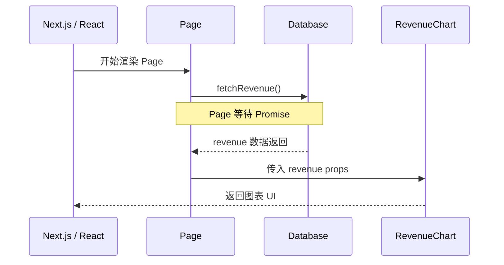
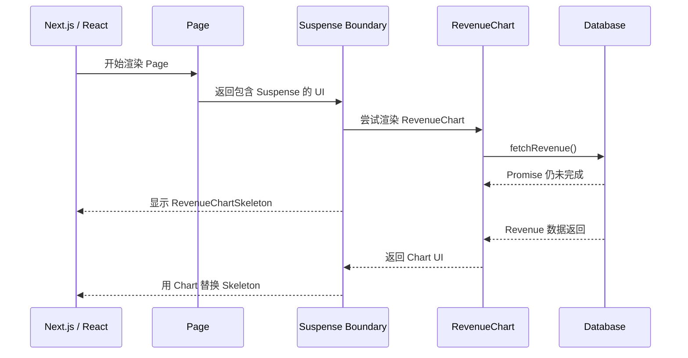

# Chapter 9 — Streaming

在上一章中，你学习了 Next.js 的不同渲染方式，并探讨了慢速数据请求对应用整体性能的负面影响。本章我们将探讨在存在慢速数据请求的情况下，如何改善用户体验。

**本章内容概览：**

- 什么是流式传输（Streaming）以及何时使用它。
- 如何通过 `loading.tsx` 和 `Suspense` 实现流式传输。
- 什么是加载骨架屏（Loading Skeletons）。
- 什么是 Next.js 路由组（Route Groups），以及何时使用它们。
- 在应用中应该将 React Suspense 边界放置在哪里。

---

# 0. 从 Chapter 7、8 到 Chapter 9：问题是如何演进的？

这三章讨论的是同一条数据展示链路上的不同问题。

| 章节      | 面对的问题                                   | 主要手段                             | 解决的是什么                       |
| --------- | -------------------------------------------- | ------------------------------------ | ---------------------------------- |
| Chapter 7 | 多个独立请求被顺序启动，产生不必要的等待     | `Promise.all()`                      | 改善多个异步任务的启动和等待关系   |
| Chapter 8 | 一个必要的数据请求本身很慢，页面仍可能等待它 | Dynamic Rendering、慢请求实验        | 认识请求时数据获取带来的等待       |
| Chapter 9 | 页面中的一个区域慢，不应让其他区域也一起等待 | Streaming、`loading.tsx`、`Suspense` | 让已经准备好的页面区域先交付和显示 |

这三个问题不能混为一谈：

- **并行数据获取**解决“请求是否不必要地排队”。
- **Streaming**解决“页面内容是否必须等到全部准备好才能开始展示”。
- Streaming 不会自动让数据库查询变快，也不等于取消慢请求；它改变的是内容交付和显示的节奏。

---

## 0.1 本章的核心心智模型

把页面想成由多个区域组成。每个区域可能有自己的数据依赖：标题可能不需要查询数据库，Revenue Chart 需要读取收入数据，Latest Invoices 需要读取最新发票。

如果把所有数据都放在 Page 的最外层等待，慢数据就可能延迟整个页面内容的返回。

若把等待放进合适的 Suspense Boundary，React / Next.js 就可以先显示 fallback 或其他已准备好的内容，再在异步内容就绪后显示它。

---

# 1. 流式传输（Streaming）

## 1.1 什么是流式传输？

流式传输（Streaming）是一种数据传输技术，允许将路由拆分为更小的“数据块（Chunks）”，并在它们准备就绪时从服务端逐步流式传输到客户端。


通过流式传输，你可以防止慢速数据请求阻塞整个页面。这使得用户可以立即查看页面的已就绪部分并与之交互，而无需等待所有数据加载完毕才能看到任何 UI。


流式传输与 React 的组件模型天然契合，因为**每个组件都可以视为一个独立的数据块（Chunk）**。

**网络协议原语（HTTP Chunked）**： 初学者常困惑：“一个 HTTP 请求不是只能返回一个响应吗？Next.js 是怎么把后来的组件塞进已经发出的响应里的？”

底层依赖 HTTP/1.1 的 **`Transfer-Encoding: chunked`**（分块传输编码）或 HTTP/2 流。

服务端首先输出主页面的 HTML 骨架，连接保持不断开；当 Suspense 内的数据就绪时，向同一个 HTTP 管道追加推送包含内联 `<script>` 的 HTML 块，客户端 React 收到后就地 Patch DOM。

在 Next.js 中实现流式传输有两种途径：

1. **页面级别**：使用 `loading.tsx` 文件（它会在底层自动为你创建 `<Suspense>` 边界）。
2. **组件级别**：针对特定组件使用 `<Suspense>`，实现粒度更细的渲染控制。

关键不在于“把页面切成很多文件”，而在于：**页面不必等到所有内容都准备完成，才开始向用户展示任何 UI。**

例如 Dashboard 有三个区域：

- `CardWrapper`：展示统计卡片；
- `RevenueChart`：展示收入图表；
- `LatestInvoices`：展示最近的发票。

假设 `RevenueChart` 的数据库请求需要 3 秒，而另外两个区域更快。如果整个页面必须等 Revenue 数据返回后才生成，用户就会长时间看不到主要内容。Streaming 允许其他已经准备好的区域先出现，Revenue 区域暂时显示自己的 fallback。

---

## 1.2 Streaming 与“并行请求”不是同一件事

两者经常一起使用，但它们解决的问题不同。

| 对比                       | 并行数据获取                   | Streaming                   |
| -------------------------- | ------------------------------ | --------------------------- |
| 关注点                     | 异步请求何时启动、是否相互等待 | UI 内容何时可以交付和显示   |
| 典型工具                   | `Promise.all()`                | `loading.tsx`、`<Suspense>` |
| 能否加快单个慢查询         | 不一定                         | 不会直接加快查询            |
| 能否让其他已准备区域先显示 | 本身不负责页面显示边界         | 可以，在边界设计正确时实现  |

例如，三个独立查询可以通过 `Promise.all()` 并发启动，但如果 Page 在返回 JSX 之前 `await` 了一个慢 Promise，页面仍然可能等它完成。

反过来，使用 Suspense 也不意味着底层数据请求一定会并行；是否并行还取决于请求何时被启动以及它们之间是否有依赖。

---

## 1.3 一个必要的边界认识

课程把每个组件解释成可以流式展示的 chunk，这是帮助理解的抽象。不要把它理解成“每个 React 组件都必定对应一个独立 HTTP 网络块”。React 树中的组件边界、Suspense 边界、服务器输出片段和网络层实际分块不是一一对应的概念。

本章只需要掌握应用层行为：**Suspense Boundary 决定哪一部分内容可以先显示 fallback，并在其子树就绪后显示实际内容。**

---

# 2. Route-level Streaming：使用 `loading.tsx`

## 2.1 `loading.tsx` 是什么？

`loading.tsx` 是 Next.js App Router 的特殊文件约定。开发者在某个路由段中创建它，Next.js 会把它用作该路由内容加载期间的 fallback UI。

```tsx
// app/dashboard/loading.tsx
export default function Loading() {
  return <div>Loading...</div>;
}
```

访问 `/dashboard` 时，路由内容尚未准备好，用户可以先看到 `Loading...`，而不是完全空白的内容区域。


`loading.tsx` 是基于 React Suspense 构建的 Next.js 特殊文件，允许你定义在页面动态内容加载过程中展示的后备占位 UI（Fallback UI）。

可以把它理解为 Next.js 提供的一种文件系统级快捷方式：开发者不必亲自在对应位置写出 `<Suspense fallback={...}>`，而是通过文件约定提供 fallback。

---

## 2.2 `loading.tsx` 与布局、页面的关系

以课程中的 Dashboard 为例：

```text
app/
└── dashboard/
    ├── layout.tsx
    ├── loading.tsx
    ├── page.tsx
    ├── invoices/
    │   └── page.tsx
    └── customers/
        └── page.tsx
```

在课程示例里，`SideNav` 位于共享布局中，而 Dashboard 页面内容可能需要等待动态数据。于是可以先显示共享布局中的 SideNav 和 `loading.tsx` 的 fallback，页面内容准备好后再替换 fallback。

需要记住：**加载边界的位置由路由文件层级决定**。课程中的 SideNav 能先显示，**是因为它处于该加载 fallback 所包围页面内容之外的共享布局区域，而且本身可以先完成渲染**。若布局自身也要等待数据，实际行为就会不同。

**当前 Next.js 文档补充的边界情况：**

-  `loading.tsx` 会自动包围对应路由段的 `page.tsx` 及其下方内容，但同级 `layout.tsx` 位于该边界之外。
- 如果同级 Layout 自己读取运行时信息（例如 `cookies()`、`headers()`）或等待未缓存的数据，它可能在 `loading.tsx` 的 fallback 出现之前就阻塞导航。
- 此时需要考虑把这部分动态工作放入 Layout 内部更小的 `<Suspense>`，或将数据获取移到可被 `loading.tsx` 覆盖的页面子树中。

> 参见 [Next.js Fetching Data：Streaming](https://nextjs.org/docs/app/getting-started/fetching-data)。

---

## 2.3 为什么页面还没全部加载好，用户仍能操作 SideNav？

由于侧边栏 `<SideNav>` 是静态组件，它会立即渲染展示。用户可以在动态内容加载的同时与 `<SideNav>` 正常交互。

这带来两个体验：

- **即时反馈**：用户较早看到页面框架和加载状态，不会面对完全空白的页面。
- **可中断导航（Interruptible Navigation）**：用户无需等待页面彻底加载完毕就可以直接点击导航离开。

“可中断导航”描述的是导航体验：正在加载的路由内容不应把用户锁死在当前页面。它不等于承诺底层数据库查询一定会被取消；导航状态与底层请求是否取消是两个不同问题。

---

## 2.4 `loading.tsx` 的适用场景

适合：

- 某个路由的主体内容整体依赖服务端数据；
- 希望在页面主体准备期间提供一个统一的加载状态；
- 该路由有明确的共享布局，布局可以先展示。

不一定适合：

- 页面中只有一个小区域较慢，其他内容应该立即显示；
- 页面不同区域需要不同的加载提示；
- 整页 Skeleton 会隐藏用户本来可以先使用的内容。

这种时候可以考虑更细粒度的组件级 Suspense。

为了进一步提升用户体验，我们可以使用**加载骨架屏（Loading Skeleton）来替代纯文本的 "Loading…"**。

---

# 3. Loading Skeletons 与 Route Groups

## 3.1 Loading Skeleton 是什么？

加载骨架屏是**实际 UI 的简化占位轮廓**。许多网站使用骨架屏来向用户明确示意内容正在加载。

它用近似真实内容的形状表示“这里稍后会出现什么”。例如：

- 图表区域显示一块图表轮廓；
- 统计卡片显示卡片大小和文本行的灰色占位；
- 发票列表显示若干行占位结构。

写入 `loading.tsx` 的 UI 会作为静态资源优先推送到客户端，随后剩余的动态内容再从服务端流式传输过来。

在 `loading.tsx` 中导入 `<DashboardSkeleton>` 组件：

```tsx
// /app/dashboard/loading.tsx
import DashboardSkeleton from "~/ui/skeletons";

export default function Loading() {
  return <DashboardSkeleton />;
}
```

刷新 `http://localhost:3000/dashboard`，即可看到整体仪表盘的骨架屏占位效果。


---

## 3.3 使用路由组修复骨架屏范围问题

当前的代码存在一个问题：由于 `loading.tsx` 位于 `/app/dashboard` 根目录下，它的层级高于 `/invoices/page.tsx` 和 `/customers/page.tsx`，因此访问发票和客户页面时也会意外触发这个骨架屏。

我们可以通过 **路由组（Route Groups）** 解决这一问题：

1. 在 `dashboard` 目录下新建一个名为 `/(overview)` 的文件夹。
2. 将 `loading.tsx` 和 `page.tsx` 移入该文件夹内：


```
/app/dashboard
 ├── /(overview)
 │    ├── loading.tsx
 │    └── page.tsx
 ├── /customers
 │    └── page.tsx
 ├── /invoices
 │    └── page.tsx
 └── layout.tsx
```

现在，`loading.tsx` 只会作用于仪表盘总览页。

Route Group 是 Next.js App Router 的文件夹约定：把文件夹名称放在括号中，例如 `(overview)`。括号中的名称用于组织路由文件，不会被包含在 URL 路径中。

关键不是括号有特殊的 Loading 功能，**而是 Route Group 改变了文件系统中的路由组织层级，同时不增加 URL 路径段**。

**路由组**允许你在不影响 URL 路径结构的前提下对文件进行逻辑归类。使用圆括号 `()` 命名的文件夹名称不会出现在最终的 URL 中。因此，`/dashboard/(overview)/page.tsx` 对应的实际访问路径仍然是 `/dashboard`。

路由组除了能隔离 `loading.tsx` 的作用域外，还常用于将大型应用拆分为不同模块（例如 `(marketing)` 营销路由与 `(shop)` 商店路由），或按团队职责划分目录。

---

# 4. 组件级流式传输

## 4.1 Suspense 的基本作用

React 的 `<Suspense>` 用来为子树尚未准备好的情况提供 fallback：

```tsx
import { Suspense } from 'react';

<Suspense fallback={<LoadingSkeleton />}>
  <SomeComponent />
</Suspense>
```

可以从三个部分理解它：

| 部分       | 作用                                 |
| ---------- | ------------------------------------ |
| `Suspense` | 建立一个等待边界                     |
| `children` | 真正希望展示的内容                   |
| `fallback` | children 暂时无法显示时展示的替代 UI |

当边界内部的内容在渲染期间发生 Suspense（挂起），React 可以先显示 fallback。等内容满足显示条件后，再显示真实内容。

在本章的 Server Component 示例中，异步组件执行到 `await fetchRevenue()`，在 Promise 尚未完成时无法继续生成完整组件结果；如果该组件位于 Suspense 边界内，边界就可以提供 fallback。

**重要：Suspense 不是“自动观察所有异步请求”的通用监听器。** React 官方说明，Suspense 不会自动检测在 `useEffect` 或事件处理函数中发起的数据获取。本章所用的是 Next.js / React 支持的异步 Server Component 渲染路径。

## 4.2 如何对特定组件进行流式传输？

到目前为止，我们流式传输的是整个页面。

```tsx
import RevenueChart from '@/app/ui/dashboard/revenue-chart';
import { fetchRevenue } from '@/app/lib/data';

export default async function Page() {
  const revenue = await fetchRevenue();

  return (
    <main>
      <h1>Dashboard</h1>
      <RevenueChart revenue={revenue} />
    </main>
  );
}
```

执行顺序：



这里 `Page` 在返回 JSX 之前就等待 `fetchRevenue()`。如果没有一个包围 Page 的更外层 Suspense fallback，Page 尚未返回的这段时间里，位于它返回值内部的 `<Suspense>` 还没有机会被创建。也就是说：**挂起必须发生在渲染期间、由 React 接住那个 promise；若在组件体里先等完数据再返回 JSX，这层边界就形同虚设**。

**那我们如何对特定组件进行流式传输呢**？

你可以借助 React Suspense 实现更细粒度的控制，对**特定组件**进行流式传输。

Suspense 允许你将应用的某些部分的渲染推迟到满足条件（例如数据加载完成）之后。你可以将动态组件包裹在 Suspense 中，并传入后备占位组件（Fallback），在动态组件加载期间展示。

在前面的章节中，慢查询 `fetchRevenue()` 拖慢了整个页面的显示速度。借助 Suspense，我们可以仅流式传输收入图表组件，同时让页面的其余部分立即展示。

要做到这一点，需要把数据获取逻辑**下沉到组件内部**。这是本章**最重要的代码结构变化**。

首先，从 `/dashboard/(overview)/page.tsx` 中删除所有 `fetchRevenue()` 的调用及相关变量：

```ts
// /app/dashboard/(overview)/page.tsx
import { Card } from '@/app/ui/dashboard/cards';
import RevenueChart from '@/app/ui/dashboard/revenue-chart';
import LatestInvoices from '@/app/ui/dashboard/latest-invoices';
import { lusitana } from '@/app/ui/fonts';
import { fetchLatestInvoices, fetchCardData } from '@/app/lib/data'; // 移除 fetchRevenue
 
export default async function Page() {
  // 删除 const revenue = await fetchRevenue()
  const latestInvoices = await fetchLatestInvoices();
  const {
    numberOfInvoices,
    numberOfCustomers,
    totalPaidInvoices,
    totalPendingInvoices,
  } = await fetchCardData();
 
  return (
    // ...
  );
}
```

接着从 `react` 中导入 `<Suspense>`，用其包裹 `<RevenueChart/>`，并传入 `<RevenueChartSkeleton>` 作为回退占位：

```tsx
// app/dashboard/(overview)/page.tsx
import { Suspense } from 'react';
import RevenueChart from '@/app/ui/dashboard/revenue-chart';
import { RevenueChartSkeleton } from '@/app/ui/skeletons';

export default async function Page() {
  // 这里仍然可以获取页面其他区域需要的数据。
  // 重点是不要在这里 await fetchRevenue()。

  return (
    <main>
      <h1>Dashboard</h1>

      <Suspense fallback={<RevenueChartSkeleton />}>
        <RevenueChart />
      </Suspense>
    </main>
  );
}
```

最后，修改 `<RevenueChart>` 组件让其自行获取数据，并移除原先传入的 props：

```tsx
// /app/ui/dashboard/revenue-chart.tsx
import { generateYAxis } from '@/app/lib/utils';
import { CalendarIcon } from '@heroicons/react/24/outline';
import { lusitana } from '@/app/ui/fonts';
import { fetchRevenue } from '@/app/lib/data';
 
// ...
 
export default async function RevenueChart() { // 改为异步组件，移除 props
  const revenue = await fetchRevenue(); // 在组件内部直接拉取数据
 
  const chartHeight = 350;
  const { yAxisLabels, topLabel } = generateYAxis(revenue);
 
  if (!revenue || revenue.length === 0) {
    return <p className="mt-4 text-gray-400">No data available.</p>;
  }
 
  return (
    // ...
  );
}
```

执行关系变成：



刷新页面，你会发现页面骨架与其它指标卡片几乎立即呈现，而 `<RevenueChart>` 所在区域单独展示骨架占位，直到 3 秒后数据就绪才淡入显示。


这里最重要的变化不是把 `fetchRevenue()` 从一个文件搬到另一个文件这么简单，而是**把异步等待放到了希望独立显示的 Suspense 子树内部**。

---

## 4.3 Page 仍然可以有自己的数据请求，但要注意边界

课程修改后的 `Page` 仍然获取 `fetchLatestInvoices()` 和 `fetchCardData()`，只把较慢的 `fetchRevenue()` 移入 RevenueChart。

这是为了让 RevenueChart 的慢请求不再阻塞其余页面内容。但需要注意：如果 Page 自己在返回 JSX 之前还要 `await` 一个很慢的请求，那么 Page 仍然会等待那个请求；包在 JSX 内部的 Suspense 无法提前显示，因为它还没有被 Page 返回出来。

因此，判断代码是否真正隔离了慢请求时，应问：

1. 哪个组件执行了慢请求？
2. 这个组件是否位于目标 Suspense Boundary 的子树中？
3. 父组件是否在返回 Boundary 之前就等待了其他慢数据？
4. 是否还有更外层的加载边界可以提供 fallback？

这也是为什么一般建议将数据获取放到真正需要数据的组件附近，而不是无条件把所有数据都提升到页面最外层。

---

## 4.4 练习：流式传输 `<LatestInvoices>`

轮到你上手了！把刚学到的东西用起来，给 `<LatestInvoices>` 组件做一次流式渲染。

1. 将 `fetchLatestInvoices()` 从页面中移除，移入 `<LatestInvoices>` 组件内部。
2. 在页面中使用 `<Suspense>` 包裹该组件，并指定回退占位为 `<LatestInvoicesSkeleton>`。

解答：

```tsx
// app/dashboard/(overview)/page.tsx

import { Suspense } from "react";
import { fetchCardData } from "~/lib/data";
import { Card } from "~/ui/dashboard/cards";
import LatestInvoices from "~/ui/dashboard/latest-invoices";
import RevenueChart from "~/ui/dashboard/revenue-chart";
import { lusitana } from "~/ui/fonts";
import { LatestInvoicesSkeleton, RevenueChartSkeleton } from "~/ui/skeletons";

export default async function Page() {
  const {
    numberOfInvoices,
    numberOfCustomers,
    totalPaidInvoices,
    totalPendingInvoices,
  } = await fetchCardData();

  return (
    <main>
      <h1 className={`${lusitana.className} mb-4 text-xl md:text-2xl`}>
        Dashboard
      </h1>
      
      <div className="mt-6 grid grid-cols-1 gap-6 md:grid-cols-4 lg:grid-cols-8">
        <Suspense fallback={<LatestInvoicesSkeleton />}>
          <LatestInvoices />
        </Suspense>
      </div>
    </main>
  );
}
```

```tsx
// app/ui/dashboard/latest-invoices.tsx
import { ArrowUpIcon } from "lucide-react";
import clsx from "clsx";
import Image from "next/image";
import { lusitana } from "~/ui/fonts";
import { fetchLatestInvoices } from "~/lib/data";

export default async function LatestInvoices() {
  const latestInvoices = await fetchLatestInvoices();

  return (
    <div>
      {/* 根据 latestInvoices 渲染最近的发票 */}
    </div>
  );
}
```

---

## 4.5 Suspense 与 Error Boundary 不一样

这两个概念容易混淆：

- **Suspense**：处理子树暂时无法完成显示的情况，例如等待受支持的异步资源。
- **Error Boundary**：处理子树渲染过程中抛出的错误，并提供错误 fallback。

如果 `fetchRevenue()` 因数据库故障而 reject，不能期待 `RevenueChartSkeleton` 永远代替错误结果。Skeleton 对应“还在等待”，不是“请求失败”。错误状态应该由适当的错误处理和 Error Boundary 处理。

---

# 5. 将多个组件组合加载（Grouping Components）

现在需要为 4 个 `<Card>` 组件添加 Suspense。如果分别为每个卡片单独获取数据并包裹 Suspense，各个卡片会在数据返回时依次“弹入”跳出，导致页面布局连续抖动（Popping effect），造成较差的视觉体验。

为了让卡片组保持整体一致性，我们可以使用包装组件（Wrapper Component）将它们整合归类：

1. 在 `page.tsx` 中移除原本单独导入的 `<Card>`。
2. 移除 `page.tsx` 中的 `fetchCardData()` 调用。
3. 导入封装后的 `<CardWrapper/>` 容器组件与 `<CardsSkeleton/>` 骨架组件。
4. 使用 `<Suspense>` 将 `<CardWrapper/>` 整体包裹。

使用 CardWrapper 作为组合单元：把四张卡片放入 `CardWrapper`，由 Wrapper 统一调用 `fetchCardData()`。

```tsx
// app/dashboard/(overview)/page.tsx
import { Suspense } from 'react';
import CardWrapper from '@/app/ui/dashboard/cards';
import { CardsSkeleton } from '@/app/ui/skeletons';

export default function Page() {
  return (
    <main>
      <h1>Dashboard</h1>

      <div className="grid gap-6 sm:grid-cols-2 lg:grid-cols-4">
        <Suspense fallback={<CardsSkeleton />}>
          <CardWrapper />
        </Suspense>
      </div>
    </main>
  );
}
```

```tsx
// app/ui/dashboard/cards.tsx
import { fetchCardData } from '@/app/lib/data';

export default async function CardWrapper() {
  const {
    numberOfInvoices,
    numberOfCustomers,
    totalPaidInvoices,
    totalPendingInvoices,
  } = await fetchCardData();

  return (
    <>
      <Card title="Collected" value={totalPaidInvoices} type="collected" />
      <Card title="Pending" value={totalPendingInvoices} type="pending" />
      <Card title="Total Invoices" value={numberOfInvoices} type="invoices" />
      <Card title="Total Customers" value={numberOfCustomers} type="customers" />
    </>
  );
}
```

这里 `CardWrapper` 不只是一个多余的包裹层。它把一组具有共同数据来源和视觉关系的卡片变成一个可独立加载的单元。

 什么时候适合分组？

适合：

- 多个组件依赖同一个查询结果；
- 多个组件在视觉上构成一个整体；
- 希望它们一起出现，避免逐项跳入；
- 一个整体 Skeleton 能合理代表加载状态。

不适合：

- 组件之间完全独立，而且用户希望先使用已经准备好的部分；
- 某一组件特别重要，需要优先显示；
- 不同组件需要完全不同的加载策略。

---

# 6. 如何决定 Suspense 边界的位置？

放置 Suspense 边界的位置取决于以下几点：   

1. 你希望用户在流式加载过程中获得怎样的视觉过渡体验。   
2. 页面中哪些核心内容需要优先展示。   
3. 哪些组件依赖了异步数据获取。   

没有绝对唯一的标准答案：   

- **整页流式传输（`loading.tsx`）**：简单直接，但如果某一个组件的数据极慢，整个主内容区都会处于骨架屏状态。   
- **单个组件粒度流式传输**：页面可用速度最快，但组件过多时容易造成界面元素此起彼伏地跳出（Layout shift / Popping）。   
- **区块分组流式传输（Section Wrapper）**：平衡了加载性能与视觉平滑度，但需要额外编写包装组件。

**通用工程最佳实践：** 通常建议**将数据获取逻辑下沉到具体需要该数据的组件中**，然后使用 Suspense 包裹这些组件。如果业务需要分块或整页呈现，也可以结合包装组件或 `loading.tsx` 灵活选用。

# 7. 本章总结：真正需要记住的思想

本章最重要的不是记住 `loading.tsx` 或 `<Suspense>` 的语法，而是理解三个层次：

**第一层：把页面看成多个可以独立准备的区域**

- 页面不是必须整体完成后才能显示。不同组件有不同的数据依赖和优先级，可以选择不同的加载单位。

**第二层：让等待发生在正确的边界内部**

- 如果慢请求在 Page 返回 JSX 之前执行，内部 Suspense 没有机会先显示 fallback。把数据获取放到需要数据的组件中，可以让异步等待被相应的 Boundary 管理。

**第三层：边界粒度是用户体验决策**

- 一个大 Boundary：整体一致，但可能一起等待。
- 多个小 Boundary：局部更快，但可能出现 UI Popping。
- 分组 Boundary：用 Wrapper 把有共同数据或视觉关系的组件组合起来。

最终设计应回答：**用户应该先看到什么？哪些内容可以独立出现？哪些内容更适合一起出现？**

流式渲染与服务端组件，为我们提供了处理数据获取和加载状态的新方式；归根结底，都是为了提升最终用户的体验。

下一章，你将学会如何使用 Next.js API 为仪表盘应用添加搜索和分页。

---

# 8. 参考资料

以下资料用于核实 React / Next.js 行为。课程本身仍然是本笔记的主要内容来源。

1. **Next.js Learn — App Router: Streaming**（本章课程原文）
   https://nextjs.org/learn/dashboard-app/streaming
2. **React — `<Suspense>`**（fallback、Suspense Boundary、可触发挂起的情形及限制）
   https://react.dev/reference/react/Suspense
3. **React — Server Components**（异步 Server Component 与 `await` 的关系）
   https://react.dev/reference/rsc/server-components
4. **Next.js — Route Groups**（括号目录不进入 URL 的规则与用途）
   https://nextjs.org/docs/app/api-reference/file-conventions/route-groups
5. **React — `use`**（读取 Promise 时的 Suspense 行为；本章不是必须使用该 API，但可帮助理解 Promise 与挂起的关系）
   https://react.dev/reference/react/use

