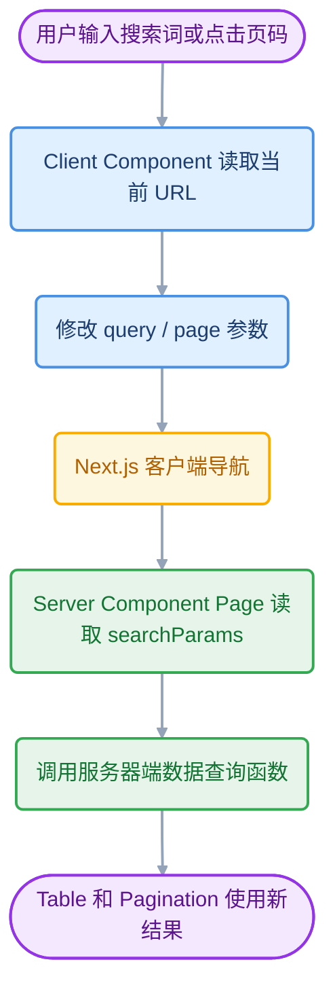
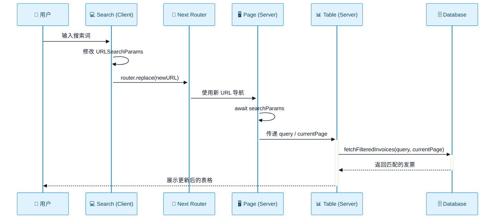
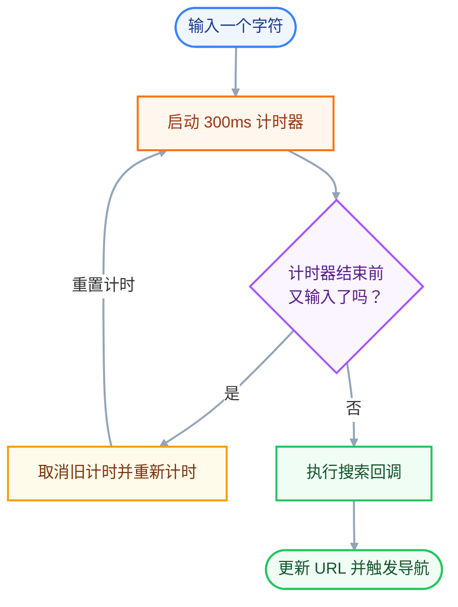

# 第 10 章：添加搜索与分页 (Adding Search and Pagination)

在上一章中，你通过流式传输提升了仪表盘的首屏加载性能。现在让我们转向 `/invoices` 页面，学习如何添加搜索与分页功能。

**本章内容概览：**

- 学习如何使用 Next.js API：`useSearchParams`、`usePathname` 和 `useRouter`。
- 使用 URL 查询参数（URL search params）实现搜索和分页功能。

本章不是简单地给表格添加一个搜索框和几个分页按钮，而是建立一条完整的数据流：



这里最重要的设计是：

- URL 保存可分享
- 可恢复的页面状态
- 客户端负责修改状态
- 服务器根据状态获取数据。 

搜索条件和页码不再只是某个组件内部的临时变量。

---

# 1. 初始代码

打开 `/dashboard/invoices/page.tsx` 文件，粘贴以下代码：

```tsx
// /app/dashboard/invoices/page.tsx
import Pagination from '@/app/ui/invoices/pagination';
import Search from '@/app/ui/search';
import Table from '@/app/ui/invoices/table';
import { CreateInvoice } from '@/app/ui/invoices/buttons';
import { lusitana } from '@/app/ui/fonts';
import { InvoicesTableSkeleton } from '@/app/ui/skeletons';
import { Suspense } from 'react';
 
export default async function Page() {
  return (
    <div className="w-full">
      <div className="flex w-full items-center justify-between">
        <h1 className={`${lusitana.className} text-2xl`}>Invoices</h1>
      </div>
      <div className="mt-4 flex items-center justify-between gap-2 md:mt-8">
        <Search placeholder="Search invoices..." />
        <CreateInvoice />
      </div>
      {/*  <Suspense key={query + currentPage} fallback={<InvoicesTableSkeleton />}>
        <Table query={query} currentPage={currentPage} />
      </Suspense> */}
      <div className="mt-5 flex w-full justify-center">
        {/* <Pagination totalPages={totalPages} /> */}
      </div>
    </div>
  );
}
```

先花点时间熟悉一下该页面以及即将用到的核心组件：

1. `<Search/>`：允许用户搜索特定的发票。
2. `<Pagination/>`：允许用户在发票列表的不同页码之间翻页导航。
3. `<Table/>`：负责展示发票数据列表。

**你的搜索功能将横跨客户端与服务端**：当用户在客户端搜索发票时，URL 参数会被更新，服务端会据此拉取新数据，随后表格组件在服务端使用新数据完成重新渲染。

---

# 2.  为什么要使用 URL 查询参数？（URL Search Params）

假设用户正在查看：

```
/dashboard/invoices?query=lee&page=2
```

这条 URL 可以拆成两部分：

- Pathname：`/dashboard/invoices`，表示当前路由。
- Search Params：`query=lee&page=2`，表示当前页面的查询状态。

`query` 保存搜索词，`page` 保存当前页码。两者共同决定表格应该展示哪一批数据。

如上所述，你将使用 URL 查询参数来管理搜索状态。如果你之前习惯使用客户端状态（如 `useState`）来做这件事，这种模式可能会让你觉得耳目一新。

使用 URL 参数实现搜索有以下几个显著优势：

- **可收藏与可分享的 URL（Bookmarkable and shareable URLs）**：由于搜索参数直接保存在 URL 中，用户可以将包含当前搜索词和筛选条件的应用状态直接添加为书签，方便日后查阅或分享给他人。
- **服务端渲染与初始化（Server-side rendering）**：服务端可以直接读取 URL 参数来渲染初始页面状态，使服务端渲染逻辑更加自然高效。
- **行为分析与追踪（Analytics and tracking）**：搜索关键词与过滤条件直接体现在 URL 中，无需编写额外的客户端上报逻辑即可轻松统计追踪用户的搜索行为。

这并不意味着所有 UI 状态都应该放进 URL。一个适合放进 URL 的状态通常具有以下特征：

- 它会改变页面所展示的资源集合或视图，并且用户可能希望分享、刷新后恢复或通过浏览器前进/后退重新访问。
- 输入框是否聚焦、弹窗是否暂时打开等纯临时交互状态，通常仍然适合留在组件状态中。

---

## 2.1 用 URLSearchParams 操作查询参数

`URLSearchParams` 是浏览器提供的 Web API，用于读取和修改 URL 查询参数。它避免了手动拼接 `?`、`&` 和编码字符。

```ts
const params = new URLSearchParams('query=lee&page=2');

params.get('query'); // 'lee'
params.get('page');  // '2'

params.set('page', '3');
params.set('status', 'pending');
params.delete('query');

params.toString(); // 'page=3&status=pending'
```

需要记住几个行为：

- `get(name)` 返回该参数的第一个值；参数不存在时返回 `null`。
- `set(name, value)` 设置参数；如果原来有同名参数，会用新值替换。
- `delete(name)` 删除参数。
- `toString()` 返回查询字符串本身，不包含开头的 `?`。
- 重复参数可以通过 `getAll(name)` 读取全部值。

例如 `?tag=a&tag=b` 中，`get('tag')` 得到 `'a'`，`getAll('tag')` 得到 `['a', 'b']`。

Next.js 的 `useSearchParams()` 返回的是只读版本的 `URLSearchParams` 接口，不能直接对它调用 `set()` 或 `delete()`。需要先复制出一个可修改对象：

```ts
const params = new URLSearchParams(searchParams.toString());
```

这样既保留了当前 URL 中其他参数，也避免直接修改 Next.js 提供的只读对象。官方文档也明确说明 `useSearchParams` 返回只读接口，并且它是 Client Component Hook，不能在 Server Component 中使用。

> 参考：[Next.js: useSearchParams](https://nextjs.org/docs/app/api-reference/functions/use-search-params)

---

# 3. 添加搜索功能：从输入框到 URL，再到服务器查询

以下是实现搜索功能将用到的 Next.js 客户端 Hooks：

- **`useSearchParams`**：允许你访问当前 URL 的查询参数。例如，对于 URL `/dashboard/invoices?page=1&query=pending`，它解析出的参数结构类似于 `{page: '1', query: 'pending'}`。
- **`usePathname`**：允许你读取当前 URL 的路径名。例如，对于路由 `/dashboard/invoices`，`usePathname` 会返回 `'/dashboard/invoices'`。
- **`useRouter`**：支持在**客户端组件**中通过编程方式在路由之间进行导航跳转（提供[多种跳转方法](https://nextjs.org/docs/app/api-reference/functions/use-router#userouter)）。

课程中的搜索组件是 Client Component，因为它需要响应输入事件并使用导航 Hook。三个 Hook 的职责并不相同：

| Hook                | 负责什么                       | 在本章中的用途                 |
| ------------------- | ------------------------------ | ------------------------------ |
| `useSearchParams()` | 读取当前 URL 的查询参数        | 读取当前 query，并保留其他参数 |
| `usePathname()`     | 读取当前路径，不包含查询字符串 | 得到 `/dashboard/invoices`     |
| `useRouter()`       | 在代码中发起客户端导航         | 使用 `replace()` 更新 URL      |

**实现步骤概览：**

1. 捕获用户的输入内容。
2. 使用搜索参数更新 URL。
3. 保持 URL 与输入框的值同步。
4. 更新表格以展示匹配搜索词的数据。

---

## 3.1 捕获用户的输入

打开 `<Search>` 组件（`/app/ui/search.tsx`），你会注意到：

- **`"use client"`**：这是一个客户端组件，意味着你可以在其中使用事件监听器和 React Hooks。
- **`<input>`**：这是搜索输入框元素。

创建一个 `handleSearch` 函数，并为 `<input>` 元素添加 `onChange` 监听事件。每当输入框的值发生变化时，`onChange` 就会调用 `handleSearch`：

```tsx
"use client";

import { SearchIcon } from "lucide-react";
import { useState } from "react";

export default function Search({ placeholder }: { placeholder: string }) {
  const [query, setQuery] = useState("");
  function handleSearch(term: string) {
    console.log(term);
  }

  return (
    <div className="relative flex flex-1 flex-shrink-0">
      <label htmlFor="search" className="sr-only">
        Search
      </label>
      <input
        className="peer block w-full rounded-md border border-gray-200 py-[9px] pl-10 text-sm outline-2 placeholder:text-gray-500"
        placeholder={placeholder}
        onChange={(e) => {
          setQuery(e.target.value);
          handleSearch(e.target.value);
        }}
      />
      <SearchIcon className="absolute top-1/2 left-3 h-[18px] w-[18px] -translate-y-1/2 text-gray-500 peer-focus:text-gray-900" />
    </div>
  );
}
```

打开浏览器开发者工具的控制台（Console），在搜索框中输入文字进行测试，你应该能看到输入的搜索词被实时打印到控制台中。

太棒了！你已经捕获了用户的搜索输入。现在，你需要将搜索词更新到 URL 中。

---

## 3.2 使用搜索参数更新 URL

从 `next/navigation` 导入 `useSearchParams` Hook，并将其赋值给一个变量：

```tsx
'use client';
 
import { MagnifyingGlassIcon } from '@heroicons/react/24/outline';
import { useSearchParams } from 'next/navigation';
 
export default function Search() {
  const searchParams = useSearchParams();
 
  function handleSearch(term: string) {
    console.log(term);
  }
  // ...
}
```

在 `handleSearch` 内部，使用 `searchParams` 变量创建一个新的 [`URLSearchParams`](https://developer.mozilla.org/en-US/docs/Web/API/URLSearchParams) 实例：

```tsx
// /app/ui/search.tsx
'use client';
 
import { MagnifyingGlassIcon } from '@heroicons/react/24/outline';
import { useSearchParams } from 'next/navigation';
 
export default function Search({ placeholder }: { placeholder: string }) {
  const searchParams = useSearchParams();
 
  function handleSearch(term: string) {
    const params = new URLSearchParams(searchParams);
  }
  // ...
}
```

`URLSearchParams` 是一个标准 Web API，提供了操作 URL 查询参数的实用方法。你无需手动拼接复杂的字符串模板，就能直接利用它生成形如 `?page=1&query=a` 的参数字符串。

接下来，根据用户的输入设置 `params` 字符串。如果输入为空，则将该参数删除：

```tsx
// /app/ui/search.tsx
'use client';
 
import { MagnifyingGlassIcon } from '@heroicons/react/24/outline';
import { useSearchParams } from 'next/navigation';
 
export default function Search({ placeholder }: { placeholder: string }) {
  const searchParams = useSearchParams();
 
  function handleSearch(term: string) {
    const params = new URLSearchParams(searchParams);
    if (term) {
      params.set('query', term);
    } else {
      params.delete('query');
    }
  }
  // ...
}
```

得到查询字符串后，即可使用 Next.js 的 `useRouter` 和 `usePathname` Hooks 来更新 URL。

从 `'next/navigation'` 导入 `useRouter` 和 `usePathname`，并在 `handleSearch` 中调用 `useRouter()` 的 `replace` 方法：

```tsx
// /app/ui/search.tsx
'use client';
 
import { SearchIcon } from "lucide-react";
import { usePathname, useRouter, useSearchParams } from "next/navigation";
 
export default function Search({ placeholder }: { placeholder: string }) {
  const searchParams = useSearchParams();
  const pathname = usePathname();
  const { replace } = useRouter();
 
  function handleSearch(term: string) {
    const params = new URLSearchParams(searchParams);
    if (term) {
      params.set('query', term);
    } else {
      params.delete('query');
    }
    replace(`${pathname}?${params.toString()}`);
  }
  // ...
}
```

**代码运行原理解析：**

- `${pathname}` 是当前路径，在本例中为 `"/dashboard/invoices"`。
- 当用户在搜索栏中输入内容时，`params.toString()` 会将输入转化为符合 URL 规范的编码格式。
- `replace(${pathname}?${params.toString()})` 使用用户的搜索数据更新浏览器 URL。例如，如果用户搜索 "Lee"，URL 会变为 `/dashboard/invoices?query=lee`。
- **得益于 Next.js 的客户端导航机制（第 5 章所学内容），更新 URL 的过程不会触发整页刷新**。⭐⭐

`handleSearch()` 的工作可以按顺序理解：

1. 复制当前查询参数，而不是创建一个空参数集合。这样分页或其他筛选参数不会被无意删除。
2. 输入非空时设置 `query`；输入清空时删除 `query`。
3. 用当前 pathname 和新参数字符串组成目标 URL。
4. 调用 `replace()`，让 Next.js 执行客户端导航。

---

### 3.2.1 为什么使用 `router.replace`，而不是直接改地址栏？

`router.replace(href)` 会导航到新 URL，但不会向浏览器历史记录栈添加一个新条目；`router.push(href)` 则会添加历史记录。

搜索框通常每输入一次就会更新 URL，如果每次都 `push`，用户按浏览器后退键可能需要逐字退回刚才的搜索过程。因此课程选择 `replace()`，让搜索过程覆盖当前历史条目。

这里的“**客户端导航**”不等于只修改地址栏。App Router 会根据新 URL 更新路由状态，并让服务端页面根据新的 `searchParams` 生成对应结果。官方文档将 `push` 和 `replace` 定义为客户端导航，并明确区分二者对浏览器历史记录的影响。

> 参考：[Next.js: useRouter](https://nextjs.org/docs/app/api-reference/functions/use-router)

`replace()` 和原生 `history.replaceState()` 也不能简单视为同一操作：

- 本章需要让服务端页面根据新查询参数重新获取数据，因此使用 Next.js Router 导航
- 原生 History API 的集成更适合只同步 URL 与客户端路由 Hook、而不需要进行完整路由数据导航的场景。

---

## 3.3 保持 URL 与输入框同步

为了确保输入框的值与 URL 保持一致（例如在通过分享链接直接打开页面时自动填充输入框），可以通过读取 `searchParams` 为 `input` 传入 `defaultValue` 属性：

```tsx
// /app/ui/search.tsx
<input
  className="peer block w-full rounded-md border border-gray-200 py-[9px] pl-10 text-sm outline-2 placeholder:text-gray-500"
  placeholder={placeholder}
  onChange={(e) => {
    handleSearch(e.target.value);
  }}
  defaultValue={searchParams.get('query')?.toString()}
/>
```

> **`defaultValue` vs. `value` / 受控组件 vs. 非受控组件**（Controlled vs. Uncontrolled） 
>
> 如果你使用 React state 来管理输入框的值，通常会使用 `value` 属性将其设为**受控组件（Controlled Component），由 React 接管输入框的状态**。
>
>  但由于此处没有使用 React state，而是将搜索词保存在了 URL 中，因此可以直接使用 `defaultValue`，交由原生 DOM `<input>` 自行维护自身的输入状态。

这里没有用 React State 控制输入框。`defaultValue` 为原生输入元素提供初始值，输入后的当前值由浏览器输入元素自身维护；URL 则保存可分享的搜索条件。

两种写法的区别是：

```tsx
// 非受控输入：React 提供初始值，之后由 DOM 管理当前输入值
<input defaultValue="lee" />

// 受控输入：React State 决定输入框当前显示什么
<input value={query} onChange={(event) => setQuery(event.target.value)} />
```

课程采用非受控输入，是因为它不需要额外维护一份 `query` React State。

但要准确理解 `defaultValue` 的边界：

- 它主要决定输入元素挂载时的初始值，不是持续的双向同步机制。
- 如果应用需要在组件已经挂载后，因浏览器前进/后退或其他外部导航而始终同步输入框内容，就需要显式设计受控状态或同步逻辑。
- 课程示例主要覆盖首次从 URL 初始化和用户输入更新 URL 的路径。

---

## 3.4 更新表格组件：URL 更新后，服务器如何拿到搜索条件？

最后，需要更新表格组件以响应搜索查询。回到发票页面 `/app/dashboard/invoices/page.tsx`。

页面组件（Page Components）默认[接收一个名为 `searchParams` 的 prop](https://nextjs.org/docs/app/api-reference/file-conventions/page)，你可以从中解析出当前 URL 参数并传递给 `<Table>` 组件：

```tsx
// /app/dashboard/invoices/page.tsx
import Pagination from '@/app/ui/invoices/pagination';
import Search from '@/app/ui/search';
import Table from '@/app/ui/invoices/table';
import { CreateInvoice } from '@/app/ui/invoices/buttons';
import { lusitana } from '@/app/ui/fonts';
import { Suspense } from 'react';
import { InvoicesTableSkeleton } from '@/app/ui/skeletons';
 
export default async function Page(props: {
  searchParams?: Promise<{
    query?: string;
    page?: string;
  }>;
}) {
  const searchParams = await props.searchParams;
  const query = searchParams?.query || '';
  const currentPage = Number(searchParams?.page) || 1;
 
  return (
    <div className="w-full">
      <div className="flex w-full items-center justify-between">
        <h1 className={`${lusitana.className} text-2xl`}>Invoices</h1>
      </div>
      <div className="mt-4 flex items-center justify-between gap-2 md:mt-8">
        <Search placeholder="Search invoices..." />
        <CreateInvoice />
      </div>
      <Suspense key={query + currentPage} fallback={<InvoicesTableSkeleton />}>
        <Table query={query} currentPage={currentPage} />
      </Suspense>
      <div className="mt-5 flex w-full justify-center">
        {/* <Pagination totalPages={totalPages} /> */}
      </div>
    </div>
  );
}
```

这里的关键是 `await props.searchParams`。当前 App Router 的 Page `searchParams` 是一个 Promise，解析后是普通 JavaScript 对象，而不是 `URLSearchParams` 实例。

课程例子假设 `query` 和 `page` 各自只出现一次，因此使用了更简单的类型。对外部输入更严格的应用，应对重复参数和非法页码做规范化处理。

> 参考：[Next.js: page.js — searchParams](https://nextjs.org/docs/app/api-reference/file-conventions/page)

查看 `<Table>` 组件（`/app/ui/invoices/table.tsx`）内部，可以看到 `query` 和 `currentPage` 这两个属性被传给了 `fetchFilteredInvoices()` 函数，用于查询并返回匹配搜索条件的发票列表：

```tsx
// /app/ui/invoices/table.tsx
// ...
export default async function InvoicesTable({
  query,
  currentPage,
}: {
  query: string;
  currentPage: number;
}) {
  const invoices = await fetchFilteredInvoices(query, currentPage);
  // ...
}
```

**数据查询留在服务器端，不把数据库连接凭证暴露给浏览器**。

完成修改后进行测试：输入关键词将更新 URL，同时向服务端发起新请求，服务端拉取过滤后的数据并仅返回匹配的发票记录。

> **何时使用 `useSearchParams()` Hook vs. `searchParams` prop？** 
>
> `useSearchParams()` 和 Page 的 `searchParams` prop 读取的是同一个 URL 状态，但服务端和客户端的职责不同。
>
> 你可能注意到我们用了两种不同的方式提取查询参数，具体选择哪一种取决于代码运行在客户端还是服务端：
>
> - `<Search>` 是**客户端组件**，因此使用 `useSearchParams()` Hook 从客户端直接访问参数，避免再绕回服务端。
> - `<Table>` 是自行获取数据的**服务端组件**，因此在页面级服务端组件中直接读取 `searchParams` prop 并向下传递。
> - **通用准则**：如果在客户端读取参数，请使用 `useSearchParams()` Hook。

完整数据流如下：



**（1）有一个实现细节值得特别留意：读取 `searchParams` 会影响渲染时机。** 

读取它会让页面变成“动态渲染”（Request-time API），并且影响预渲染（缓存）的范围。

- Next.js 在构建（Build）时，会尽量把页面生成静态 HTML（预渲染）。
- 但是，一旦你在页面代码里读取了 `searchParams`，Next.js 就会知道：“**这个页面的内容取决于用户请求时带的参数，我没法在构建时提前算出来**”。使用它会使页面依赖请求时信息。

结果：整个页面或包含该读取操作的区域，会从静态渲染（SSG）变成**动态渲染（Dynamic Rendering）**。

如果开启了最新版 Next.js 的部分预渲染（Cache Components / PPR），代码中读取 `searchParams` 的具体位置，决定了哪些外壳能保持静态缓存，哪些部分必须等到请求到达时再渲染。

> 参考：[Next.js: page.js](https://nextjs.org/docs/app/api-reference/file-conventions/page)


**（2）另外：还有一个 Client Component 使用 `useSearchParams()` 的 Suspense 陷阱。**

如果你在**静态预渲染页面中**的 Client Component 里用了 `useSearchParams()`，需要留意最近的 Suspense 边界，Next.js 在构建（Bulid Time）时会懵圈（因为它不知道用户会在 URL 里带什么）。

因为：在静态路由中，**该 Hook 会使最近 Suspense 边界以内的客户端组件树转为客户端渲染**。

为了解决这个冲突，Next.js 规定：**在静态页面中使用这个 Hook，必须用 `<Suspense>` 包裹该组件**。

例如：

```tsx
// app/about/page.tsx (静态页面)
import { Suspense } from 'react';
import Search from '~/ui/search';

export default function AboutPage() {
  return (
    <div>
      <h1>关于我们（静态内容）</h1>
      
      {/* ✅ 用 <Suspense> 把使用了 useSearchParams 的组件包裹起来 */}
      <Suspense fallback={<div>搜索框加载中...</div>}>
        <Search />
      </Suspense>

      <p>这里是长篇的公司介绍文字...</p>
    </div>
  );
}
```

在这里，`<Suspense>` 并不是用来等网络请求（fetch）的，而是充当了一个“构建期与运行期的切割边界（Boundary）”。

在 React 的底层机制里，**唯一能够让组件树“渲染到一半停下来，先用占位符顶替，等条件成熟（比如到了浏览器端）再继续渲染”的机制，就是 `<Suspense>`！**

我们来看加了 `<Suspense>` 之后，整个渲染流程发生了什么变化：

```
[阶段 1：打包构建时 (next build)]
Next.js 从上往下扫描 AboutPage：
  ├── <h1>关于我们</h1>         ──> 确定是静态的，直接写进 HTML
  ├── 遇到 <Suspense> 边界！    ──> 发现里面的 <Search /> 用了 useSearchParams()
  │                                 构建器不再往里渲染 <Search />，
  │                                 而是直接把 fallback ("搜索框加载中...") 写进 HTML！
  └── <p>公司介绍文字...</p>    ──> 确定是静态的，直接写进 HTML
  ↓
生成静态文件 `about.html`（里面包含标题、介绍文字、以及“搜索框加载中...”）

-------------------------------------------------------------------------

[阶段 2：用户浏览器访问时 (Request Time, 例如访问 /about?query=nextjs)]
  1. 浏览器瞬间收到预先生成好的 `about.html`，立刻展示标题、介绍文字和“搜索框加载中...”。
  2. 紧接着，React 在用户的浏览器端（Client-side）激活。
  3. 此时已经在浏览器里了，`<Search />` 可以毫无障碍地读取地址栏里的 `?query=nextjs`。
  4. React 把 `<Suspense>` 里的“搜索框加载中...”替换成真正带参数的 `<Search />` 输入框。
```

这样页面主体依然可以是静态的（极速加载），当请求到达时，被 `<Suspense>` 包裹的客户端组件再根据实际 URL 进行客户端渲染（CSR）。

`useSearchParams()` 确实是用来在客户端读 URL 的，但因为 **Next.js 默认会在打包构建时（服务端）把所有的 Client Component 也预渲染一遍成静态 HTML**，而构建时没有 URL，所以 `useSearchParams()` 只能通过**主动触发 `<Suspense>` 挂起**的方式，“逃避”构建期的服务端预渲染，从而把自己推迟到真正的浏览器端去执行。

> 课程的发票页面（Invoices Page）在服务端读取 `searchParams`，与单纯在静态页面中使用该 Hook 的**场景不同**。
>
> 一旦你在 `Page`（Server Component）中使用了 `props.searchParams`，Next.js 就知道：**这个页面必须在每次用户请求到达时在服务端动态渲染（Dynamic Rendering）**。 
>
> 既然每次都是请求到达时才渲染，服务端在那一刻**已经知道**完整的 URL 和查询参数是什么了！因此，哪怕 `<Search/>` 内部用了 `useSearchParams()`，它在服务端动态渲染时也能直接拿到当前的 URL 参数，根本不存在“构建时不知道 URL 是什么”的冲突。
>
> 参考：[Next.js: useSearchParams 的 Prerendering 行为](https://nextjs.org/docs/app/api-reference/functions/use-search-params)

---

### 3.4.1 为什么 Invoices Page 里面的 `Suspense` 要加 `key` ？

在 **Next.js App Router（RSC + 流式渲染）** 的语境下，加上 `key` 的底层逻辑是为了解决 **“客户端导航时，Suspense 状态复用导致的 UI 表现不符合预期”** 的问题。

我们抛开之前的表述，用更严谨的 React / Next.js 底层逻辑重新梳理一遍：

当用户在搜索框输入 "abc"（从 `?query=lee&page=1` 变成 `?query=abc&page=2`）时，Next.js 会发起一次**客户端路由跳转**（Client-side Navigation）。

如果不加 `key`，React 看到的组件结构是这样的：

```tsx
<Suspense fallback={<Skeleton />}>
   <InvoicesTable query="abc" page={2} /> 
</Suspense>
```

1. **React 的协调（Reconciliation）机制**：React 发现 `<Suspense>` 还在原来的位置，里面的 `<InvoicesTable>` 也是同一个组件。React 的第一反应是**“复用”**这个组件实例，仅仅去更新它的 props（从 lee:1 变成 abc:2）。
2. **Suspense 的尴尬状态**：此时，这个 `<Suspense>` 边界在上一轮渲染中已经**完成了数据加载（Resolved）**，它处于一个“已经展示出内容”的状态。
3. **新请求的触发**：因为 props 变了，Server Component 开始向服务器请求新数据，数据开始流式传输（Streaming）。
4. **“卡住”或“状态错乱”的原因**：在这个等待新数据到达的间隙，React 会怎么做？
   - 它**不一定会立刻把当前内容替换回 `<Skeleton>`**（因为 Suspense 已经 Resolved 过了）。
   - 它更倾向于**保留旧 UI（"lee" 的表格数据）**，直到新数据（"abc"）完全到达，然后“啪”地一下直接替换。
   - 如果网络慢，用户会盯着旧的搜索结果发呆好几秒（看起来像“卡住”了），没有任何加载提示。更糟糕的是，如果内部组件有内部状态（比如表格的排序、滚动位置），这些状态会被错误地延续到新的搜索词上。

当你加上 `key={query:*q**u**ery*:{currentPage}}`：

```tsx
<Suspense fallback={<Skeleton />}>
   <InvoicesTable key="abc:2" query="abc" page={2} /> 
</Suspense>
```

1. **强行销毁与重建**：当 `key` 从 `"lee:1"` 变成 `"abc:2"` 时，React 的协调机制会判定：**这是一个完全不同的全新组件！**
2. **卸载旧的，挂载新的**：React 会立刻卸载（Unmount）旧的 Table 组件，销毁其所有内部状态（滚动条位置等被重置）。
3. **强制触发 Fallback**：React 开始挂载（Mount）全新的 Table 组件。在初次挂载时，数据（Promise）显然还没准备好。于是，新组件**必然**会向最近的 `<Suspense>` 边界抛出（throw）一个 Pending 的 Promise。
4. **完美展现 Loading**：`<Suspense>` 捕获到这个全新的 Pending 状态，**100% 会重新展示 `<Skeleton />`**。

---

## 3.5 最佳实践：防抖（Debouncing）

你已经成功实现了搜索功能！但在性能上还有进一步优化的空间。

在 `handleSearch` 函数中添加一行 `console.log`：

```tsx
// /app/ui/search.tsx
function handleSearch(term: string) {
  console.log(`Searching... ${term}`);
 
  const params = new URLSearchParams(searchParams);
  if (term) {
    params.set('query', term);
  } else {
    params.delete('query');
  }
  replace(`${pathname}?${params.toString()}`);
}
```

在搜索栏中输入 `"Delba"` 并查看开发者工具控制台：

```tsx
Searching... D
Searching... De
Searching... Del
Searching... Delb
Searching... Delba
```

**用户每按一次键，都会更新一次 URL，进而触发一次数据库查询！** 在小型演示应用中这或许不成问题，但如果应用有成千上万名并发用户，每次击键都向数据库发起请求将造成巨大的资源浪费。

**防抖（Debouncing）** 是一种限制函数触发频率的编程技术。在当前场景下，我们希望**仅当用户停止输入后**才真正向数据库发起查询。

**防抖的工作原理：**

1. **触发事件（Trigger Event）**：当需要防抖的事件（如搜索框按键）发生时，启动一个定时器。
2. **等待重置（Wait）**：如果在定时器倒计时结束前又有新事件触发，则重置定时器重新计时。
3. **执行函数（Execution）**：当定时器顺利走完倒计时，才真正执行被包裹的目标函数。

我们可以安装 `use-debounce` 库来快速实现防抖：

```
pnpm add use-debounce
```

在 `<Search>` 组件中导入 `useDebouncedCallback`：

```tsx
// /app/ui/search.tsx
// ...
import { useDebouncedCallback } from 'use-debounce';
 
// 在 Search 组件内部...
const handleSearch = useDebouncedCallback((term) => {
  console.log(`Searching... ${term}`);
 
  const params = new URLSearchParams(searchParams);
  if (term) {
    params.set('query', term);
  } else {
    params.delete('query');
  }
  replace(`${pathname}?${params.toString()}`);
}, 300);
```

这个函数会包裹 `handleSearch` 的处理逻辑，并仅在用户停止输入达到指定时间（300 毫秒）后才执行代码。

流程图：



再次在搜索栏快速输入 `"Delba"`，控制台将只输出一次：

```
Searching... Delba
```

通过防抖，你可以大幅削减发送到数据库的无效请求数量，显著节约服务器资源。

它与 Throttling（节流）的区别在于：防抖倾向于等待连续事件停止后执行；节流则限制一段时间内最多执行多少次，通常会按固定时间窗口允许执行。搜索输入通常更适合防抖，因为用户往往希望在停下来后查询最终输入内容。

---

# 4. 添加分页功能（Pagination）

引入搜索功能后，你会发现**表格每次最多只显示 6 条发票记录**。这是因为 `data.ts` 中的 `fetchFilteredInvoices()` 函数限制了每页最多返回 6 条数据。

添加分页功能可以让用户在不同页码之间翻页查看所有发票。

分页要解决两个问题：**当前页应该取哪 6 条记录，以及符合当前搜索条件的结果一共有多少页**。

因此课程在服务器端使用两个不同的数据获取函数：

- `fetchFilteredInvoices(query, currentPage)`：根据搜索词和当前页码取出当前页的发票。
- `fetchInvoicesPages(query)`：根据搜索词计算总页数。

如果当前搜索条件匹配 12 条记录，每页 6 条，则总页数为：
$$
[ \text{totalPages} = \left\lceil \frac{12}{6} \right\rceil = 2 ]
$$

> 注意是向上取整

这个计算关系说明：**总页数依赖 query，而不依赖当前 page。** 搜索条件变化时，总页数也可能变化。

下面我们像实现搜索一样，使用 URL 参数来实现分页。

打开 `<Pagination/>` 组件，你会发现它是一个客户端组件。`Page` 在服务器端取得参数并计算总页数，再把结果传给客户端 `Pagination` 。

**为了避免暴露数据库密钥，我们不应该在客户端直接拉取数据，而是应该在服务端查询总页数，再作为 prop 传递给它**。

在 `/dashboard/invoices/page.tsx` 中导入 `fetchInvoicesPages` 函数，并将 `searchParams` 中的 `query` 作为参数传入：

```tsx
// app/dashboard/invoices/page.tsx

import Table from "~/ui/invoices/table";
import Pagination from "~/ui/invoices/pagination";
import Search from "~/ui/search";
import { lusitana } from "~/ui/fonts";
import { CreateInvoice } from "~/ui/invoices/buttons";
import { InvoicesTableSkeleton } from "~/ui/skeletons";
import { Suspense } from "react";
import { fetchInvoicesPages } from "~/lib/data";

export default async function Page(props: {
  searchParams?: Promise<{
    query?: string;
    page?: string;
  }>;
}) {
  const searchParams = await props.searchParams;
  const query = searchParams?.query || "";
  const currentPage = Number(searchParams?.page) || 1;
  const totalPages = await fetchInvoicesPages(query);

  return (
    <div className="w-full">
      <div className="flex w-full items-center justify-between">
        <h1 className={`${lusitana.className} text-2xl`}>Invoices</h1>
      </div>
      <div className="mt-4 flex items-center justify-between gap-2 md:mt-8">
        <Search placeholder="Search invoices..." />
        <CreateInvoice />
      </div>
      <Suspense key={query + currentPage} fallback={<InvoicesTableSkeleton />}>
        <Table query={query} currentPage={currentPage} />
      </Suspense>
      <div className="mt-5 flex w-full justify-center">
        <Pagination totalPages={totalPages} />
      </div>
    </div>
  );
}
```

`fetchInvoicesPages` 会根据当前搜索词返回匹配结果的总页数。例如，若有 12 条发票匹配查询，且每页显示 6 条，则 `totalPages` 为 2。

接着打开 `<Pagination/>` 组件（`/app/ui/invoices/pagination.tsx`），导入 `usePathname` 和 `useSearchParams` Hooks，并取消组件内部被注释的代码。

在 `<Pagination>` 组件内创建 `createPageURL` 函数，使用 `URLSearchParams` 设置新的页码，并结合 `pathname` 生成完整的跳转 URL 字符串：

```tsx
// /app/ui/invoices/pagination.tsx
'use client';
 
import { ArrowLeftIcon, ArrowRightIcon } from '@heroicons/react/24/outline';
import clsx from 'clsx';
import Link from 'next/link';
import { generatePagination } from '@/app/lib/utils';
import { usePathname, useSearchParams } from 'next/navigation';
 
export default function Pagination({ totalPages }: { totalPages: number }) {
  const pathname = usePathname();
  const searchParams = useSearchParams();
  const currentPage = Number(searchParams.get('page')) || 1;
 
  const createPageURL = (pageNumber: number | string) => {
    const params = new URLSearchParams(searchParams);
    params.set('page', pageNumber.toString());
    return `${pathname}?${params.toString()}`;
  };
 
  // ...
}
```

**代码运行原理解析：**

- `createPageURL` 基于当前的查询参数创建一个新实例。
- 然后，它将 `"page"` 参数更新为传入的目标页码。
- 最后，它使用当前路径名（`pathname`）和更新后的搜索参数来构建完整的 URL。

最后一步：当用户输入新的搜索查询时，应该**将页码重置回第 1 页**。更新 `<Search>` 组件中的 `handleSearch` 函数：

```tsx
// /app/ui/search.tsx
'use client';
 
import { MagnifyingGlassIcon } from '@heroicons/react/24/outline';
import { usePathname, useRouter, useSearchParams } from 'next/navigation';
import { useDebouncedCallback } from 'use-debounce';
 
export default function Search({ placeholder }: { placeholder: string }) {
  const searchParams = useSearchParams();
  const { replace } = useRouter();
  const pathname = usePathname();
 
  const handleSearch = useDebouncedCallback((term) => {
    const params = new URLSearchParams(searchParams);
    params.set('page', '1');
    if (term) {
      params.set('query', term);
    } else {
      params.delete('query');
    }
    replace(`${pathname}?${params.toString()}`);
  }, 300);
  // ...
}
```

`<Pagination>` 组件的其余部分负责处理样式和不同的状态（如首页、尾页、激活、禁用等）。在本课程中我们不会深入探讨这部分细节，但欢迎你随时浏览代码，看看 `createPageURL` 在哪里被调用。

课程实现的分页组件导航是使用 `<Link />` 组件实现的。

这里使用 `Link` 是合适的：分页是明确的链接导航，而不是必须通过事件回调才能完成的程序化跳转。

Next.js 官方也建议，在没有特殊需求时优先使用 `<Link>`；`useRouter()` **更适合需要在代码中主动发起导航的场景**。

> 参考：[Next.js: useRouter](https://nextjs.org/docs/app/api-reference/functions/use-router)

---

## 4.1 为什么分页时必须保留 `query`？搜索时为什么又要重置 `page`？

`createPageURL()` 不是重新创建一个只有 `page` 的 URL，而是先复制当前参数，再修改 `page`。例如：

```
当前 URL：/dashboard/invoices?query=lee&page=1
点击第 2 页：
目标 URL：/dashboard/invoices?query=lee&page=2
```

如果生成分页 URL 时丢弃了 `query`，用户就会从“搜索 Lee 的发票”跳回“所有发票”。**所以分页只修改页码，必须保留查询条件**。

搜索时则相反：**搜索词改变了结果集合，原来的页码可能不再有效**。例如用户正在第 5 页，新的搜索结果只有 2 页。如果保留 `page=5`，表格就可能显示空结果，即使搜索本身确实匹配了记录。因此课程在搜索回调中加入：

```ts
params.set('page', '1');
```

这是一条状态一致性规则：**改变结果集合的条件时，重置依赖该集合的分页位置；只改变分页位置时，保留搜索条件。**

---

# 5. 实现检查：容易遗漏的边界

课程示例为了突出主要流程，假设 URL 参数格式正确、`query` 和 `page` 都只有一个值。

真实应用还应注意以下边界：

**页码必须是有效的正整数。** `Number(value) || 1` 可以处理缺失值、空字符串和 `NaN`，但不能阻止 `-2` 或 `1.5`。可以使用更严格的解析：

```ts
function parsePage(value: string | undefined): number {
  const page = Number(value);
  return Number.isInteger(page) && page > 0 ? page : 1;
}
```

**重复查询参数要明确处理。** 当前 Page `searchParams` 的值可能是 `string[]`，例如 `?query=a&query=b`。如果应用只允许一个搜索词，应选择第一个值、拒绝重复值或进行规范化，不要假设所有输入都是单一字符串。`useSearchParams().get()` 则返回第一个值；需要全部值时使用 `getAll()`。

**不要丢掉现有参数。** 搜索更新 `query` 时应保留其他有意义的筛选条件；分页更新 `page` 时尤其要保留 `query`。先复制当前参数，再修改指定字段，是本章反复使用的关键操作。

**注意 Suspense 覆盖范围。** 课程把 `<Table>` 放在 Suspense 内，并用 `key` 标识 query 和 currentPage 的变化。这会让表格数据的异步等待拥有自己的 fallback。但示例中的 `await fetchInvoicesPages(query)` 位于 Page 返回 JSX 之前，因此这项查询本身并不在 Table 的 Suspense 边界内；如果它也变慢，页面仍可能等待它完成后才返回这部分 UI。要隔离它，需要重新设计分页数据的加载边界。本章重点是实现搜索和分页，没有进一步优化这条查询路径。

**数据库查询仍然留在服务器端。** 用户输入的 query 是外部数据，应该作为查询参数传给数据访问函数，并使用安全的参数化 SQL。不要因为搜索组件在客户端，就把数据库连接或 SQL 查询逻辑移动到浏览器。本章沿用 Chapter 7 建立的数据访问边界。

---

# 6. 本章总结

恭喜！你刚刚使用 URL 搜索参数（URL search params）和 Next.js API 完成了**搜索与分页功能的实现**。

本章内容总结如下：

- 你使用 URL 搜索参数（而不是客户端状态）来处理搜索和分页。
- 你在服务端获取数据。
- 使用 `useRouter` Hook 实现平滑的无刷新客户端路由过渡。

这些模式可能与你以往在客户端 React 开发中习惯的模式不同，但希望你现已更好地理解了使用 URL 搜索参数，以及将状态提升至服务端所带来的好处。

记住这条关系就能串起本章的实现：

```
URL 是搜索和分页状态的共同来源

Search（Client）修改 query ─┐
                            ├─> URL -> Page（Server）-> 数据查询 -> Table
Pagination（Client）修改 page┘
```

搜索改变结果集合，所以把页码重置为 1；分页只改变当前数据窗口，所以保留搜索条件。Debouncing 则控制搜索状态更新的频率，避免连续输入产生过多导航和服务端查询。


