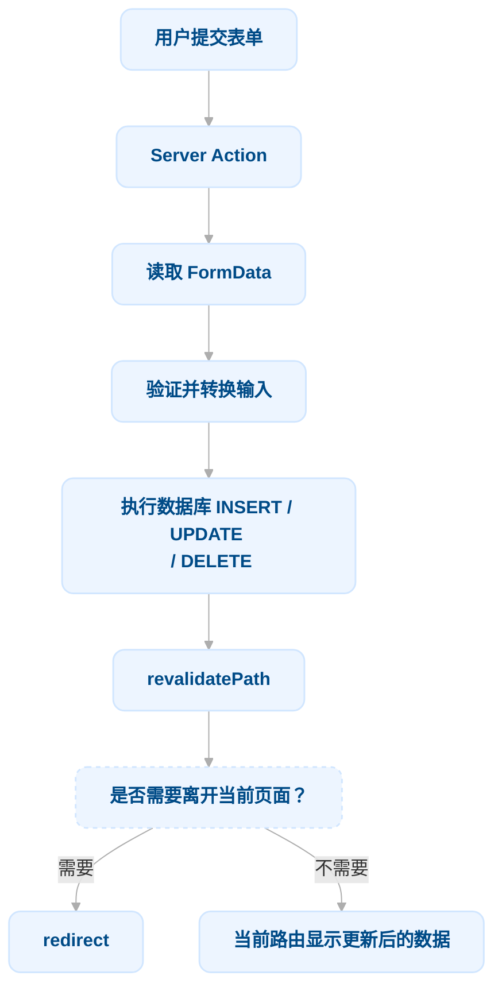

# 第 11 章：变更数据 (Mutating Data)

在上一章中，你使用 URL 查询参数和 Next.js API 实现了搜索与分页功能。接下来，我们将通过添加创建、更新和删除发票的功能，继续完善发票页面（Invoices Page）！

**本章内容概览：**

- 什么是 React Server Actions，以及如何使用它们来变更数据。
- 如何结合表单（Forms）与服务端组件（Server Components）进行开发。
- 操作原生 `FormData` 对象的最佳实践，包括类型校验与转换。
- 如何使用 `revalidatePath` API 重新验证客户端缓存。
- 如何创建带有特定 ID 的动态路由段（Dynamic Route Segments）。

本章要解决的问题：

前面章节已经完成了数据库读取、搜索和分页。本章把方向反过来：用户在页面中填写或修改数据后，应用怎样把这些输入送到服务器，经过验证后写进数据库，并让页面反映修改结果？

这条链路可以看成一次完整的 mutation：



这几个步骤解决的是不同问题：

- Server Action 提供服务器端执行入口；
- FormData 携带浏览器提交的字段；
- Zod 检查数据是否符合应用预期；
- SQL 修改数据库；`revalidatePath()` 让相关路由重新取得数据；
- `redirect()` 决定操作完成后用户去哪里。

不要把它们混成一个笼统的“提交表单”动作。

---

# 1. 什么是 Server Actions？

React Server Actions **允许你直接在服务端运行异步代码**。它们消除了为了变更数据而手动创建 API 端点的需求。相反，你只需编写在服务端执行的异步函数，即可从客户端组件或服务端组件中直接调用它们。

安全性是 Web 应用的重中之重，因为它们容易受到各类安全威胁。这正是 Server Actions 大显身手的地方。它们内置了加密闭包（Encrypted closures）、严格的输入检查、错误消息哈希处理、主机限制（Host restrictions）等特性——所有这些机制协同工作，显著提升了应用的安全性。

## 1.1 结合表单使用 Server Actions（它解决什么问题）

传统做法通常是：表单在浏览器中提交到一个 API Endpoint，服务端 Route Handler 接收请求，再调用数据库代码。

Server Actions 提供了另一种组织方式：把服务端异步函数直接传给 React 表单的 `action` 属性，由 React / Next.js 负责把调用发送到服务端。

该 Action 会自动接收包含所捕获数据的原生 `FormData` 对象。

```tsx
// Server Component
export default function Page() {
  async function create(formData: FormData) {
    'use server';

    // 在服务端处理表单数据并写入数据库
  }

  return <form action={create}>{/* 表单字段 */}</form>;
}
```

这里有两个关键点：

- `async`：Server Action 是异步服务端函数，通常要执行数据库或其他 I/O 操作。
- `'use server'`：告诉 React / Next.js 这个函数需要作为 Server Function 在服务端执行，而不是普通的浏览器函数。

在服务端组件中调用 Server Actions 的表单天然支持**渐进式增强（Progressive Enhancement）**：即使客户端的 JavaScript 尚未加载完成（例如在弱网环境下），表单依然可以正常提交。

## 1.2 为什么 `action={create}` 能收到 `FormData`

React 的 `<form>` 对 `action` 有特殊处理：

- 传入 URL 字符串时，它遵循原生 HTML 表单提交行为
- 传入函数时，React 会在提交时调用这个函数，并把表单数据作为参数传进去。

```tsx
<form action={createInvoice}>
  <select name="customerId">...</select>
  <input name="amount" type="number" />
  <button type="submit">Create</button>
</form>
```

React 会收集表单中参与提交、并带有 `name` 的字段，构造 `FormData`。

因此，`name` 不只是方便查询 DOM 的属性，它还是表单字段进入 `FormData` 时使用的键。

```tsx
export async function createInvoice(formData: FormData) {
  const customerId = formData.get('customerId');
  const amount = formData.get('amount');
  const status = formData.get('status');
}
```

**注意**：`FormData.get()` 的返回值不是“保证存在的字符串”，而是 `FormDataEntryValue | null`，也就是 `string`、`File` 或 `null`。不能只因为表单上写了 `name`，就认为服务端一定收到了合法值。

## 1.3 它与 API Route 是什么关系

Server Actions 并不是“没有网络请求”。它们只是让我们不必手动设计一个 API URL、编写对应的请求处理入口，再从表单中自己发起请求。

调用 Server Action 时，**Next.js 在底层通过 POST 请求把调用送到服务端**。

| 做法                      | 开发者显式编写的入口                    | 常见使用场景                                                |
| ------------------------- | --------------------------------------- | ----------------------------------------------------------- |
| Route Handler / API Route | `app/api/.../route.ts` 等 HTTP 处理入口 | 需要提供通用 HTTP API，供浏览器、其他服务或第三方客户端调用 |
| Server Action             | 一个**标记**为服务端函数的异步函数      | 应用内部由表单或交互触发的数据变更                          |

所以更准确的理解是：**Server Actions 把服务端变更逻辑以函数的形式暴露给 React 交互使用，底层仍然需要一次网络调用。**

## 1.4 渐进式增强（Progressive Enhancement）

当表单由 Server Component 渲染，并把 Server Action 直接传给 `<form action>` 时，用户可以在客户端 JavaScript 尚未加载、甚至被禁用的情况下提交表单。

这就是 Progressive Enhancement：基础功能先依赖浏览器原生表单能力工作，JavaScript 加载后再获得增强体验。

这也是课程选择在 Server Component 页面中获取 customers、再把数据传给表单组件的原因之一：页面负责服务端数据准备，表单负责展示输入控件，提交后由 Server Action 处理变更。

## 1.5 Next.js 与 Server Actions

Server Actions 还与 Next.js 的缓存机制深度集成。

当通过 Server Action 提交表单时，你不仅可以使用该 Action 来变更数据，还可以使用 `revalidatePath` 和 `revalidateTag` 等 API 重新验证关联的缓存。

---

# 2. 创建发票：从 FormData 到数据库记录

以下是创建新发票的具体步骤：

1. 创建一个用于捕获用户输入的表单。
2. 创建一个 Server Action 并从表单中调用它。
3. 在 Server Action 内部，从 `formData` 对象中提取数据。
4. **校验**并准备要插入数据库的数据。
5. 插入数据并**处理可能出现的错误**。
6. **重新验证缓存**并将用户**重定向**回发票列表页。

创建操作最适合用来理解整条数据链路，因为它包含数据读取、校验、转换、数据库写入和页面更新。

## 2.1 创建新路由与表单

首先，在 `/invoices` 文件夹内添加一个名为 `/create` 的新路由段，并在其中创建一个 `page.tsx` 文件：


你将使用该路由来创建新发票。在 `page.tsx` 文件中粘贴以下代码：

```tsx
import Form from '@/app/ui/invoices/create-form';
import Breadcrumbs from '@/app/ui/invoices/breadcrumbs';
import { fetchCustomers } from '@/app/lib/data';
 
export default async function Page() {
  const customers = await fetchCustomers();
 
  return (
    <main>
      <Breadcrumbs
        breadcrumbs={[
          { label: 'Invoices', href: '/dashboard/invoices' },
          {
            label: 'Create Invoice',
            href: '/dashboard/invoices/create',
            active: true,
          },
        ]}
      />
      <Form customers={customers} />
    </main>
  );
}
```

该页面是一个服务端组件，负责获取客户列表，然后再通过 props 传递给预先构建好的 `<Form>` 组件。查看 `<Form>` 组件内部，你会看到表单包含：

- 一个包含客户列表的 `<select>`（下拉选择框）元素。
- 一个用于输入金额的 `<input type="number">` 元素。
- 两个用于选择状态的 `<input type="radio">` 单选框元素。
- 一个 `<button type="submit">` 提交按钮。

访问 `http://localhost:3000/dashboard/invoices/create`，即可看到创建发票的表单界面。


## 2.2 创建 Server Action

接下来，创建一个在表单提交时被调用的 Server Action。

进入 `lib/` 目录，新建一个名为 `actions.ts` 的文件。在文件顶部添加 React 的 `'use server'` 指令：

```tsx
// /app/lib/actions.ts
'use server';
```

通过添加 `'use server'`，你将该文件内导出的**所有函数都标记为 Server Actions**。

这些服务端函数随后可以在客户端组件和服务端组件中被导入和使用。如果该文件中包含未被使用的函数，它们会在最终的应用构建包中被自动移除（Tree-shaking）。

你也可以通过在 Action 函数内部直接添加 `"use server"` 将其写在服务端组件内，但将它们集中管理在单独的文件中是**更推荐的工程实践**。

在 `actions.ts` 文件中，创建一个接收 `formData` 的新异步函数：

```tsx
// /app/lib/actions.ts
'use server';
 
export async function createInvoice(formData: FormData) {}
```

接着，在 `<Form>` 组件中从 `actions.ts` 导入 `createInvoice`。为 `<form>` 元素添加 `action` 属性，并传入 `createInvoice`：

```tsx
// /app/ui/invoices/create-form.tsx
import { CustomerField } from '@/app/lib/definitions';
import Link from 'next/link';
import {
  CheckIcon,
  ClockIcon,
  CurrencyDollarIcon,
  UserCircleIcon,
} from '@heroicons/react/24/outline';
import { Button } from '@/app/ui/button';
import { createInvoice } from '@/app/lib/actions';
 
export default function Form({
  customers,
}: {
  customers: CustomerField[];
}) {
  return (
    <form action={createInvoice}>
      {/* ... */}
    </form>
  );
}
```

> **核心概念提示**：在原生 HTML 中，你会向 `action` 属性传递一个目标 URL（通常是 API 端点）。而在 React 中，`action` 属性被视为一个特殊的 prop——React 在其之上进行了扩展以支持直接调用函数。
>
> 在底层，Server Actions 会自动为你创建一个加密的 `POST` API 端点，因此你无需手动编写 API 路由。

## 2.3 从 `formData` 中提取数据

回到 `actions.ts` 文件，你需要从 `formData` 中提取值。可以使用 `.get(name)` 方法来完成：

```tsx
// /app/lib/actions.ts
'use server';
 
export async function createInvoice(formData: FormData) {
  const rawFormData = {
    customerId: formData.get('customerId'),
    amount: formData.get('amount'),
    status: formData.get('status'),
  };
  // 测试输出：
  console.log(rawFormData);
}
```

> **技巧**：如果处理的表单包含大量字段，可以考虑结合使用 [`formData.entries()`](https://developer.mozilla.org/en-US/docs/Web/API/FormData/entries) 与 JavaScript 的 [`Object.fromEntries(formData.entries())`](https://developer.mozilla.org/en-US/docs/Web/JavaScript/Reference/Global_Objects/Object/fromEntries) 一次性提取。

在浏览器中填写并提交表单进行测试。提交后，你应该能在运行开发服务器的**命令行终端**（而非浏览器控制台，因为代码运行在服务端）中看到打印出的表单数据。

既然你的数据现在已经是对象的形式，处理起来就会容易得多。

## 2.4 校验并准备数据

在将表单数据发送到数据库之前，**你需要确保它的格式和类型完全正确**。回顾此前定义的数据库表结构，目标 `invoices` 表期望的数据格式如下：

```tsx
// /app/lib/definitions.ts
export type Invoice = {
  id: string; // 将在数据库中自动生成
  customer_id: string;
  amount: number; // 以美分（cents）为单位存储
  status: 'pending' | 'paid';
  date: string;
};
```

到目前为止，你从表单中只拿到了 `customer_id`、`amount` 和 `status`。

---

### 类型校验与强制转换（Type validation and coercion）

验证表单数据与数据库预期的类型是否一致非常重要。

如果你在 Action 中打印 `console.log(typeof rawFormData.amount)`，你会发现即便输入框设置了 `type="number"`，它返回的 `amount` 实际上依然是 `string` 类型而非 `number`！

要处理类型验证，你有几种选择。虽然可以手动验证类型，但使用类型验证库能节省时间和精力。在这个示例中，我们将使用 Zod——一个 TypeScript 优先的验证库，可以简化这项任务。

在你的 `actions.ts` 文件中，导入 Zod，并定义一个与表单对象结构匹配的 schema。这个 schema 会在将 `formData` 保存到数据库之前对其进行验证。

```tsx
"use server";

import { z } from "zod";

const FormSchema = z.object({
  id: z.string(),
  customerId: z.string(),
  amount: z.coerce.number(),
  status: z.enum(["pending", "paid"]),
  date: z.string(),
});

const CreateInvoice = FormSchema.omit({ id: true, date: true });

export async function createInvoice(data: FormData) {
  // ...
}
```

`FormSchema` 描述完整发票记录需要的字段；创建时 `id` 由数据库生成，`date` 由服务端生成，因此 `CreateInvoice` 通过 `omit()` 去掉这两个字段。

`amount` 字段被专门设置为**强制转换（coerce），将字符串转换为数字，同时也会验证其类型**。

接着用 `parse()` 处理从 `FormData` 取出的值：

```tsx
// /app/lib/actions.ts
// ...
export async function createInvoice(formData: FormData) {
  const { customerId, amount, status } = CreateInvoice.parse({
    customerId: formData.get('customerId'),
    amount: formData.get('amount'),
    status: formData.get('status'),
  });
}
```

这里的 `parse()` 同时承担两件事：

- **验证形状和类型**：例如 `status` 必须是 `pending` 或 `paid`。
- **执行 Schema 定义的转换**：`z.coerce.number()` 会尝试把输入转换为数字，因此表单传来的字符串金额可以变成 JavaScript `number`。

**需要区分**：TypeScript 类型只在开发阶段帮助检查代码；它不会自动验证浏览器实际提交的内容。Zod 在服务端运行，才是在运行时检查外部输入。

`parse()` 验证失败时会抛出异常。本章暂时不处理这个异常对应的用户界面反馈；课程将错误处理放到下一章。

> **校验边界**：课程中的 Schema 验证了 `customerId` 是字符串、`amount` 能转换为数字、`status` 是两个枚举值之一，但没有进一步规定金额必须大于 0、最多两位小数，也没有在这里验证 customer 是否真实存在。Schema 目前只做了示例所需的基础类型校验，不等于完整业务校验。

---

### 以美分为单位存储金额（Storing values in cents）

在数据库中，通常最佳实践是将货币金额以最小货币单位（如美分/分）的整数形式存储，这样可以彻底规避 JavaScript 浮点数计算精度误差，确保财务数据的准确性。

将金额乘以 100 转换为美分，并生成格式为 `"YYYY-MM-DD"` 的创建日期：

```tsx
// /app/lib/actions.ts
export async function createInvoice(formData: FormData) {
  const { customerId, amount, status } = CreateInvoice.parse({
    customerId: formData.get('customerId'),
    amount: formData.get('amount'),
    status: formData.get('status'),
  });
  const amountInCents = amount * 100;
  const date = new Date().toISOString().split('T')[0];
}
```

- 课程示例只做了乘以 100，并没有在 Schema 中限制小数位数或明确处理舍入。因此，如果金额字段允许任意小数位，不能仅凭 `amount * 100` 就认定结果一定是符合业务规则的整数分。真实项目应按货币规则校验精度，并明确转换策略。
- `toISOString()` 生成 UTC 时间表示，`split('T')[0]` 取出日期部分，得到 `YYYY-MM-DD` 形式的字符串。它取得的是 **UTC 日期**，不一定等于用户所在时区的当地日期；如果业务要求按某个地区的自然日记账，就需要明确使用哪个时区。

---

## 2.5 将数据插入数据库

现在所有必需的值都已就绪，编写 SQL 语句将新发票插入数据库：

```tsx
// /app/lib/actions.ts
'use server';

import { z } from 'zod';
import postgres from 'postgres';
 
const sql = postgres(process.env.POSTGRES_URL!, { ssl: 'require' });
 
// ...
 
export async function createInvoice(formData: FormData) {
  const { customerId, amount, status } = CreateInvoice.parse({
    customerId: formData.get('customerId'),
    amount: formData.get('amount'),
    status: formData.get('status'),
  });
  const amountInCents = amount * 100;
  const date = new Date().toISOString().split('T')[0];
 
  await sql`
    INSERT INTO invoices (customer_id, amount, status, date)
    VALUES (${customerId}, ${amountInCents}, ${status}, ${date})
  `;
}
```

到这里要停一下：**数据库中出现新记录，并不意味着当前页面已经自动显示了它。** 数据库状态和 Next.js 页面缓存是两个不同层次，下一步要显式处理页面重新验证。

> 注：目前我们暂未添加错误捕获逻辑，这将在下一章专门处理。

---

## 2.6 重新验证缓存并重定向

Next.js 拥有一个**客户端路由缓存（Client-side Router Cache）**，它会在用户浏览器中临时存储路由段。结合[预取机制](https://nextjs.org/docs/app/building-your-application/routing/linking-and-navigating#1-prefetching)，该缓存确保用户可以在路由间快速切换，同时减少向服务端发起的请求次数。

由于你刚刚更新了发票路由中展示的数据，因此**需要清除该缓存并触发向服务端重新拉取最新数据**。这可以通过 Next.js 的 [`revalidatePath`](https://nextjs.org/docs/app/api-reference/functions/revalidatePath) 函数实现：

```tsx
'use server';
 
import { z } from 'zod';
import { revalidatePath } from 'next/cache';
import postgres from 'postgres';
 
const sql = postgres(process.env.POSTGRES_URL!, { ssl: 'require' });
 
// ...
 
export async function createInvoice(formData: FormData) {
  const { customerId, amount, status } = CreateInvoice.parse({
    customerId: formData.get('customerId'),
    amount: formData.get('amount'),
    status: formData.get('status'),
  });
  const amountInCents = amount * 100;
  const date = new Date().toISOString().split('T')[0];
 
  await sql`
    INSERT INTO invoices (customer_id, amount, status, date)
    VALUES (${customerId}, ${amountInCents}, ${status}, ${date})
  `;
 
  revalidatePath('/dashboard/invoices');
}
```

数据库更新完成后，`/dashboard/invoices` 路径会被**重新验证**，并会从服务器获取最新数据。

它不是 SQL 操作，不会替你修改数据库；它处理的是 Next.js 对页面和数据的缓存。

可以把这两个步骤分开看：

- SQL `INSERT` / `UPDATE` / `DELETE`：改变数据库中的事实。
- `revalidatePath()`：告诉 Next.js，指定路径原先缓存的结果不应继续被当作最新结果使用。

当前 Next.js 文档将 `revalidatePath` 描述为按路径使缓存失效的 API；在 Server Function 中调用时，如果用户当前正在查看受影响的路径，UI 可以立即更新。其具体缓存行为会受到 Next.js 版本和缓存配置影响，不应把它简单理解成“清空整个浏览器缓存”。

此时，你还希望把用户重定向回 `/dashboard/invoices` 页面。你可以使用 Next.js 的 [`redirect`](https://nextjs.org/docs/app/api-reference/functions/redirect) 函数来实现：

```tsx
'use server';
 
import { z } from 'zod';
import { revalidatePath } from 'next/cache';
import { redirect } from 'next/navigation';
import postgres from 'postgres';
 
const sql = postgres(process.env.POSTGRES_URL!, { ssl: 'require' });
 
// ...
 
export async function createInvoice(formData: FormData) {
  // ...
 
  revalidatePath('/dashboard/invoices');
  redirect('/dashboard/invoices');
}
```

恭喜！你刚刚实现了第一个 Server Action。添加一张新发票来测试一下，如果一切正常：

- 提交后，你应被重定向到 `/dashboard/invoices` 路由。
- 你应能在表格顶部看到新发票。

---

# 3. 更新发票

更新发票表单与创建发票表单类似，区别在于你需要传递 invoice `id`，以便更新数据库中的记录。下面看看如何获取并传递 invoice `id`。

更新发票需要以下步骤：

1. 创建一个包含 invoice `id` 的动态路由段。
2. 从页面参数（page params）中读取 invoice `id`。
3. 从数据库中获取指定的发票。
4. 用发票数据预填充表单。
5. 更新数据库中的发票数据。

---

## 3.1 创建带有 invoice id 的动态路由段

Next.js 允许在你不知道确切的段名，并希望基于数据创建路由时，创建**动态路由段（Dynamic Route Segments）**。这类数据可以是博客文章标题、商品页面等。你可以通过把文件夹名包在**方括号**里来创建动态路由段。例如 `[id]`、`[post]` 或 `[slug]`。

在 `/invoices` 文件夹中，新建一个名为 `[id]` 的动态路由，再新建一个名为 `edit` 的路由，并在其中放入 `page.tsx` 文件。你的文件结构应如下所示：


在你的 `<Table>` 组件中，注意有一个 `<UpdateInvoice />` 按钮，它从表格记录中接收 invoice 的 id。

```tsx
// /app/ui/invoices/table.tsx
export default async function InvoicesTable({
  query,
  currentPage,
}: {
  query: string;
  currentPage: number;
}) {
  return (
    // ...
    <td className="flex justify-end gap-2 whitespace-nowrap px-6 py-4 text-sm">
      <UpdateInvoice id={invoice.id} />
      <DeleteInvoice id={invoice.id} />
    </td>
    // ...
  );
}
```

转到你的 `<UpdateInvoice />` 组件，更新 `Link` 的 `href`，使其接收 `id` prop。你可以使用**模板字符串（template literals）**链接到动态路由段：

```tsx
// /app/ui/invoices/buttons.tsx
import { PencilIcon, PlusIcon, TrashIcon } from '@heroicons/react/24/outline';
import Link from 'next/link';
 
// ...
 
export function UpdateInvoice({ id }: { id: string }) {
  return (
    <Link
      href={`/dashboard/invoices/${id}/edit`}
      className="rounded-md border p-2 hover:bg-gray-100"
    >
      <PencilIcon className="w-5" />
    </Link>
  );
}
```

---

## 3.2 从页面 `params` 中读取 invoice `id`

回到你的 `<Page>` 组件，粘贴以下代码：

```tsx
// /app/dashboard/invoices/[id]/edit/page.tsx
import Form from '@/app/ui/invoices/edit-form';
import Breadcrumbs from '@/app/ui/invoices/breadcrumbs';
import { fetchCustomers } from '@/app/lib/data';
 
export default async function Page() {
  return (
    <main>
      <Breadcrumbs
        breadcrumbs={[
          { label: 'Invoices', href: '/dashboard/invoices' },
          {
            label: 'Edit Invoice',
            href: `/dashboard/invoices/${id}/edit`,
            active: true,
          },
        ]}
      />
      <Form invoice={invoice} customers={customers} />
    </main>
  );
}
```

注意它与你的 `/create` invoice 页面很相似，只是导入了一个不同的表单（来自 `edit-form.tsx` 文件）。这个表单应当用客户名称、invoice 金额和状态的 `defaultValue` 进行**预填充（pre-populate）**。要预填充表单字段，你需要使用 `id` 获取特定的 invoice。

除了 `searchParams`，页面组件还接受一个名为 `params` 的 prop，你可以用它来访问 `id`。更新你的 `<Page>` 组件以接收该 prop：

```tsx
// /app/dashboard/invoices/[id]/edit/page.tsx
import Form from '@/app/ui/invoices/edit-form';
import Breadcrumbs from '@/app/ui/invoices/breadcrumbs';
import { fetchCustomers } from '@/app/lib/data';
 
export default async function Page(props: { params: Promise<{ id: string }> }) {
  const params = await props.params;
  const id = params.id;
  // ...
}
```

---

## 3.3 获取特定发票的数据

接下来：

- 导入新函数 `fetchInvoiceById` 并传入 `id`。
- 导入 `fetchCustomers` 用于获取客户下拉列表。

利用 `Promise.all` 并行发起两个数据请求：

```tsx
// /dashboard/invoices/[id]/edit/page.tsx

import Form from '@/app/ui/invoices/edit-form';
import Breadcrumbs from '@/app/ui/invoices/breadcrumbs';
import { fetchInvoiceById, fetchCustomers } from '@/app/lib/data';
 
export default async function Page(props: { params: Promise<{ id: string }> }) {
  const params = await props.params;
  const id = params.id;
  const [invoice, customers] = await Promise.all([
    fetchInvoiceById(id),
    fetchCustomers(),
  ]);
  // ...
}
```

> **注意**：此时终端中针对 `invoice` 属性可能会提示 TypeScript 警告，指出 `invoice` 可能为 `undefined`。暂时不必担心，我们将在下一章的错误处理中妥善解决。

现在测试整套流程：访问 `http://localhost:3000/dashboard/invoices`，点击任一发票的铅笔图标进入编辑页。页面跳转后，你应该能看到表单中已填充好了该发票的已有数据。


此时浏览器地址栏的 URL 也会带上具体 ID，例如：`http://localhost:3000/dashboard/invoices/uuid/edit`。

> **深入思考：UUID 与自增主键（Auto-incrementing Keys）的权衡**
>
> 本教程选用 **通用唯一识别码（UUID）** 替代连续自增主键（如 1, 2, 3...）。虽然这会导致 URL 变长，但 UUID 天然杜绝了 ID 碰撞风险，具有全局唯一性，同时能有效防御**遍历枚举攻击（Enumeration Attacks）**，非常契合大型与分布式数据库的设计要求。
>
> 当然，如果你更加追求简洁可读的 URL，也可以视场景选择自增主键。

---

## 3.4 将 id 传递给 Server Action

最后一步是将发票 `id` 传给 Server Action，以便精确更新数据库中的对应行。在 React 中，你**不能**直接在 JSX 中以函数传参的方式调用：

```tsx
// /app/ui/invoices/edit-form.tsx

// 这种直接传参的方式不可行
<form action={updateInvoice(id)}>
```

正确的做法是借助 JavaScript 的 `bind` 方法向 Server Action 传递参数。**这种方式能确保传递给 Server Action 的参数在传输过程中经过妥善编码**：

```tsx
// /app/ui/invoices/edit-form.tsx

// ...
import { updateInvoice } from '@/app/lib/actions';
 
export default function EditInvoiceForm({
  invoice,
  customers,
}: {
  invoice: InvoiceForm;
  customers: CustomerField[];
}) {
  const updateInvoiceWithId = updateInvoice.bind(null, invoice.id);
 
  return <form action={updateInvoiceWithId}>{/* ... */}</form>;
}
```

> **补充说明**：使用表单隐藏域传参同样可行（例如 `<input type="hidden" name="id" value={invoice.id} />`）。但该方式的缺点是 ID 会以明文形式直接暴露在 HTML 源码中，对于敏感数据而言不够安全。

紧接着，在 `actions.ts` 中新建 `updateInvoice` action：

```ts
// 使用 Zod 声明预期类型模式
const UpdateInvoice = FormSchema.omit({ id: true, date: true });
 
// ...
 
export async function updateInvoice(id: string, formData: FormData) {
  const { customerId, amount, status } = UpdateInvoice.parse({
    customerId: formData.get('customerId'),
    amount: formData.get('amount'),
    status: formData.get('status'),
  });
 
  const amountInCents = amount * 100;
 
  await sql`
    UPDATE invoices
    SET customer_id = ${customerId}, amount = ${amountInCents}, status = ${status}
    WHERE id = ${id}
  `;
 
  revalidatePath('/dashboard/invoices');
  redirect('/dashboard/invoices');
}
```

与 `createInvoice` 类似，这里的处理流程是：

1. 从 `formData` 中读取提交的表单字段。
2. 使用 Zod 进行类型与格式校验。
3. 将金额转化为“分”。
4. 将参数注入 SQL 语句并执行更新。
5. 调用 `revalidatePath` 刷新客户端缓存，触发服务端重新拉取数据。
6. 调用 `redirect` 将用户导回发票列表页。

你可以编辑一张发票进行验证：提交表单后，页面应重定向回发票列表页，且对应记录的数据已成功更新。

---

# 4. 删除发票（Deleting an invoice）

要通过 Server Action 实现发票删除，我们只需将删除按钮包裹在 `<form>` 元素内，并使用 `bind` 将发票 `id` 绑定至对应的 Server Action：   

```tsx
// /app/ui/invoices/buttons.tsx

import { deleteInvoice } from '@/app/lib/actions';
 
// ...
 
export function DeleteInvoice({ id }: { id: string }) {
  const deleteInvoiceWithId = deleteInvoice.bind(null, id);
 
  return (
    <form action={deleteInvoiceWithId}>
      <button type="submit" className="rounded-md border p-2 hover:bg-gray-100">
        <span className="sr-only">Delete</span>
        <TrashIcon className="w-4" />
      </button>
    </form>
  );
}
```

随后在 `actions.ts` 中实现 `deleteInvoice` 函数：   

```tsx
export async function deleteInvoice(id: string) {
  await sql`DELETE FROM invoices WHERE id = ${id}`;
  revalidatePath('/dashboard/invoices');
}
```

因为该 action 本身就是在 `/dashboard/invoices` 页面触发调用的，因此无需执行 `redirect` 重定向；直接调用 `revalidatePath` 就会刷新服务端数据并重新渲染表格。   

这只是本课程界面的交互选择，不是“DELETE 操作永远不需要 redirect”的通用规则。如果产品设计要求删除后进入详情页、父级页面或其他位置，仍然可以根据需求导航。

---

# 拓展阅读

在本章中，你掌握了如何使用 Server Actions 进行数据变更，学习了借助 `revalidatePath` API 刷新 Next.js 路由缓存，以及通过 `redirect` 完成页面重定向。

如果想要进一步深入，建议阅读 Next.js 官方关于 **Server Actions 安全机制（[Security with Server Actions](https://nextjs.org/blog/security-nextjs-server-components-actions)）** 的相关文档。

> **恭喜完成第 11 章！**
>
> 你已经掌握了结合表单与 React Server Actions 实现数据增删改（CRUD）的核心工作流。
>
> 下一章预告：12. 错误处理（Handling Errors） 我们将继续探讨表单数据变更的最佳工程实践，重点覆盖异常处理（Error Handling）与无障碍访问（Accessibility，a11y）。
